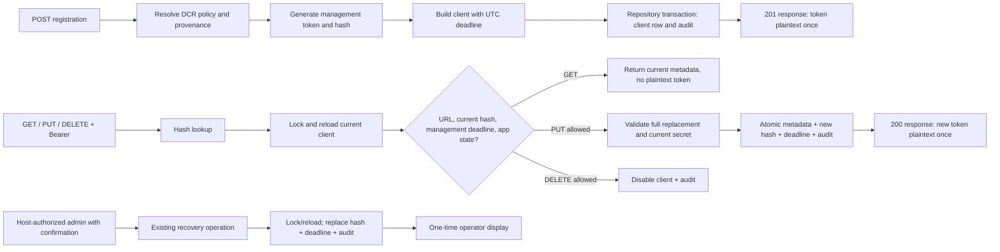

# Phase 165: Management-Token Lifecycle & Recovery - Research

**Researched:** 2026-10-21
**Domain:** OAuth 2.0 Dynamic Client Registration management, Elixir/Phoenix protocol and Ecto/PostgreSQL lifecycle transactions
**Confidence:** HIGH

<user_constraints>
## User Constraints (from CONTEXT.md)

### Locked Decisions

- **D-01:** Nil and zero management duration mean unlimited; a positive integer means seconds from token issuance or replacement. Snapshot policy at that event. GET, token lookup and policy edits do not renew existing credentials. Apply DCR defaults according to existing registration provenance, preserving the direct/operator-registration boundary.
- **D-02:** Validate nil or integer 0..2_147_483_647 at supported management-policy write/use boundaries. Malformed policy, missing adapter support and unsupported durable lifetime state are configuration/server failures, never unlimited fallback or misleading invalid-token errors.
- **D-03:** Store authoritative finite management deadlines as UTC whole seconds and nil for unlimited. Eligibility is strictly now < deadline, with equality expired and no JWT-skew allowance. Use explicit injectable clocks; capture the final decision time after required blocking locks/current-row reload, and use that time for checks, replacement dates and corresponding audit state.
- **D-04:** Add the selected server-owned response extensions lockspire_client_expires_at and lockspire_registration_access_token_expires_at to applicable registration/management responses. Each is numeric Unix seconds or 0 for effective unlimited, including legacy state. Describe them as Lockspire extensions, not RFC fields or access-token expires_in. GET returns neither plaintext management token nor client secret. PUT returns only its newly committed management token, preserving existing shared-secret disclosure rules.
- **D-05:** Authorize GET, PUT and DELETE against the current token identity, URL/client binding, management deadline and operation-specific app state. Retain current-row/fingerprint checks; an earlier lookup or accepted snapshot is not continuing authority after replacement or disablement. Keep response encoding and remote work outside locks.
- **D-06:** A valid management token permits GET/DELETE for a naturally expired, enabled app; PUT is forbidden with 403 registration_expired. Explicit disablement rejects all self-management. Expired/replaced/wrong tokens cannot use the expired-app GET/DELETE exception. Closing registration intake alone must leave existing management available.
- **D-07:** Preserve non-disclosing protocol errors: missing Bearer credential gets 401 Bearer challenge without error detail; wrong, expired or replaced token, unknown app, URL mismatch or disabled-app credential gets 401 Bearer invalid_token. Storage/configuration failure stays a server failure. GET/PUT success is 200; DELETE success is 204.
- **D-08:** Complete the Phase 162 PUT contract: unchanged client_id must be present in the body and validated separately from the URL identity; mutable metadata follows replacement semantics. Reject registration_access_token, registration_client_uri, client_secret_expires_at and client_id_issued_at. If client_secret is included it must match current material and never requests rotation. Extension omission preserves server values; identical echoes are accepted; attempted changes return 400 invalid_client_metadata. Registration intake rejects client-supplied lifecycle extensions. A rotated response represents the new deadline even when a request echoed the prior deadline.
- **D-09:** Successful PUT rotates management hash/deadline immediately under current applicable policy and preserves app/secret deadlines. GET never rotates. No overlap or replay recovery with the old token: a lost successful PUT response requires authorized host recovery.
- **D-10:** Reuse existing host-authorized management-token rotation and one-time plaintext display. Preserve the existing host permission boundary and confirmation handling; do not add Lockspire accounts, another recovery credential or a new privilege route. Client ID, setup token, expired token and client secret are not recovery authority.
- **D-11:** Recovery replaces management hash/deadline without enabling an app or changing app/secret deadlines. Recovery may replace lost/expired credentials, but an expired app still allows only GET/DELETE and a disabled app remains blocked. Recovery is not app renewal.
- **D-12:** Replacement hash, deadline, lifetime canonicalization, intended mutable metadata and required audit commit or roll back together on the current locked row. Reauthorize self-management after waiting and apply intended fields to current state; never restore stale secrets, active state or unrelated deadlines. Do not deliver successful plaintext after failed writes/audits.
- **D-13:** Preserve existing stale-snapshot rejection for competing management-token replacements, including host recovery. Two PUTs using the same old token have one winner; stale requests cannot retain or restore prior authority. Do not import Phase 164's different serialized secret-rotation behavior into management-token recovery or invent an overlapping-token guarantee. A host retry must use refreshed current state through the authorized path.
- **D-14:** Legacy v0 credentials remain effectively unlimited. On explicit management replacement, atomically canonicalize the current whole-row lifetime state: clear advisory app/secret/management dates, set only the new management deadline and promote to v1. Preserve hashes, identity, enabled state and unrelated metadata. V1 replacement preserves authoritative app/secret deadlines. No guessed backfill, eager fleet promotion or version-only update.
- **D-15:** Reuse the existing lifetime-aware adapter/shared transaction contract and persisted deadline field. Extend conformance coverage for management round trips, guarded mutation and audit rollback; adapters must not silently drop lifecycle fields or split transaction authority. No new migration, background expiry worker, runtime dependency or general capability framework is needed for this scope.
- **D-16:** Focused proof accompanies implementation: nil/zero/positive issuance, before/equality/after expiry, changed policy, provenance, GET non-renewal, successful PUT/recovery, lost-response recovery, disabled/expired apps, intake closure, request-field rules, wire metadata and legacy promotion preserving unrelated credentials.
- **D-17:** Prove actual independent PostgreSQL transaction schedules with observable blockers and injected clocks: expiry during a client-lock wait, stale GET/PUT/DELETE after token replacement, competing PUT/recovery replacements, secret rotation and disablement racing management writes, and write/audit rollback. Reuse existing helpers; sleeps and shared sandbox connections are not race proof.
- **D-18:** Exercise real finite-token use, expiry rejection, self-management replacement and authorized recovery in redaction tests. Require observed events. Audit/telemetry must distinguish host recovery from self-management and disclose no plaintext token, hash, shared secret or verifier material. Correct the existing self-management attribution on host recovery.
- **D-19:** Update affected guidance with executable behavior now, including recovery steps, no-overlap/lost-response consequences and the optional-finite-token lockout tradeoff. Final integrated guidance remains Phase 166. Read PRODUCT.md personas/vocabulary before changing admin text; use app management token, update retired wording/contracts when needed, and preserve the existing task flow without an admin redesign.

### the agent's Discretion

Choose narrow helper names, callback transport, clock plumbing, error types and focused plan/test organization within these decisions. Reuse ordinary Elixir functions, the repository facade and existing transaction seams. Preserve public APIs where practical; any minimal additive adaptation must satisfy existing compatibility and host-boundary contracts. Reopen only a demonstrated contradiction with the normative Phase 162 contract.

### Deferred Ideas (OUT OF SCOPE)

- Phase 166: final cross-phase packaged host journeys, complete lifetime/security/redaction matrix, required CI and final integrated guidance proof; only that proof can close the lifetime umbrella todo.
- App renewal, overlapping credentials, new recovery credentials/accounts, a new adoption UI/CLI, mixed-version zero-downtime bridge, general capability frameworks, new dependencies, broad admin redesign and package publication remain outside this phase.

### Folded Todos (context)

The DCR lifetime umbrella is already approved milestone scope. Its management-token portion informs this phase; preserve the pending todo and resolves_phase: 166 until final cross-phase proof. No duplicate audit or new capability is folded in.
</user_constraints>

<phase_requirements>
## Phase Requirements

| ID | Description | Research Support |
|----|-------------|------------------|
| DCR-10 | An app receives an app-management token whose stored lifecycle matches the selected policy, including any chosen finite or unlimited lifetime. | DCR policy resolution, registration issuance, timestamp storage/serialization, provenance and clock seams are identified below. |
| DCR-11 | A client can read, update and delete its registration according to the selected management-token and app lifecycle, and an authorized host operator has the documented recovery path when management access is lost. | Management current-row authorization, controller response mapping, existing host rotation flow, and RFC 7592 PUT/recovery constraints are documented below. |
| DCR-12 | A management-token rotation commits the replacement hash and lifecycle together and handles stale credentials and competing requests according to the selected transaction contract. | Existing locked-row transaction/audit adapter seam and required one-winner PostgreSQL race proof are documented below. |
</phase_requirements>

## Summary

Implement DCR-10–12 in the existing management path and storage contract. The code already persists a management deadline column, resolves a management lifetime setting, hashes registration access tokens, locks/reloads client rows, and has a confirmed host-side rotation flow. Current enforcement is incomplete: registration generation returns a plaintext/hash pair without applying the resolved management lifetime, management resolution and the Ecto policy changeset do not validate that policy field, GET/PUT/DELETE check app state but not the management-token deadline, both replacement callbacks currently write a nil deadline, and the controller removes the required body client_id before update validation. The implementation plan should connect those existing seams and inject one decision clock after current-row lock/reload. [VERIFIED: `lib/lockspire/protocol/registration.ex:453-465` — “`{rat_plaintext, rat_hash} = RegistrationAccessToken.generate()`”; `lib/lockspire/protocol/dcr_policy.ex:94-100,136-149` — “`validate_default_client_lifetime`”, “`validate_default_client_secret_lifetime`”, and “`default_registration_access_token_lifetime_seconds:`”; `lib/lockspire/storage/ecto/server_policy_record.ex:66-76` — “`dcr_default_registration_access_token_lifetime_seconds`” is cast and “`validate_app_lifetime`” and “`validate_secret_lifetime`” are chained; `lib/lockspire/protocol/registration_management.ex:181-194` — “`Repository.lock_clients([snapshot.client_id])`” and “`DateTime.utc_now() |> DateTime.truncate(:second)`”; `lib/lockspire/storage/ecto/repository/client_store.ex:143-157` — “`Client.credential_lifetime_changes(current, :management, nil)`”; `lib/lockspire/web/controllers/registration_controller.ex:54-66` — “`metadata = Map.delete(params, "client_id")`”.]

Preserve the separate recovery boundary: host operator authentication remains outside Lockspire and only the existing authorized, confirmed admin action rotates a self-registered app’s management token. RFC 7592 recommends against expiration that could strand management and supports rotation on read/update; Lockspire’s selected optional finite lifetime is a local policy choice paired with host recovery. Its PUT rules also align with the selected full-replacement, immutable-identity, matching-secret contract. [CITED: https://www.rfc-editor.org/rfc/rfc7592.html#section-2.2; https://www.rfc-editor.org/rfc/rfc7592.html#section-5; https://www.rfc-editor.org/rfc/rfc7592.html#appendix-A.1]

**Primary recommendation:** Keep management-token lifecycle calculation, current-token validation, hash/deadline replacement, lifetime-version promotion, and required audit under the existing repository transaction authority; disclose plaintext only after commit and only to the one-time registration/PUT/operator response path. [VERIFIED: `lib/lockspire/client_lifecycle.ex:114-135` — “`Repository.transact(fn ->`” and “`action: :dcr_management_updated`”; `lib/lockspire/web/live/admin/clients_live/show.ex:199-220` — “`revealed_rat: nil`” and “`revealed_rat: plaintext`”.]

## Architectural Responsibility Map

| Capability | Primary Tier | Secondary Tier | Rationale |
|------------|-------------|----------------|-----------|
| Token issuance and management eligibility | API / Backend | Database / Storage | Protocol orchestration resolves policy and makes endpoint decisions; durable authoritative state is in the client row. [VERIFIED: `lib/lockspire/protocol/registration.ex:453-465`; `lib/lockspire/protocol/registration_management.ex:181-194`; `lib/lockspire/storage/ecto/client_record.ex:94-98`] |
| Current-token replacement and rollback | Database / Storage | API / Backend | The locked current row, lifecycle fields, credential hash, and audit must share one transaction. [VERIFIED: `lib/lockspire/storage/ecto/repository/client_store.ex:99-120,140-157`] |
| Host recovery authorization and confirmation | Frontend Server (SSR) | API / Backend | The host-guarded admin surface already owns staff access and confirmation; protocol operation performs the credential replacement. [VERIFIED: `lib/lockspire/web/live/admin/clients_live/show.ex:199-220`; `165-CONTEXT.md` D-10] |
| Registration JSON extensions and one-time plaintext | API / Backend | Browser / Client | Server serializer controls effective values and disclosure; callers receive the replacement credential once. [VERIFIED: `lib/lockspire/web/registration_json.ex:8-28,41-48`] |

## Standard Stack

### Core

| Library / component | Version | Purpose | Why Standard |
|---------------------|---------|---------|--------------|
| Elixir | 1.18.4 (selected by supplied ASDF variables) | Protocol and domain lifecycle logic | Repository runtime and current Phase 163–164 validation environment. [VERIFIED: project probe 2026-10-21; `.tool-versions`] |
| Ecto SQL / PostgreSQL | Ecto SQL 3.13.5 / PostgreSQL 14+ | Locked current-row writes, deadline persistence, and audit rollback | Existing repository facade and verified adapter contract already supply transaction ownership. [VERIFIED: `AGENTS.md` technology stack; `mix.exs:55-58`] |
| Lockspire `RegistrationManagement` / `ClientLifecycle` / Ecto repository | In-repo | Protocol orchestration and credential mutation | Existing public management functions, audit path, and current-row lock are the scoped extension points. [VERIFIED: `lib/lockspire/protocol/registration_management.ex:48-53,74-90,127-131`; `lib/lockspire/client_lifecycle.ex:124-135`; `lib/lockspire/storage/ecto/repository/client_store.ex:91-120`] |

### Supporting

| Component | Purpose | When to Use |
|-----------|---------|-------------|
| `Lockspire.Protocol.RegistrationAccessToken` | Generate/hash/verify registration management tokens | Continue using for issuance and replacement; do not persist plaintext. [VERIFIED: `lib/lockspire/protocol/registration_access_token.ex:17-26`] |
| `Lockspire.Storage.ClientLifetime` and `ClientStore` | Declare and validate lifetime-aware store/current-row transaction support | Keep built-in and custom adapter support within the existing v1 contract. [VERIFIED: `lib/lockspire/storage/client_lifetime.ex:20-57`; `lib/lockspire/storage/client_store.ex:14-22`] |
| Existing PostgreSQL race helpers | Independent sandbox sessions, blocker observation, deferred clocks | Use for lock-wait and one-winner behavior; do not rely on sleeps. [VERIFIED: `test/support/client_lifetime_race_helpers.ex:9-50`] |

No new package installation is required or authorized by the selected scope. The runtime dependency set is already locked and available; no package legitimacy audit applies. [VERIFIED: `mix.exs:12-15,55-58` — “`version: "1.6.1"`”, “`elixir: "~> 1.18"`”, “`{:ecto_sql, "~> 3.13.5"}`”; environment command `mix deps.get --check-locked` returned “All dependencies are up to date”.]

### Alternatives Considered

| Instead of | Could Use | Tradeoff |
|------------|-----------|----------|
| Existing client deadline and shared repository transaction | New token table, expiry worker, or separate recovery credential | Out of scope and would split current authorization authority or create a new host/security boundary. [VERIFIED: `165-CONTEXT.md` D-10, D-15 and Deferred Ideas] |
| Current host-authorized rotation | Client ID, expired token, setup token, or client secret as recovery proof | Explicitly not recovery authority; would confuse distinct credentials and weaken the existing host boundary. [VERIFIED: `165-CONTEXT.md` D-10] |

## Architecture Patterns

### System Architecture Diagram



Protocol errors are mapped by the registration controller; JSON serialization and HTTP rendering occur after the database transaction so response work does not extend the row lock. The current implementation’s time sample is inside the transaction after `lock_clients/1`, but it needs to be injected consistently and extended to the management deadline. [VERIFIED: `lib/lockspire/protocol/registration_management.ex:181-194` — “`Repository.transact(fn ->`”, “`Repository.lock_clients([snapshot.client_id])`”, and “`DateTime.utc_now() |> DateTime.truncate(:second)`”; `lib/lockspire/web/registration_json.ex:8-28` — “`success_response`”, “`read_response`”, and “`update_response`”.]

### Recommended Project Structure

The listed source/test files already exist and form the current management/lifecycle seam; extend these paths before introducing new modules. [VERIFIED: `rg --files lib/lockspire test/lockspire test/integration` and direct reads of the listed modules/tests.]

```text
lib/lockspire/protocol/registration.ex                 # DCR issuance and resolved policy
lib/lockspire/protocol/registration_management.ex      # GET/PUT/DELETE and operator rotation
lib/lockspire/client_lifecycle.ex                      # neutral lifecycle/audit entry points
lib/lockspire/domain/client.ex                         # deadline eligibility and v0 canonicalization
lib/lockspire/storage/client_store.ex                  # adapter callback contract
lib/lockspire/storage/ecto/repository/client_store.ex  # locked atomic persistence
lib/lockspire/web/registration_json.ex                 # server-owned lifecycle extensions
test/lockspire/protocol/registration_management_test.exs
test/lockspire/web/controllers/registration_controller_test.exs
test/integration/app_lifetime_management_test.exs
test/lockspire/storage/client_lifetime_conformance_test.exs
```

### Pattern 1: Make decisions on the locked current row

**What:** Resolve the bearer hash to an initial candidate, then bind URL identity, row ID, current hash, enabled state, app state, and management deadline against the row reloaded after acquiring the repository lock. Use one post-lock UTC second for expiry and replacement timestamp/deadline. [VERIFIED: `lib/lockspire/protocol/registration_management.ex:181-194` — “`client_id_from_url == snapshot.client_id`”, “`current.registration_access_token_hash == snapshot.registration_access_token_hash`”, and “`current.active`”.]

**When to use:** Every self-management operation and every replacement path, including the host recovery callback’s stale-snapshot guard. GET does not mutate or renew; its successful locked check is the authorization point.

**Example:**

```elixir
Repository.transact(fn ->
  with {:ok, [current]} <- Repository.lock_clients([snapshot.client_id]),
       true <- current.registration_access_token_hash == snapshot.registration_access_token_hash,
       :ok <- Client.management_eligibility(current, decision_time),
       {:ok, deadline} <- Client.management_deadline(current, decision_time, duration) do
    persist_hash_deadline_and_audit(current, new_hash, deadline, decision_time)
  else
    _ -> {:error, :invalid_token}
  end
end)
```

This is a planning skeleton: helper names are discretionary and any newly introduced discrete value must follow the contract and source-backed tests. The current authoritative management deadline field is `registration_access_token_expires_at`; its exact record declaration is `field(:registration_access_token_expires_at, :utc_datetime_usec)`. [VERIFIED: `lib/lockspire/storage/ecto/client_record.ex:96-98` — “`field(:lifetime_version, :integer)`”, “`field(:client_expires_at, :utc_datetime_usec)`”, “`field(:registration_access_token_expires_at, :utc_datetime_usec)`”.]

### Pattern 2: Reuse legacy whole-row replacement canonicalization

**What:** Compute a real replacement deadline, then pass it into the existing `Client.credential_lifetime_changes(current, :management, deadline)` contract. A v0 row becomes v1 on this explicit replacement, clears advisory unrelated app/secret dates, and retains current identity, secret hash, active state, and metadata. A v1 row preserves its authoritative app/secret deadlines. [VERIFIED: `lib/lockspire/domain/client.ex:312-338` — “`@spec credential_lifetime_changes(t(), :secret | :management, DateTime.t() | nil)`”, “`%{lifetime_version: 1, client_expires_at: nil}`”, “`%{client_secret_expires_at: nil, registration_access_token_expires_at: nil}`”, and v1 management returns “`%{registration_access_token_expires_at: deadline}`”.]

**When to use:** PUT self-rotation and authorized host recovery. Do not promote on GET or an unrelated metadata/enablement update.

### Pattern 3: Deliver plaintext only from committed success

Generate the random token and its deterministic hash, persist only the hash, and return plaintext only from `{:ok, ...}` after the repository operation—including required audit—succeeds. The existing serializer already omits secret/token material on GET and adds the management token only to registration and PUT responses. [VERIFIED: `lib/lockspire/protocol/registration_access_token.ex:17-26` — “`@spec generate() :: {plaintext :: String.t(), hash :: String.t()}`” and “`Policy.hash_token(plaintext)`”; `lib/lockspire/web/registration_json.ex:8-27` — plaintext added in success and update responses; `lib/lockspire/web/registration_json.ex:41-48` — “`Map.delete(:client_secret)`” and “`Map.delete("client_secret")`”.]

### Anti-Patterns to Avoid

- Treating an earlier hash lookup or request snapshot as continuing authority after waiting for the client-row lock; repeat current hash, URL binding, and state checks after reload.
- Reusing ambient wall-clock calls independently in protocol and repository code; one post-wait decision time must govern eligibility, deadline, and audit.
- Storing plaintext management tokens or returning a generated token after write/audit rollback.
- Rotating on GET or allowing an expired-app exception to bypass invalid/replaced management token checks.
- Resetting the registration deadline to nil, enabling an app during recovery, or restoring stale metadata from a request snapshot.
- Copying Phase 164 secret rotation semantics into management token recovery; the selected D-13 contract keeps one-winner stale-snapshot rejection.
- Treating an optional finite management timeout as RFC-required behavior. RFC 7592 §5 warns that an expired registration token can strand management; finite expiry and recovery are Lockspire policy choices, not a universal RFC timeout. [CITED: https://www.rfc-editor.org/rfc/rfc7592.html#section-5]

## Don't Hand-Roll

| Problem | Don't Build | Use Instead | Why |
|---------|-------------|-------------|-----|
| Token randomness and hash lookup | New token encoding, hash algorithm, or plaintext storage | `RegistrationAccessToken.generate/0` and existing hash lookup | It is already the token primitive used by issuance and management. |
| Transaction/audit rollback | Compensating writes or audit after the transaction | Existing `ClientLifecycle` and repository `TransactionStore` path | Credential, metadata, deadline, lifetime version, and audit must commit or roll back together. |
| Host recovery identity and staff auth | Lockspire user accounts, alternate recovery secrets, new route | Existing host-protected admin rotation action | The host remains owner of staff authentication and permissions. |
| PostgreSQL concurrency proof | Sleeps or shared sandbox ownership | `ClientLifetimeRaceHelpers` independent sessions, `pg_blocking_pids`, and barrier clock | Tests need evidence that the intended row lock is blocking before advancing the injected decision time. |

## Common Pitfalls

### 1. Issuing a token with no authoritative deadline

**What goes wrong:** Policy may say finite, while registration stores unlimited management state and advertises no matching extension. Later auth can’t distinguish expiry.
**Why:** `DcrPolicy.resolve/3` copies the management setting into its resolved struct, but validation currently checks the app and secret lifetimes only; `Registration.generate_credentials/2` creates token/hash and `ClientMetadata.build_dcr_client/4` must attach the resolved deadline at issuance. [VERIFIED: `lib/lockspire/protocol/dcr_policy.ex:94-100,136-149` — “`validate_default_client_lifetime`”, “`validate_default_client_secret_lifetime`”, and “`default_registration_access_token_lifetime_seconds:`”; `lib/lockspire/protocol/registration.ex:453-465` — generation returns `rat` and `rat_hash` without a deadline.]
**How to avoid:** Validate nil or integer 0..2_147_483_647 at every supported policy boundary; calculate the whole-second deadline from the registration instant and resolved DCR policy only for self-registered apps; confirm operator/direct registrations retain their policy boundary.

### 2. Checking management expiry before locking

**What goes wrong:** A request or recovery can authenticate with a still-valid snapshot, wait until expiry or replacement, then mutate current state.
**How to avoid:** Lock and reload first; take one injectable UTC-second time after the required wait and evaluate both management and operation-specific app eligibility against that current row. Expiry equality is ineligible per Phase 165 D-03 and the Phase 162 contract. [VERIFIED: `lib/lockspire/protocol/registration_management.ex:181-194` — lock before the current app eligibility sample; `[CITED: https://www.rfc-editor.org/rfc/rfc7592.html#section-2.1]` for the endpoint’s current registration credential requirement.]

### 3. Treating host recovery as app renewal

**What goes wrong:** A lost-token recovery could accidentally re-enable a disabled app, clear app/secret deadlines, or grant expired apps PUT.
**How to avoid:** Make recovery only a hash/deadline replacement on the current row under existing host authorization. Keep the app and secret deadlines and active flag; a valid recovered token still gets only GET/DELETE for an expired enabled app, and disabled apps remain blocked. [VERIFIED: `lib/lockspire/web/live/admin/clients_live/show.ex:199-220` — confirmed existing self-registered-client action and one-time `revealed_rat`; `lib/lockspire/storage/ecto/repository/client_store.ex:140-160` — host replacement currently reloads current row and checks snapshot hash.]

### 4. Returning stale or misleading response metadata

**What goes wrong:** GET may imply renewal, JSON may expose the previous extension value after PUT, or raw user metadata may override server-owned fields.
**How to avoid:** Serialize effective persisted values as numeric Unix seconds or zero; GET has no plaintext management token or client secret; PUT sends only its newly committed token and the new deadline. For request validation, preserve extensions on omission, accept an identical echo, and reject changed values; keep DCR intake from accepting these server-owned fields.

### 5. Failing to distinguish absent auth from invalid auth

**What goes wrong:** Missing Bearer and a stale/expired supplied token receive the same diagnostic detail, or storage/configuration failures are misreported as invalid credentials.
**How to avoid:** Follow selected D-07: missing Bearer is 401 challenge without detail; supplied wrong/expired/replaced tokens are 401 `invalid_token`; malformed/unsupported durable state is a server failure. RFC 6750 §3 aligns the missing-versus-invalid distinction. The current controller emits `error="invalid_token"` even when the Bearer credential is missing, and the existing integration test asserts that behavior, so update the response mapping and test expectation together. [VERIFIED: `lib/lockspire/web/controllers/registration_controller.ex:107-142` — missing bearer extracts as `nil`, then `handle_error(:invalid_token)` includes `error="invalid_token"`; `test/integration/app_lifetime_management_test.exs:143-151` — “`missing bearer stays a non-disclosing 401 challenge`” and expected header includes `error="invalid_token"`; CITED: https://www.rfc-editor.org/rfc/rfc6750.html#section-3]

### 6. Breaking PUT identity and replacement semantics

**What goes wrong:** URL client ID is silently injected into the request body, absent body `client_id` passes validation, or server-managed lifecycle fields are treated as mutable client metadata.
**How to avoid:** Validate URL binding and body identity separately; require the unchanged body identifier; reject the standard management fields and validate an included `client_secret` against current material. RFC 7592 §2.2 requires the same client ID, a matching included secret, and replacement semantics. [CITED: https://www.rfc-editor.org/rfc/rfc7592.html#section-2.2]

### 7. Host recovery has self-management attribution

**What goes wrong:** Audit records indicate operator recovery, but telemetry still reports a self-registered-client actor.
**How to avoid:** Keep distinct observability actor attribution for self PUT and operator recovery; ensure both event paths are exercised and secret/hash/verifier material is redacted. CONTEXT D-18 identifies this as an existing misattribution.

## Code Examples

### Existing current-row rotation skeleton

The live implementation currently uses `:management` replacement kind and `registration_access_token_expires_at` as its durable field. These values are quoted verbatim from the source before using them in the planning example. [VERIFIED: `lib/lockspire/domain/client.ex:312-319` — “`@spec credential_lifetime_changes(t(), :secret | :management, DateTime.t() | nil)`” and “`:management -> %{registration_access_token_expires_at: deadline}`”.]

```elixir
with {:ok, [current]} <- Repository.lock_clients([client_id]),
     true <- current.registration_access_token_hash == presented_hash,
     :ok <- Client.management_eligibility(current, decision_time),
     {:ok, deadline} <- Client.management_deadline(current, decision_time, duration),
     {:ok, changes} <- Client.credential_lifetime_changes(current, :management, deadline) do
  # Persist hash, changes, intended metadata, and audit in the same transaction.
end
```

Helper signatures here are a planning shape, not a claim that the helpers currently exist. The repository already exposes `lock_clients/1`, and its current rotation callback atomically writes the hash, lifetime changes, and audit but currently supplies a nil deadline. [VERIFIED: `lib/lockspire/storage/client_store.ex:14-22` — “`@callback lock_clients([String.t()])`”; `lib/lockspire/storage/ecto/repository/client_store.ex:143-157` — “`Client.credential_lifetime_changes(current, :management, nil)`” and “`append_audit_or_rollback(repo, audit_attrs)`”.]

## Validation Architecture

### Test Framework

| Property | Value |
|----------|-------|
| Framework | ExUnit; Elixir 1.18.4 / Erlang OTP 27.3.4.15 selected and probed in this environment |
| Config file | `config/test.exs`; test repo uses Ecto SQL Sandbox and database name comes from `LOCKSPIRE_TEST_DB_NAME` |
| Test DB | Use a dedicated `lockspire_phase165_validation` database; currently absent. PostgreSQL is listening on `/tmp:5432`. |
| Setup command | `ASDF_ELIXIR_VERSION=1.18.4-otp-27 ASDF_ERLANG_VERSION=27.3.4.15 MIX_HOME=/private/tmp/lockspire-163-13-debug-8/old-public/mix-home HEX_HOME=/private/tmp/lockspire-163-13-debug-8/old-public/hex-home LOCKSPIRE_TEST_DB_NAME=lockspire_phase165_validation MIX_ENV=test mix test.setup` |
| Focused command | `ASDF_ELIXIR_VERSION=1.18.4-otp-27 ASDF_ERLANG_VERSION=27.3.4.15 MIX_HOME=/private/tmp/lockspire-163-13-debug-8/old-public/mix-home HEX_HOME=/private/tmp/lockspire-163-13-debug-8/old-public/hex-home LOCKSPIRE_TEST_DB_NAME=lockspire_phase165_validation MIX_ENV=test mix test --include integration test/lockspire/protocol/registration_management_test.exs test/lockspire/protocol/registration_access_token_test.exs test/lockspire/web/registration_json_test.exs test/lockspire/web/controllers/registration_controller_test.exs test/integration/app_lifetime_management_test.exs test/lockspire/storage/client_lifetime_conformance_test.exs test/lockspire/protocol/dcr_telemetry_redaction_test.exs` |
| Full suite | Same environment variables with `MIX_ENV=test mix test.fast` |

`mix deps.get --check-locked` reports all dependencies up to date. The supplied mix/hex home directories exist, `pg_isready` reports PostgreSQL accepting connections, and `psql -lqt` lists the Phase 164 databases but no Phase 165 validation database. [VERIFIED: `config/test.exs:1-22` — “`database: System.get_env("LOCKSPIRE_TEST_DB_NAME") || "lockspire_test"`”; environment probes on 2026-10-21 — “`Elixir 1.18.4`”, “`OTP "27"`”, “`/tmp:5432 - accepting connections`”, `mix deps.get --check-locked`: “All dependencies are up to date”.]

### Phase Requirements → Test Map

| Req ID | Behavior | Test Type | Automated Command | File Exists? |
|--------|----------|-----------|-------------------|-------------|
| DCR-10 | nil/zero/positive policy issuance, lifetime validation, registration provenance, effective deadline response extensions | unit + PostgreSQL integration | `MIX_ENV=test mix test test/lockspire/protocol/dcr_policy_test.exs test/lockspire/web/registration_json_test.exs test/lockspire/web/controllers/registration_controller_test.exs` | Existing, extend management cases |
| DCR-11 | before/equality/after management expiry; GET non-renewal; expired/disabled app policy; body identity/field rules; authorized recovery and one-time disclosure | protocol + endpoint integration | `MIX_ENV=test mix test test/lockspire/protocol/registration_management_test.exs test/lockspire/web/controllers/registration_controller_test.exs test/integration/app_lifetime_management_test.exs` | Existing, add cases |
| DCR-12 | atomic hash/deadline/version/metadata/audit commit; stale token rejection and one-winner competing PUT/recovery; rollback | PostgreSQL integration | `MIX_ENV=test mix test --include integration test/lockspire/storage/client_lifetime_conformance_test.exs test/lockspire/storage/repository_concurrency_test.exs test/integration/app_lifetime_management_test.exs` | Existing test files/helpers, add management race schedules |
| DCR-11/12 | recovery telemetry attribution and no disclosure of plaintext/hash/shared secret/verifier | telemetry integration | `MIX_ENV=test mix test test/lockspire/protocol/dcr_telemetry_redaction_test.exs` | Existing, add management-specific exercised events |

The `--include integration` phase selection must run after the dedicated database setup and use independent PostgreSQL sessions for schedules. The listed tests exist; existing helpers expose backend PIDs, assert the expected blocker with `pg_blocking_pids`, and permit a barrier clock to advance after lock wait. [VERIFIED: `test/lockspire/protocol/registration_management_test.exs`, `test/lockspire/web/registration_json_test.exs`, `test/lockspire/web/controllers/registration_controller_test.exs`, `test/integration/app_lifetime_management_test.exs`, `test/lockspire/storage/client_lifetime_conformance_test.exs`, `test/support/client_lifetime_race_helpers.ex:9-50` — “`Sandbox.unboxed_run`”, “`SELECT pg_backend_pid()`”, “`pg_blocking_pids($1)`”, “`barrier_clock(before_wait, after_wait)`”.]

### Sampling Rate

- **Per protocol/serializer task:** run the focused protocol and response/controller files above.
- **Per transaction/concurrency task:** run the management race, rollback, and conformance cases using PostgreSQL independent sessions.
- **Phase gate:** run `mix test.fast` with the dedicated database before phase verification; Phase 166 owns the integrated cross-phase gate.

### Wave 0 Gaps

- No framework or fixture setup is missing. Extend existing management, endpoint, adapter conformance, PostgreSQL race, and telemetry/redaction fixtures with Phase 165 cases.
- Add a database setup using `lockspire_phase165_validation` before focused or full suite commands; this database is not currently listed. [VERIFIED: `config/test.exs:1-22` and `psql -lqt` probe.]

## Security Domain

Security enforcement is enabled by default because `.planning/config.json` does not set `security_enforcement: false`. The currently published OWASP ASVS version is 5.0.0; applicable categories below fit this token protocol, Ecto persistence, and host-integrated admin operation. [CITED: https://asvs.owasp.org/ — stable ASVS 5.0.0; category names verified at https://cornucopia.owasp.org/taxonomy/asvs-5.0]

| ASVS 5.0.0 Category | Applies | Standard Control |
|---------------------|---------|------------------|
| V2 Validation and Business Logic | Yes | Validate policy duration types/range and operation-specific app/token lifecycle; test exact equality boundary. [VERIFIED: Phase 165 D-02, D-03, D-16] |
| V4 API and Web Service | Yes | Preserve HTTP method/status/error mapping and server-owned response fields. [VERIFIED: Phase 165 D-04, D-07, D-08] |
| V6 Authentication | Yes | Keep registration management bearer identity bound to the current client hash. [VERIFIED: Phase 165 D-05, D-07] |
| V8 Authorization | Yes | Recheck current URL/client/hash/enabled/deadline after row locking; preserve host staff authorization for recovery. [VERIFIED: Phase 165 D-05, D-10] |
| V10 OAuth and OIDC | Yes | Match RFC 7592 client management field, token rotation, and error contracts while preserving Lockspire-specific extensions. [CITED: RFC 7592 §§2.1–2.3, https://www.rfc-editor.org/rfc/rfc7592.html] |
| V11 Cryptography | Yes | Generate high-entropy token and persist only the existing hash; never expose hashes/verifier material. [VERIFIED: Phase 165 D-18; `lib/lockspire/protocol/registration_access_token.ex:17-26`] |
| V12 Secure Communication | Yes | Management credentials are bearer secrets; rely on host TLS termination and preserve product’s HTTPS route requirement. [CITED: RFC 7592 §5, https://www.rfc-editor.org/rfc/rfc7592.html#section-5; RFC 6750 §5, https://www.rfc-editor.org/rfc/rfc6750.html#section-5] |
| V16 Security Logging and Error Handling | Yes | Audit/telemetry distinguish operator recovery from self-management, redact credentials, and keep auth/configuration failures distinct. [VERIFIED: Phase 165 D-07, D-18; `lib/lockspire/client_lifecycle.ex:124-135`] |

### Known Threat Patterns

| Pattern | STRIDE | Standard Mitigation |
|---------|--------|---------------------|
| Replayed old management token after successful PUT/recovery | Elevation of privilege | Hash-current-row check under lock; stale competitors lose and receive non-disclosing invalid-token behavior. |
| Finite management deadline ignored or checked before a lock wait | Spoofing / elevation | Strict post-lock decision clock and persisted deadline check for GET/PUT/DELETE and recovery. |
| Recovery restores stale app metadata or re-enables a disabled app | Tampering / elevation | Merge intended changes into locked current row; replacement only changes management hash/deadline and selected PUT metadata. |
| Plaintext token delivered although transaction/audit failed | Information disclosure | Return only from committed success after required audit; test audit failure and response disclosure. |
| Observability discloses bearer secret, hash or verifier | Information disclosure | Fixed audit attributes and observed redaction tests for self PUT and host recovery events. |

## Project Constraints (from AGENTS.md)

Source: repository `AGENTS.md`, read during this research.

- Build Lockspire as a separate companion library, not a Sigra module.
- Preserve the embedded-library shape; do not turn this into a required standalone auth service.
- Keep strong internal boundaries between protocol core, storage, generators, Plug/Phoenix integration, and LiveView/admin surfaces.
- Treat the host seam as explicit and narrow: account resolution, claims, login redirects, branding, and product policy belong to the host app.
- Do not broaden v1 into SAML, LDAP/AD federation, hosted auth, or a full CIAM suite.
- Preserve Phoenix `1.8.5`, Phoenix LiveView `1.1.28`, Ecto SQL `3.13.5`, PostgreSQL `14+`, host/demo-only Bandit, Oban `2.21.x`, and OpenTelemetry `1.6.0`; do not add Bandit as a Lockspire dependency.
- Preserve PKCE S256 by default, exact-match redirect URI validation, client secrets hashed at rest, short-lived single-use authorization codes, refresh token rotation with family-wide revocation on reuse, no implicit flow, no `alg=none`, and strong redaction in logs and operator surfaces.
- Before admin UI copy changes, read PRODUCT.md personas and vocabulary; use its “UI says” terms, add new domain concepts to the map, and add replaced terms to the retired-wording table.
- No project skills were discovered in `.codex/skills/` or `.agents/skills/`.

## Environment Availability

| Dependency | Required By | Available | Version | Fallback |
|------------|-------------|-----------|---------|----------|
| ASDF Elixir/Erlang | Compile and ExUnit | ✓ | Elixir 1.18.4 / OTP 27.3.4.15 with supplied env selectors | — |
| Mix / locked dependencies | Compile and tests | ✓ | Mix 1.18.4; `mix deps.get --check-locked` clean | — |
| PostgreSQL | Row locks and rollback proof | ✓ | Local server accepts connections at `/tmp:5432` | — |
| Phase validation database | Isolated integration state | ✗ | `lockspire_phase165_validation` not present | Create through `mix test.setup` with the dedicated DB env var; do not use shared `lockspire_test`. |
| Context7 MCP / ctx7 CLI | External library docs | ✗ | Neither available in this agent context | No external library API research is needed; cite in-repo source and official RFCs. |

**Missing dependencies with no fallback:** None.
**Missing dependencies with fallback:** Create the dedicated Phase 165 database with the existing project test setup task.

## State of the Art

| Older / generic approach | Selected/current approach | When changed | Impact |
|--------------------------|---------------------------|--------------|--------|
| Treat management tokens as unlimited and rotation deadline as nil | Enforce optional snapshotted finite lifetime with current-state checks and host recovery | Phase 162 contract, implemented in Phase 165 | Existing column and adapter contract can be reused; no new migration or worker is required. |
| Trust endpoint lookup or request snapshot for whole operation | Reauthorize against locked current row after wait | Phases 162–163 contract/foundation | Stale GET/PUT/DELETE or host recovery cannot keep old authority. |
| Let PUT rotate plaintext without an auditable atomic write boundary | Commit replacement hash, deadline, intended metadata, lifetime canonicalization, and audit together | Existing Phase 163–164 transaction patterns; complete in Phase 165 | No successful token disclosure on rollback. |

RFC 7592 §5 says a registration access token **SHOULD NOT** expire while the registration is active because the client may lose read/update/delete access; this is a recommendation with an explicit lockout rationale, not an absolute MUST. The selected Lockspire policy deliberately permits optional finite lifetimes only because the existing host-authorized recovery path is part of the contract. [CITED: https://www.rfc-editor.org/rfc/rfc7592.html#section-5]

## Assumptions Log

| # | Claim | Section | Risk if Wrong |
|---|-------|---------|---------------|
| — | No unresolved technical assumption is required to plan; scope and decisions are locked in Phase 165 CONTEXT. | — | — |

## Open Questions

1. **Dedicated validation database initialization:** The PostgreSQL server is available but the proposed Phase 165 database is absent. Run the existing `mix test.setup` with `LOCKSPIRE_TEST_DB_NAME=lockspire_phase165_validation` before executing tests; no new database schema choice is needed.

## Sources

### Primary (HIGH confidence)

- Current source: `lib/lockspire/protocol/registration_management.ex`, `registration.ex`, `dcr_policy.ex`, `client_metadata.ex`, `registration_access_token.ex`, `client_lifecycle.ex`, `domain/client.ex`, `storage/client_store.ex`, `storage/client_lifetime.ex`, and Ecto repository/client record.
- Phase contracts: `162-CONTRACT.md`, `162-CASES.json`, `165-CONTEXT.md`, `163-CONTEXT.md` and `163-VERIFICATION.md`, `164-CONTEXT.md` and `164-VERIFICATION.md`.
- Existing proof: management endpoint/protocol tests, lifetime adapter conformance, PostgreSQL race helpers, integration management tests, and telemetry/redaction tests.
- [RFC 7592](https://www.rfc-editor.org/rfc/rfc7592.html) §§2.1–2.3, 5 and Appendix A.1 — management endpoint semantics, replacement, bearer authority, expiry lockout warning, and rotation.
- [RFC 6750](https://www.rfc-editor.org/rfc/rfc6750.html#section-3) §3 — Bearer challenge and error distinctions.
- [OWASP ASVS 5.0.0](https://asvs.owasp.org/) — security verification framework and current version.

### Secondary (MEDIUM confidence)

- `docs/dynamic-registration.md`, `docs/upgrading/client-lifetimes.md`, `docs/operator-admin.md`, `docs/supported-surface.md`, and `PRODUCT.md` — current adopter/operator boundary and vocabulary.

## Metadata

**Confidence breakdown:**
- Standard stack: HIGH — actual project constraints, locked dependencies, and runtime selectors were checked.
- Architecture: HIGH — source and Phase 162–164 contracts were opened and compared.
- Pitfalls: HIGH — concrete missing management lifetime handling and existing tests were inspected.
- Protocol standards: HIGH for normative RFC text — RFC Editor primary documents read during this session.

**Research date:** 2026-10-21
**Valid until:** 2026-11-20 (the protocol standards and in-repo architecture are stable; recheck runtime/dependencies when implementing)
