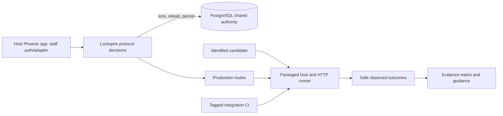

# Phase 166: End-to-End Lifetime, Security & Guidance Proof - Research

**Researched:** 2026-10-21
**Domain:** OAuth/OIDC lifetimes, PostgreSQL concurrency, packaged Phoenix-host acceptance, security evidence and guidance
**Confidence:** HIGH for repo seams and locked behavior; MEDIUM for external docs

<user_constraints>
## User Constraints (from CONTEXT.md)

<!-- DATA_a74f2c01_START -->
## Implementation Decisions

### Contract coverage and deterministic time

- **D-01:** Use `162-CONTRACT.md` and `162-CASES.json` as the fixed expected behavior. Build a compact traceability matrix from DCR-15–19 and the applicable contract cases to focused tests, cross-phase journeys, race schedules and retained evidence. Distinguish inherited focused proof from new integrated proof; rerun applicable evidence against the final candidate. Add only demonstrated missing cases, avoiding duplicate suites and a Cartesian product of every dimension.
- **D-02:** Cover all three independent lifetimes across nil/zero/positive policy, before/equality/after expiry, issuance-time policy snapshots, changed-policy replacement, non-secret methods, provenance, legacy promotion and disabled-versus-expired apps. Prove interactions: management replacement/recovery does not renew app/secret deadlines; secret rotation does not renew app/management deadlines; reads do not renew; enabling does not clear expiry. Preserve the distinct secret-rotation and management-token contention contracts.
- **D-03:** Use existing injectable protocol clocks for exact equality and post-lock decision time. Pair that deterministic proof with real packaged HTTP behavior. The registration controller has no caller-supplied clock: do not add public time headers, replace production routes or introduce a time library solely for acceptance. Any lab-only setup/time control stays isolated to the host test environment, uses documented seams where available, and must not masquerade as an adopter API or as real-time boundary proof.
- **D-04:** Use separate registrations or controlled stages so an earlier secret/token deadline cannot mask the app or other credential gate being tested. Include valid management GET/DELETE versus forbidden PUT for naturally expired enabled apps, disabled-app denial, recovery preserving unrelated deadlines, rejected redemption preserving the grant/code, and matching stored/wire/enforced expiry. Keep independent JWT assertion timing/replay controls and online-versus-offline token behavior visible.

### PostgreSQL authority, races and rollback

- **D-05:** Reuse existing independent-session PostgreSQL helpers and focused suites. Show distinct backend sessions and the actual blocking relationship before releasing a lock holder; evaluate time and current identity/state after all relevant waits. Coordination polling may observe locks, but sleeps cannot establish expiry or race ordering. Shared SQL Sandbox tasks are not independent-transaction proof.
- **D-06:** Link each required schedule to durable assertions: expiry during client/grant waits, committed disablement/rotation before stale issuance or management, competing replacements, and late write/audit failures. Inspect credentials, verifier, lifecycle version/deadlines, enabled state, intended metadata, grant/token state and audit as applicable. Rejection must not consume or resurrect authority. Reuse existing coverage when sufficient; add only uncovered cross-phase schedules. Serialize lanes that mutate shared policy or the same dedicated database.

### Packaged fresh, upgrade and custom-store journeys

- **D-07:** Extend the existing clean-room package/process/HTTP lab. Prove registration, actual use, independent expiry, secret rotation, successful management PUT and authorized host recovery using the candidate package through real production routes. Keep fresh install, pinned legacy upgrade and configured custom-store evidence distinct and link each to the contract. Reuse the existing public/custom-prefix migration scenarios and historical migration checksum checks. Do not create another harness or storage backend.
- **D-08:** Build one identified candidate artifact per proof run and feed that identity to the proof legs. Verify package bytes, extracted/vendor contents and resolved dependency provenance before execution; reject or recreate stale unpacked, vendored or compiled host state. Same filenames and a digest recorded only after reuse are insufficient. Add a focused negative check for same-filename changed bytes/stale candidate reuse. Bind receipts to the source revision plus actual candidate content/artifact digest; do not assume independently rebuilt tarballs must be byte-identical.
- **D-09:** Extend legacy proof beyond schema/constructed-client probes: authenticate/use representative legacy credentials, observe grandfathered unlimited behavior despite advisory historical dates, explicitly replace credentials under current policy and verify whole-row canonicalization preserves unrelated authority. Reuse nil/creation/past/future historical-date and public/custom-prefix cases where already covered. Prove old writers have exited before authoritative v1 writes and retain the existing downgrade boundary; no guessed backfill or old-binary traffic after activation.
- **D-10:** Add a host-owned client-store adapter composition using the existing supported lifetime/shared-transaction seam and PostgreSQL authority. Prove normal configuration selects it and its callbacks actually execute during successful issuance and credential replacement. Inject a late failure and verify durable rollback across applicable client/grant/token/audit participants from an independent observation. A process-dictionary fixture remains useful field/negative conformance evidence, but cannot establish successful shared-authority storage. A delegating adapter demonstrates that named composition, not arbitrary external datastore support.
- **D-11:** Preserve the clean-room boundary audit. Its current blanket `Lockspire.Storage.` prohibition may need a narrow documented-adapter exception for D-10; permit only the explicit public seam needed by the host fixture and keep protocol internals, checkout imports and `test/support` inaccessible to the packaged runtime. Do not disable the audit or expose an internal module as supported merely to pass a test. If a required seam is not public, resolve that specific mismatch before making a support claim.

### Required execution, safe evidence and security

- **D-12:** Wire the new packaged proof into an active canonical CI path. Existing `test --only integration` includes tagged storage race/conformance files outside `test/integration`; the shorter `mix test.integration` alias does not reproduce that selection. The older Phase 133 full journey wrapper is unconditionally skipped and is not proof of execution. Use an explicit required invocation or active wrapper in the existing CI structure, with positive scenario counts and failure on omitted required proof. Preserve truthful skipped/excluded counts rather than treating aggregate green or an artifact's existence as coverage.
- **D-13:** Retain small allowlisted receipts containing source/package identity, scenario/contract identifiers, executed/passed/failed/skipped counts, observed outcomes/events and cleanup status. Use the existing CI artifact conventions and bounded retention (14 days is the current timing-artifact precedent); retain sanitized identities/outcomes in milestone records for durable traceability. Do not upload raw host roots, DB dumps, configs, credentials or raw request/process traces. Hashes prove identity, not execution; receipts need observed lifecycle results.
- **D-14:** Extend existing positive-event redaction tests to integrated app expiry and packaged success/failure paths. Require actual expected events and persisted audit rows before checking redaction. Preserve distinct host-recovery and self-management attribution and the absence of success events on rollback. Register actual returned/generated credentials and relevant encoded/verifier/hash values with the existing redactor before rendering output; allowlist receipts and guard stdout, stderr, command arguments, exceptions and assertion diagnostics. The current upgrade runner's `client_secret=...` substitution alone is insufficient.
- **D-15:** Remove credential fragments and raw captured payloads from redaction assertion failures. Report safe scenario/event/field identifiers and counts so a detector cannot publish the leak it detects. Include focused success and deliberately failing-output checks for the acceptance evidence boundary; no new logging/redaction dependency is needed.
- **D-16:** Require a scoped independent security review and current canonical required CI evidence for the final changed surfaces before merge/completion claims. Reuse and run meaningful existing gates for S256, exact redirects, hashed secrets, code single-use, refresh-family reuse revocation, algorithm restrictions/no implicit flow and storage/configuration fail-closed behavior. Add integration checks only where lifetime changes cross those controls. Local tests, old reviews and source workflow files alone cannot establish live required-check success. Preserve historical exceptions and report uncovered/blocked evidence honestly.

### Adopter/operator jobs and guidance truth

- **D-17:** Reconcile configuration, DCR, storage, migration, recovery, operator and supported-surface guidance against the completed case/evidence matrix. Change pending-proof statements only after their evidence exists. Clearly distinguish expired app, expired secret, expired management token, disabled app and unavailable/unsupported storage. Explain issuance-time policy and renewal events, no-overlap/lost-response recovery, legacy grandfathering, maintenance cutover and post-v1 rollback limits. Do not imply app renewal, host-session logout, universal immediate offline JWT revocation or production migration-duration guarantees.
- **D-18:** Make custom-adapter guidance executable for adopters. Repository-private tests/scripts are maintainer checkout commands and do not ship in the package. Provide a bounded copyable host-test example exercising the supported seam with ordinary ExUnit/Ecto; execute that same example in the packaged host. Cover lifecycle round trips, shared authority, current-state checks, atomic replacement/audit rollback and unsupported-state failure at the appropriate test layer. Do not ship a general conformance framework or imply that private test helpers are a public SDK.
- **D-19:** Keep existing operator tasks and host-authorized one-time credential reveal. PRODUCT.md personas/vocabulary govern changed admin copy; add new terms/retired wording and run its contracts where needed. Keep storage-version/transaction details in host-maintainer guidance. Preserve existing accessible controls, confirmations, focus behavior and themes if touched; only rendered behavior that changes needs corresponding browser evidence. Current `brandbook/` guidance supersedes older prompt branding. No broad visual refresh is justified.
- **D-20:** Close the pending DCR lifetime umbrella only after DCR-15–19 have current non-skipped evidence, applicable failure paths, package identity, required CI and scoped review. Until then preserve its `resolves_phase: 166` pending state. Stop expanding research/tests when that bounded coverage closes; no manual UAT handoff for already automated properties, no new dependency, unrelated grant, distributed activation framework or package publication.

### Agent discretion

Choose concise case IDs, receipt schema, helper names, scenario grouping, active CI invocation shape, narrowly scoped adapter-fixture configuration and host-only setup mechanics within these guarantees. Use ordinary Elixir functions/behaviours, existing repository transactions, ExUnit and existing Python acceptance helpers. Preserve public APIs where practical; a demonstrated unsupported seam or contract contradiction must be resolved explicitly rather than hidden by a test shortcut.

## Deferred Ideas

App renewal, overlapping credentials, public acceptance clock controls, alternative datastores, generalized conformance/capability frameworks, a new acceptance harness, broad admin redesign, automatic zero-downtime mixed-version activation, unrelated dependency upgrades and package publication remain outside this phase. Supplemental certification/conformance and historical verification exceptions remain separate.
<!-- DATA_a74f2c01_END -->
</user_constraints>

<phase_requirements>
## Phase Requirements

| ID | Description | Research Support |
|----|-------------|------------------|
| DCR-15 | A maintainer can reproduce deterministic before/at/after-expiry checks for all three lifetimes, unset/zero/positive settings, policy changes, rotation and disabled/expired registrations. | Existing protocol and integration suites; add only missing cross-phase cases. [VERIFIED: .planning/REQUIREMENTS.md:40] |
| DCR-16 | A maintainer can reproduce real PostgreSQL races and failed-write rollback checks for expiry, disablement and credential rotation without stale authorization restoring an invalid credential. | Existing blocker-observed helpers, races and rollback tests; map and fill gaps. [VERIFIED: .planning/REQUIREMENTS.md:41] |
| DCR-17 | An adopter can complete an executable packaged clean-room registration-to-use-to-expiry/rotation journey, with fresh-install, legacy-upgrade and custom-storage evidence linked to the selected contract. | Extend current package/HTTP lab and upgrade runner; add configured adapter proof. [VERIFIED: .planning/REQUIREMENTS.md:42] |
| DCR-18 | A maintainer can verify that the changed protocol, storage and host surfaces preserve established security defaults and redaction, with required CI and a scoped security review passing before merge. | Reuse security gates; extend positive-event and failure-output redaction. [VERIFIED: .planning/REQUIREMENTS.md:43] |
| DCR-19 | An operator or host developer can follow configuration, storage, migration and rotation guidance whose expiry claims match verified behavior; changed admin wording follows PRODUCT.md vocabulary and retired-wording contracts. | Reconcile docs against evidence; run vocabulary contract if UI copy changes. [VERIFIED: .planning/REQUIREMENTS.md:44] |
</phase_requirements>

## Summary

Phase 162 is the behavior oracle. Phases 163–165 already have focused policy, consumer, PostgreSQL wait, legacy migration, adapter-field, recovery, audit attribution and guidance evidence. Map/re-run applicable proof instead of duplicating complete suites. [VERIFIED: 162-CONTRACT.md:1-10; 163-VERIFICATION.md:208-212; 164-VERIFICATION.md:90-95; 165-VERIFICATION.md:126-146]

The integration gap is clear: client_lifetime_upgrade.py proves migration/cutover through package-installed CLI and SQL checks. The separate clean-room HTTP journey covers OAuth/refresh but not all DCR lifetime gates in one candidate-bound flow. Current custom-store fixtures are process-local conformance, not configured successful packaged issuance and late PostgreSQL rollback under shared authority. [VERIFIED: scripts/acceptance/clean_room/client_lifetime_upgrade.py:140-249; scripts/acceptance/clean_room_saas_journey.py:517-554,928-990; test/lockspire/storage/client_lifetime_conformance_test.exs:34-63,104-138]

**Primary recommendation:** Extend the existing clean-room runner and tagged integration CI. Share one identified candidate package across fresh, legacy and custom-store proof legs; add only uncovered contract-backed cases. Do not add packages or another harness. [VERIFIED: 166-CONTEXT.md:16-18,48-84]

## Architectural Responsibility Map

| Capability | Primary Tier | Secondary Tier | Rationale |
|------------|-------------|----------------|-----------|
| Lifetime eligibility/renewal | API / Backend | Database / Storage | Protocol decides; current client row persists deadlines. [VERIFIED: lib/lockspire/domain/client.ex:211-243,400-429; lib/lockspire/storage/ecto/repository/client_store.ex:14-36,94-165] |
| Race ordering/atomic writes | Database / Storage | API / Backend | Shared authority, locks and reloads establish durable order. [VERIFIED: lib/lockspire/storage/transaction_store.ex:1-28; test/support/client_lifetime_race_helpers.ex:9-37] |
| Host adapter composition | API / Backend | Database / Storage | Host selects documented callbacks and authority. [VERIFIED: lib/lockspire/storage/client_store.ex:10-50; lib/lockspire/storage/client_lifetime.ex:20-54] |
| Packaged journey/receipt | API / Backend | — | Isolated host exercises production HTTP and emits safe observations. [VERIFIED: scripts/acceptance/clean_room_saas_journey.py:75-107,928-990] |
| Staff recovery | API / Backend | Browser / Client | Lockspire rotates credential; host owns staff auth/account UX. [VERIFIED: 162-CONTRACT.md:57-75] |

## Standard Stack

| Existing tool | Version | Use | Evidence |
|---------------|---------|-----|----------|
| Elixir / ExUnit | Elixir ~> 1.18 | Protocol/storage/integration tests | [VERIFIED: mix.exs:14,79,90-101] |
| Ecto SQL / Sandbox | 3.13.5 | PostgreSQL persistence and session tests | [VERIFIED: mix.exs:57; mix.lock:11; race helper:4-15] |
| PostgreSQL | project 14+; CI 16 | Race, rollback, migration and packaged DB proof | [VERIFIED: AGENTS.md:26-33; .github/workflows/ci.yml:271-305] |
| Python stdlib | Python 3.14.4 here | Existing acceptance scripts | [VERIFIED: scripts/acceptance/clean_room_saas_journey.py:12-45; environment probe] |
| Hex package task | Existing project toolchain | Build/unpack candidate | [CITED: https://hex.hexdocs.pm/Mix.Tasks.Hex.Build.html] |

No new dependency is recommended or permitted. [VERIFIED: 166-CONTEXT.md:136-155]

## Project Constraints (from AGENTS.md)

- Keep Lockspire separate and embedded; preserve protocol/storage/generator/Plug/Phoenix/LiveView boundaries and host-owned accounts, claims, redirects, branding and product policy. No SAML, LDAP/AD, hosted auth or full CIAM. [VERIFIED: AGENTS.md:16-24]
- Preserve Phoenix 1.8.5, LiveView 1.1.28, Ecto SQL 3.13.5, PostgreSQL 14+, Oban 2.21.x and OpenTelemetry 1.6.0; Bandit is host/demo-only. [VERIFIED: AGENTS.md:26-33]
- Preserve S256, exact redirect matching, hashed client secrets, single-use codes, refresh-family reuse revocation, no implicit flow, no alg=none and strong redaction. [VERIFIED: AGENTS.md:39-47]
- Admin copy changes follow PRODUCT.md persona/vocabulary, update new and retired terms, and run vocabulary contract. [VERIFIED: AGENTS.md:49-53]

## Architecture Patterns

### System Architecture Diagram



Protocol/storage owns lifecycle truth; host owns staff auth/account policy. Acceptance clocks stay test-only. [VERIFIED: 162-CONTRACT.md:57-75; 166-CONTEXT.md:20-35]

### Recommended Project Structure

Extend test/lockspire/protocol, test/lockspire/storage, test/support/client_lifetime_race_helpers.ex, test/integration, test/clean_room, scripts/acceptance/clean_room, scripts/ci/run_test_matrix.sh, .github/workflows/ci.yml and existing docs/contracts. [VERIFIED: test/support/client_lifetime_race_helpers.ex:1-109; test/integration/app_lifetime_packaged_upgrade_test.exs:1-79; package_input.py:22-24; run_test_matrix.sh:124-127]

### Pattern 1: Requirement-to-evidence matrix

Map DCR IDs and Phase 162 cases to inherited focused tests, integrated journey, race/rollback, receipt outcomes and guidance. The current cases JSON maps DCR-02–04 and D-01–27. [VERIFIED: .planning/phases/162-lifetime-semantics-upgrade-contract/162-CASES.json:1-7; .planning/REQUIREMENTS.md:40-44]

### Pattern 2: Observed PostgreSQL waits

Use unboxed sessions, backend IDs and pg_blocking_pids observation before releasing holder; assert post-wait identity/state and durable rows. Existing helper implements this. [VERIFIED: test/support/client_lifetime_race_helpers.ex:9-37,87-107]

Sandbox shared work uses one connection, not independent transaction proof. PostgreSQL now()/CURRENT_TIMESTAMP means transaction start; clock_timestamp() is actual call time. Sample decision time after waits. [CITED: https://ecto-sql.hexdocs.pm/Ecto.Adapters.SQL.Sandbox.html; https://www.postgresql.org/docs/14/functions-datetime.html; VERIFIED: 166-CONTEXT.md:36-45]

### Pattern 3: One package identity and safe receipts

Build/unpack once; bind artifact bytes and source revision; pass the same root into proof legs; verify extracted/vendor bytes and dependency resolution before execution. Current package utilities check tar source, inventory and resolved path; stale reuse needs a focused check. Redactor.register/assert_safe support safe allowlisted observations. [VERIFIED: package_input.py:187-237,250-270,291-344; redaction.py:53-123; 166-CONTEXT.md:48-78]

### Anti-Patterns to Avoid

- Sleep-based race proof; observe blockers then assert after wait. [VERIFIED: race helper:34-37,87-107]
- Shared Sandbox task called independent DB proof. [CITED: https://ecto-sql.hexdocs.pm/Ecto.Adapters.SQL.Sandbox.html]
- now() treated as post-wait wall clock. [CITED: https://www.postgresql.org/docs/14/functions-datetime.html]
- Migration CLI/SQL treated as runtime adopter journey. [VERIFIED: client_lifetime_upgrade.py:140-249]
- Package filename/version or post-hoc digest trusted when stale candidate tree may be reused. [VERIFIED: client_lifetime_upgrade.py:125-130,228-234]
- Credential fragment/raw payload included in redaction failure; current telemetry test formats an 8-character plaintext fragment. [VERIFIED: dcr_telemetry_redaction_test.exs:128-137]
- mix test.integration treated as canonical tagged CI selection. [VERIFIED: mix.exs:98-101; run_test_matrix.sh:124-127]

## Don't Hand-Roll

| Problem | Use | Why |
|---------|-----|-----|
| PostgreSQL race coordination | Existing lifetime helper/suites | Distinct backend sessions and blocker observation. [VERIFIED: test/support/client_lifetime_race_helpers.ex:9-107] |
| Package provenance/isolation | package_input.py and existing lab | Archive, vendor and dependency path checks already exist. [VERIFIED: package_input.py:135-146,187-237,250-270,291-344] |
| Redaction | Existing Redactor | Real-value registration with no dependency. [VERIFIED: redaction.py:53-123] |
| Adapter transactions | Documented ClientStore/transaction seam | Avoid synthetic success or widened support claim. [VERIFIED: client_store.ex:10-50; transaction_store.ex:1-28] |

## Common Pitfalls

1. Duplicate focused suites or overclaim package integration; map inherited proof and missing boundary proof separately. [VERIFIED: 166-CONTEXT.md:16-35]
2. Run stale candidate bytes; compare artifact/vendor content before execution and add same-name changed-bytes negative test. [VERIFIED: package_input.py:205-237,250-270; 166-CONTEXT.md:48-58]
3. Count skipped Phase 133 wrapper; require positive expected scenario counts in active CI. [VERIFIED: phase133_clean_room_saas_journey_test.exs:1-7; run_test_matrix.sh:124-127]
4. Leak detector findings; diagnostics contain safe IDs/fields/counts only and have deliberate failure test. [VERIFIED: dcr_telemetry_redaction_test.exs:128-137; 166-CONTEXT.md:66-78]
5. Process-local custom adapter mistaken for authority proof; package callbacks on success and late rollback must be observed independently. [VERIFIED: client_lifetime_conformance_test.exs:34-63,104-138; 166-CONTEXT.md:53-58]
6. Earlier deadline masks gate; isolate registrations and preserve unrelated deadlines. [VERIFIED: 166-CONTEXT.md:26-35]

## Code Examples

```elixir
{_task, backend_pid} = await_session!("contender")
:ok = await_blocker!(repo, backend_pid, holder_backend_pid)
release(holder_pid)
result = await_task!(task)
```

Also assert distinct backend IDs and durable post-wait state. For rollback, inject late transaction failure then re-read rows independently. [VERIFIED: race helper:9-37,70-85; client_lifetime_rollback_test.exs:103-159; CITED: https://ecto.hexdocs.pm/3.13.5/Ecto.Multi.html]

## State of the Art

Reuse observed blocker pattern over sleep; prove package HTTP over migration-only schema state; use active tagged CI over skipped Phase 133 wrapper. [VERIFIED: race helper:9-107; 166-CONTEXT.md:48-84; phase133_clean_room_saas_journey_test.exs:1-7]

## Assumptions Log

| # | Claim | Section | Risk if Wrong |
|---|-------|---------|---------------|
| A1 | Packaged fixture can select documented client-store callbacks/shared authority without importing test-only internals; confirm via boundary audit. [ASSUMED] | Adapter | Resolve seam before claiming custom-storage support. |

## Open Questions

Which CI check is required on the target branch, and did the final candidate pass? Workflow source does not establish branch protection/live run; record check/run identity with receipt. [VERIFIED: .github/workflows/ci.yml:344-363; ASSUMED: live state not inspected]

## Environment Availability

| Dependency | Available | Observation | Fallback |
|------------|-----------|-------------|----------|
| Python 3 | yes | 3.14.4 | — |
| PostgreSQL | yes | local 5432 accepts; version not queried | CI PostgreSQL |
| Elixir/Mix | no in this shell | asdf reports no selected version | select configured toolchain or CI |
| Context7/ctx7 | no | tool/CLI unavailable | official docs browsed directly |

These are session observations, not compatibility claims. [VERIFIED: environment probes]

## Validation Architecture

### Test Framework

| Property | Value |
|----------|-------|
| Framework | ExUnit and tagged integration tests |
| Config | mix.exs aliases, test.setup, run_test_matrix.sh |
| Quick command | MIX_ENV=test mix do test.setup + test test/lockspire/protocol/app_lifetime_policy_test.exs test/lockspire/protocol/client_secret_lifetime_policy_test.exs test/lockspire/protocol/management_token_lifetime_policy_test.exs |
| Canonical CI | bash scripts/ci/run_test_matrix.sh --integration .artifacts/ci/integration-timings.json .artifacts/ci/coverage/integration "$GITHUB_SHA"; set CLEAN_ROOM_CACHE_ROOT as in ci.yml |

Serialize tests that mutate shared policy/DB. Independent wait proof needs independent sessions. [VERIFIED: 166-CONTEXT.md:36-45; CITED: https://hexdocs.pm/ex_unit/ExUnit.Case.html]

### Phase Requirements → Test Map

| Req | Existing evidence | Plan guidance |
|-----|-------------------|---------------|
| DCR-15 | app/secret/management policy and registration/use tests | Compact case map; add missing cross-lifetime journey only. [VERIFIED: app_lifetime_policy_test.exs; client_secret_lifetime_policy_test.exs; management_token_lifetime_policy_test.exs] |
| DCR-16 | client/secret/management wait/race and rollback tests | Assert blocker, post-wait identity, credentials/verifier/deadlines/grant/token/audit. [VERIFIED: race helper:9-107; client_lifetime_rollback_test.exs] |
| DCR-17 | app_lifetime_packaged_upgrade_test and clean-room scripts | Add production HTTP DCR lifecycle, legacy credential use, configured adapter, same candidate identity. [VERIFIED: app_lifetime_packaged_upgrade_test.exs:11-79; client_lifetime_upgrade.py:140-249] |
| DCR-18 | auth/security, telemetry/redaction, active CI | Preserve S256/exact redirect/hash/single-use/refresh reuse/alg/fail-closed; live CI and scoped review. [VERIFIED: AGENTS.md:39-47; ci.yml:344-363] |
| DCR-19 | client_lifetime_guidance_test and vocabulary_contract_test | Reconcile claims after proof; run vocabulary test for changed copy. [VERIFIED: named files] |

### Sampling Rate

- Per task: narrow affected suite; PostgreSQL tests need configured database.
- Per wave: tagged CI selection and all required clean-room legs with positive counts.
- Phase gate: live required CI, valid non-skipped receipts and scoped security review.

### Wave 0 Gaps

- Packaged successful adapter use plus late shared-PostgreSQL rollback. [VERIFIED: client_lifetime_conformance_test.exs:34-63]
- Candidate-bound real HTTP DCR journey and runtime use of legacy credentials; current upgrade proof is CLI/SQL. [VERIFIED: client_lifetime_upgrade.py:140-249]
- Same-name changed-bytes stale-package negative test. [VERIFIED: client_lifetime_upgrade.py:125-130]
- Packaged positive-event redaction and safe deliberate-failure diagnostics. [VERIFIED: 166-CONTEXT.md:66-78]
- No new framework/dependency; Nyquist validation enabled. [VERIFIED: .planning/config.json:19]

## Security Domain

| ASVS Category | Applies | Control |
|---------------|---------|---------|
| V2 Authentication | yes | Current credentials and host-authorized recovery. [VERIFIED: 162-CONTRACT.md:57-75] |
| V3 Session Management | host seam | Keep host session/CSRF; no host/RP logout claim. [VERIFIED: 162-CONTRACT.md:27-30] |
| V4 Access Control | yes | Host-only recovery/current-row checks. [VERIFIED: dcr_audit_attribution_test.exs:65-124] |
| V5 Input Validation | yes | Validate policy and authoritative state, fail closed. [VERIFIED: client_lifetime.ex:74-104] |
| V6 Cryptography | yes | Preserve S256, secret/verifier protections, algorithm/replay checks. [VERIFIED: AGENTS.md:39-47] |
| V7 Logging/Error | yes | Redact before rendering and keep diagnostics structural. [VERIFIED: redaction.py:53-123] |

| Threat | STRIDE | Mitigation |
|--------|--------|------------|
| Stale authority after wait | Elevation/Tampering | Independent sessions, observed blocker and post-wait decision. [VERIFIED: 166-CONTEXT.md:36-45] |
| Late write/audit failure | Tampering | Shared transaction plus independent rollback read. [VERIFIED: client_lifetime_rollback_test.exs:103-159] |
| Credential leak | Information Disclosure | Register actual values, allowlist receipts, safe failure test. [VERIFIED: redaction.py:53-123; 166-CONTEXT.md:66-78] |
| Stale package/vendor content | Tampering/supply chain | Bind revision and bytes; verify before execution. [VERIFIED: package_input.py:187-237,250-270] |

## Sources

### Repository (HIGH)
- Phase 162 contract/cases; Phase 163–165 verifications; AGENTS.md; .planning/config.json; mix.exs; active CI; race, package, redaction and guidance test sources.

### Official docs (MEDIUM; checked this session)
- [PostgreSQL 14 Explicit Locking](https://www.postgresql.org/docs/14/explicit-locking.html) and [Date/Time Functions](https://www.postgresql.org/docs/14/functions-datetime.html).
- [Ecto SQL Sandbox](https://ecto-sql.hexdocs.pm/Ecto.Adapters.SQL.Sandbox.html), [Ecto.Multi 3.13.5](https://ecto.hexdocs.pm/3.13.5/Ecto.Multi.html), [Hex build](https://hex.hexdocs.pm/Mix.Tasks.Hex.Build.html), [ExUnit.Case](https://hexdocs.pm/ex_unit/ExUnit.Case.html).
- [RFC 7591 §3.2.1](https://www.rfc-editor.org/rfc/rfc7591.html#section-3.2.1), [RFC 7592 §5](https://www.rfc-editor.org/rfc/rfc7592.html#section-5), [RFC 6750 §3.1](https://www.rfc-editor.org/rfc/rfc6750.html#section-3.1), [RFC 9700](https://www.rfc-editor.org/rfc/rfc9700.html) — compatibility/security background only; Phase 162 remains the oracle.

## Metadata

**Confidence breakdown:** Stack HIGH (project config); architecture HIGH (repo seams); pitfalls HIGH for repo facts and MEDIUM for external docs.

**Research date:** 2026-10-21
**Valid until:** 2026-11-20 for stable repo seams; recheck live CI and branch protection at completion.
