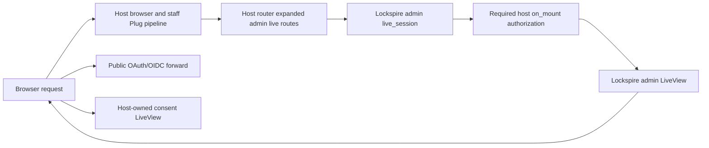

# Phase 167: Host-Expanded Admin Routing - Research

**Researched:** 2026-10-22
**Domain:** Phoenix Router macros and Phoenix LiveView host integration
**Confidence:** HIGH for framework constraints and repository inventory; MEDIUM for the proposed new public macro contract, which still needs implementation-level reproduction.

## User Constraints

There is no Phase 167 CONTEXT.md. These are the applicable approved scope constraints, copied verbatim from the current roadmap and requirements:

> “Mechanical host integration and automated verification. Keep accounts, staff identity, login UX, layouts, branding and product policy host-owned. Preserve public protocol behavior and security defaults. No visual redesign or subjective UI signoff.” [VERIFIED: .planning/ROADMAP.md:24]

> “A Phoenix host can use one reusable route integration to open and navigate every existing admin task at its supported configured mount, while public and consent routes remain independent.” [VERIFIED: .planning/ROADMAP.md:39]

> “Settle public API signature, route inventory ownership, session naming, host hook composition, path normalization, root-layout/session options and old AdminRouter compatibility with executable evidence. Required authorization wiring must be explicit and fail closed from the start; Phase 168 owns its complete behavioral denial proof. Do not patch private Phoenix join internals. Add focused route and connected-mount tests during this phase.” [VERIFIED: .planning/ROADMAP.md:50]

## Phase Requirements

| ID | Description | Research Support |
|----|-------------|------------------|
| MNT-01 | A Phoenix host can mount the complete admin surface through one reusable integration that defines the LiveView routes inside its own router, without copying Lockspire's route list. | Put one route declaration macro in the host router and centralize the route inventory so both the host-expanded integration and retained AdminRouter consume it. |
| MNT-02 | Staff can open, navigate and reconnect to admin pages at the default mount and supported custom mount paths, with links, redirects and task URLs retaining the configured prefix. | Normalize the configured mount once; exercise root, default and nested custom paths through both HTTP and connected navigation, including query strings, task paths, redirects and reconnect. |
| MNT-03 | Existing admin URLs keep their corresponding LiveView and action, including list/detail/new/edit and policy/rotation task routes; adopting the new integration does not silently remove routes or change their meaning. | Compare normalized route tuples (path, verb, LiveView module, action) with the current AdminRouter inventory; assert route_info selects each intended route. |
| MNT-04 | A host can protect admin pages independently while its public OAuth/OIDC endpoints and host-owned consent routes retain their intended access and routing behavior, without being shadowed by either mount. | Require the host HTTP pipeline and LiveView on_mount hook, put direct admin routes before the public forward, and keep consent routes outside the admin live_session. |

The requirement descriptions above are verbatim from `.planning/REQUIREMENTS.md:14-17` [VERIFIED: .planning/REQUIREMENTS.md:14-17].

## Summary

Lockspire already has a complete canonical admin LiveView route list in `Lockspire.Web.AdminRouter`; the generated install router still forwards that module, while the adoption demo separately copies the list into its host router and then keeps the forward. The existing runtime contract checks path-set parity and the host's browser, operator and root-layout pipeline, but its assertions do not compare the matching LiveView/action tuple. These are source observations, not a fresh reproduction of the forward-only connection failure. [VERIFIED: lib/lockspire/web/admin_router.ex:1-86] [VERIFIED: priv/templates/lockspire.install/router.ex:41-57] [VERIFIED: examples/adoption_demo/lib/adoption_demo_web/router.ex:58-140] [VERIFIED: test/lockspire/web/live/admin/admin_liveview_runtime_contract_test.exs:25-67]

The native implementation direction is a library route macro that expands `live` declarations in the host router, inside a named `live_session`; the old AdminRouter should remain available as a compatibility surface without private Phoenix socket patches. Make its shared route declarations the single source of truth. The host integration should require both an HTTP `pipe_through` list and host `on_mount` hook(s), while using LiveView's native session, layout and root-layout options where needed. [CITED: https://hexdocs.pm/phoenix_live_view/1.1.28/Phoenix.LiveView.Router.html#live_session/3] [CITED: https://hexdocs.pm/phoenix/1.8.5/Phoenix.Router.html]

**Primary recommendation:** Add a single host-router macro with a required literal admin route path, required non-empty `pipe_through:` and `on_mount:` options, an internal fixed `:lockspire_admin` live-session name, optional native `:root_layout`, `:layout` and `:session` pass-throughs, and one shared route inventory used by the retained AdminRouter. Keep the admin declarations before the public forward and keep consent routes in their own host scope/session.

## Architectural Responsibility Map

| Capability | Primary Tier | Secondary Tier | Rationale |
|------------|-------------|----------------|-----------|
| Admin URL declaration and dispatch | API / Backend (host Phoenix Router) | — | Phoenix compiles route macros in the host router; route metadata and matched paths must use the host prefix. |
| Staff HTTP gate | API / Backend (host Plug pipeline) | — | Host policy runs before the disconnected LiveView render. |
| Connected mount and navigation gate | API / Backend (host LiveView on_mount hook) | Browser / Client | LiveView reuses its socket on navigation; HTTP plugs do not run on in-session navigation. |
| Admin root layout and endpoint session transport | Frontend Server (SSR) | Browser / Client | Root layout and signed session transport belong to the host router/endpoint contract. |
| OAuth/OIDC endpoints and consent routes | API / Backend | Frontend Server (SSR) | They remain separate host/library routes and must not inherit admin-only checks by path-prefix accident. |

## Standard Stack

The source-of-truth project stack says:

> `- Phoenix \`1.8.5\`` and `- Phoenix LiveView \`1.1.28\`` [VERIFIED: AGENTS.md:23-31]

### Core

| Library | Version | Purpose | Why Standard |
|---------|---------|---------|--------------|
| Phoenix Router | 1.8.5 supported floor | Host route scopes, macro expansion, route ordering and route introspection | Existing support contract; its native compile-time router macros produce host-owned route metadata. [VERIFIED: AGENTS.md:23-31] [CITED: https://hexdocs.pm/phoenix/1.8.5/Phoenix.Router.html] |
| Phoenix LiveView | 1.1.28 supported floor | `live` routes, `live_session`, lifecycle hooks and connected test APIs | Existing support contract; the floor docs specify the required host-expanded route/session behavior. [VERIFIED: AGENTS.md:23-31] [CITED: https://hexdocs.pm/phoenix_live_view/1.1.28/Phoenix.LiveView.Router.html#live_session/3] |
| ExUnit + Phoenix.LiveViewTest | Existing project test stack | Router parity and connected mount/navigation regressions | Already in the project; add no test dependency. [VERIFIED: mix.exs:90-101] |

### Supporting

| Library | Version | Purpose | When to Use |
|---------|---------|---------|-------------|
| Plug.Session | Existing Phoenix/Plug stack | Host cookie session and LiveView websocket `connect_info` | Host endpoint already owns this configuration; Lockspire must not choose the host's cookie name or signing salt. |
| `Phoenix.Router.routes/1` and `route_info/4` | Existing Phoenix Router API | Route tuple, order and effective-match assertions | Use for deterministic route/action parity and forward-shadow checks. |

### Alternatives Considered

| Instead of | Could Use | Tradeoff |
|------------|-----------|----------|
| Host-expanded macro over a shared route inventory | Host manually copies all `live` declarations | Works mechanically but makes adopters maintain a second inventory and repeats the demo's source drift. |
| Native LiveView route/session primitives | Patch forwarded join paths or private Phoenix socket internals | Violates the documented direct-route expectation and makes support depend on private implementation details. |
| Required host `on_mount` and HTTP pipeline | Lockspire-owned staff authentication | Crosses the approved host ownership boundary and invents identity/policy the project does not own. |

**Installation:** No new packages. This is a source-level integration on the existing stack.

## API Contract Recommendation

Expose a `Lockspire.Web.AdminRoutes` macro intended to be called once from the host router. Recommended call shape (new API, therefore `[ASSUMED]` until implemented and compiled):

All paths, host modules, and pipeline names in this example are proposed placeholders `[ASSUMED]`.

```elixir
lockspire_admin_routes "/lockspire/admin",
  pipe_through: [:browser, :require_staff],
  on_mount: HostWeb.LockspireAdminAuth,
  root_layout: {HostWeb.Layouts, :root}
```

The macro should:

1. Require a compile-time literal path and require non-empty `pipe_through:` and `on_mount:` options. It owns a scope at that path, pipes all generated routes through the given host pipeline(s), and wraps all admin `live` routes in one named `live_session`.
2. Fix the library session name at `:lockspire_admin`; it is not a host cookie name. Only one admin mount per router is in the approved scope, so no user-derived or generated atom is needed. Duplicate declarations should fail compilation through Phoenix's normal named-session validation.
3. Preserve the caller's `on_mount` list in order. Require at least one host hook and document that the first host hook owns the current staff decision; do not silently provide an allow-all default. Phase 168 owns the complete denial matrix, but Phase 167 must prove that the required host hook is present in the compiled live-session metadata.
4. Pass optional `root_layout:`, `layout:` and `session:` through unchanged to LiveView's `live_session/3`. Root layout can be inherited from the host pipeline when omitted. `session:` is LiveView's additional signed private mount-session map or MFA callback, not the Plug cookie session configuration. [CITED: https://hexdocs.pm/phoenix_live_view/1.1.28/Phoenix.LiveView.Router.html#live_session/3]
5. Keep the route declaration list in one shared macro/module so the legacy `Lockspire.Web.AdminRouter` can expand that same inventory for source compatibility. Retain its module and avoid private Phoenix patches. The forwarded form remains unsupported for connected LiveView behavior and should no longer be documented as the healthy install path. Existing callers can keep compiling while Phase 169 supplies migration diagnostics.

This route macro name/signature and the rule tying its literal compile-time route path to runtime `:lockspire, :mount_path` are the hard-to-reverse published contract choices. Settle them with the focused tests below before publishing; the approved roadmap authorizes normal source/API additions and does not require an extra approval checkpoint. Ensure the macro or its verifier checks that the route prefix matches `Lockspire.mount_path()` plus `/admin`, since existing admin links build from `Lockspire.mount_path()`. [VERIFIED: lib/lockspire/config.ex:86-103] [VERIFIED: lib/lockspire/web/live/admin/overview_live/index.ex:233]

## Architecture Patterns

### Data flow



### Recommended Project Structure

```text
lib/lockspire/web/
├── admin_routes.ex       # single compile-time route inventory / expansion macro
└── admin_router.ex       # retained legacy router that consumes the shared inventory
priv/templates/lockspire.install/
└── router.ex             # generated host call to the public macro
test/lockspire/web/live/admin/
└── admin_route_integration_test.exs # synthetic host router route and connected tests
```

These are recommended targets, not existing paths beyond the currently present AdminRouter and template. `[ASSUMED]`

### Pattern 1: Expand Native Routes in the Host Router

**What:** Define each admin route with Phoenix LiveView's `live` macro in the host router compile context under the admin path scope, host HTTP pipeline and named `live_session`. LiveView 1.1.28 documents the signature `live_session(name, opts \\ [], list)`, supports `:session`, `:root_layout`, `:on_mount`, `:layout`, and states that `live_session` does not currently work with `forward`. [CITED: https://hexdocs.pm/phoenix_live_view/1.1.28/Phoenix.LiveView.Router.html#live_session/3]

**When to use:** For the Lockspire admin surface, where route metadata and signed LiveView paths must use the adopter's host path and authorization boundaries.

**Example:**

All host modules, paths and pipeline atoms below are proposed placeholders `[ASSUMED]`.

```elixir
scope "/lockspire" do
  Lockspire.Web.AdminRoutes.lockspire_admin_routes "/admin",
    pipe_through: [:browser, :require_staff],
    on_mount: HostWeb.LockspireAdminAuth
end

scope "/" do
  forward("/lockspire", Lockspire.Web.Router)
end
```

This example illustrates intent only; exact import/require syntax and macro shape are new public API decisions `[ASSUMED]`. Admin scope must compile before the general public forward because Phoenix matches routes top-to-bottom. [CITED: https://phoenix.hexdocs.pm/1.8.5/Phoenix.Router.html]

### Route and Action Parity

Treat the current `Lockspire.Web.AdminRouter` declarations as the baseline inventory. The current source includes `live("/", Lockspire.Web.Live.Admin.OverviewLive.Index, :index)` and `live("/overview", Lockspire.Web.Live.Admin.OverviewLive.Index, :index)`. [VERIFIED: lib/lockspire/web/admin_router.ex:13-15] The existing runtime test reduces both routers to path sets; extend the test to compare each matched admin route's relative path, HTTP verb, LiveView module, and action, and also use `route_info/4` to verify the actual route selected for list/detail/new/edit and policy/rotation paths. Test the root route against the explicit overview route because they resolve to the same view/action but remain separate URLs. [VERIFIED: test/lockspire/web/live/admin/admin_liveview_runtime_contract_test.exs:25-58]

### Path normalization and link generation

The existing config explicitly says:

> “Accepts any binary, including the empty string (`""`), which is a deliberate signal that Lockspire is mounted at the host's root. Only `nil` (config unset) is rejected — host apps must set this explicitly to declare intent.” [VERIFIED: lib/lockspire/config.ex:86-91]

The verifier's exact root cases are `defp admin_mount_path(""), do: "/admin"` and `defp admin_mount_path("/"), do: "/admin"`. [VERIFIED: lib/lockspire/install/verify.ex:305-307] Normalize these to one canonical empty prefix before composing `/admin`; preserve nested mount prefixes and reject malformed paths.

The admin UI currently constructs links using `defp admin_path(path), do: Lockspire.mount_path() <> "/admin" <> path`. [VERIFIED: lib/lockspire/web/live/admin/overview_live/index.ex:233] Preserve that prefix source or replace all link construction with route helpers in a single coordinated change. Check absolute redirects, task URLs, query strings and `push_patch` URLs at root, default and nested custom paths. [VERIFIED: lib/lockspire/web/live/admin/clients_live/index.ex:430-445] [VERIFIED: lib/lockspire/web/live/admin/tokens_live/index.ex:252-266]

`Lockspire.mount_path()` comes from runtime application config, while Phoenix routes are compiled. Therefore the host macro should take the generated/compile-time route prefix and the supported install path must keep it aligned with runtime config. Do not claim arbitrary runtime-changing mount paths work without adding a distinct runtime routing design. `[ASSUMED]`

## Don't Hand-Roll

| Problem | Don't Build | Use Instead | Why |
|---------|-------------|-------------|-----|
| Route dispatch and path metadata | Private Phoenix route/socket patch or manual path matcher | Phoenix Router and LiveView `live` macros in the host router | The public API compiles route matching and verified route metadata in the owning router. |
| LiveView session boundary | Custom process/session routing | Native named `live_session` | It supplies navigation boundaries and per-session hooks/layout/session options. |
| Route parity matcher | Brittle source-string route extraction in tests | `Phoenix.Router.routes/1` plus `route_info/4` | Inspects compiled route path, module, action and effective match. |
| Host session/auth | Lockspire staff account, cookie or policy subsystem | Host Plug pipeline and required host `on_mount` hook | Preserves the embedded host ownership contract. |

**Key insight:** The bug is an integration-context mismatch: a forwarded nested router cannot supply the host router's native LiveView session/path metadata. Put the route declarations in the host router and reuse one library-owned route inventory.

## Common Pitfalls

### A successful HTTP render is mistaken for a connected LiveView

**What goes wrong:** A `200` HTML response makes the forward look healthy although the client cannot complete or reconnect the stateful join.
**Why it happens:** The disconnected HTTP render and connected mount are distinct lifecycle steps; reconnect invokes mount again. [CITED: https://hexdocs.pm/phoenix_live_view/1.1.28/Phoenix.LiveView.html]
**How to avoid:** Keep the forward-only case as a regression fixture and exercise a connected mount through the host-expanded route. This research did not execute a forward-only failure reproduction.
**Warning signs:** A test asserts only status/body or only static route table/path equality.

### HTTP pipeline treated as sufficient authorization

**What goes wrong:** HTTP entry is gated, but connected mount/reconnect or in-session navigation misses host policy.
**Why it happens:** LiveView navigation inside a live_session does not run the Plug pipeline. [CITED: https://hexdocs.pm/phoenix_live_view/1.1.28/Phoenix.LiveView.Router.html#live_session/3]
**How to avoid:** Make both `pipe_through:` and host `on_mount:` required in the macro and test the compiled metadata. Phase 168 owns the full allow/deny behavior matrix.

### Host hook or staff identity guessed by the library

**What goes wrong:** The integration accepts a missing hook or relies on `conn.assigns`/a session boolean that is absent or stale on a connected socket.
**Why it happens:** The host owns the staff identity and current permission decision; the LiveView socket has its own mount session.
**How to avoid:** Require a host callback; pass host session data through the native session option only when needed; do not create default allow behavior. Full policy semantics belong to Phase 168.

### Route parity checks omit actions or public precedence

**What goes wrong:** A path exists but maps to a different LiveView/action, or the public forward wins route matching.
**How to avoid:** Compare route tuples and query `route_info/4` for each representative route; assert all admin declarations precede the general public forward and consent routes stay in their independent scope. [CITED: https://phoenix.hexdocs.pm/1.8.5/Phoenix.Router.html]

### Route path prefix and runtime link prefix drift

**What goes wrong:** Pages mount at a nested path but links, redirects, task URLs or patches still point to the default path (or generate double slashes at root).
**How to avoid:** Centralize normalization, align macro path with configured mount path, and run route/navigation assertions for root, default and nested custom mounts. Do not add multi-mount or reverse-proxy-prefix behavior by inference.

### Old router is deleted or forwarded join internals are patched

**What goes wrong:** Existing callers lose a public module unexpectedly, or behavior depends on private Phoenix internals.
**How to avoid:** Keep `Lockspire.Web.AdminRouter` available and consume the shared inventory from it; explicitly mark direct host expansion as the supported connected path. Preserve no private Phoenix patches. Full upgrade handling is Phase 169.

## Code Examples

The verified native API skeleton below uses only official LiveView options. The `Lockspire.Web.AdminRoutes` call remains a proposed API and is intentionally not presented as existing code. Host module, route, and session-name examples in this snippet are placeholders `[ASSUMED]`.

```elixir
import Phoenix.LiveView.Router

scope "/admin" do
  pipe_through([:browser, :require_staff])

  live_session :lockspire_admin,
    on_mount: HostWeb.LockspireAdminAuth,
    root_layout: {HostWeb.Layouts, :root} do
    live("/", Lockspire.Web.Live.Admin.OverviewLive.Index, :index)
    live("/clients", Lockspire.Web.Live.Admin.ClientsLive.Index, :index)
  end
end
```

This documents where the route macro should expand, not a replacement inventory. Phoenix LiveView's exact `live_session/3` options are listed in the official floor docs. [CITED: https://hexdocs.pm/phoenix_live_view/1.1.28/Phoenix.LiveView.Router.html#live_session/3]

## State of the Art

| Old Approach | Current Approach | When Changed | Impact |
|--------------|------------------|--------------|--------|
| Forward a separate AdminRouter and assume it owns LiveView path/session context | Expand native `live` routes directly in the host router inside `live_session` | LiveView 1.1.28 docs explicitly state that `live_session` does not work with `forward`; no repository implementation change has been made yet | Keeps route metadata and session boundary in the host router. |
| Demo hand-copies the route list and keeps a fallback forward | Shared library route inventory expanded by the supported host macro | Proposed for v1.46 Phase 167 | Removes drift while retaining old router source compatibility. |

**Deprecated/outdated:** Forward-only connected admin mounting is incompatible with the documented LiveView session/routing contract. Retain the old AdminRouter module without claiming its forwarded form provides connected LiveView behavior.

## Environment Availability

| Dependency | Required By | Available | Version | Fallback |
|------------|-------------|-----------|---------|----------|
| Elixir | Mix and ExUnit | ✓ | 1.20.4-otp-29 selected via `ASDF_ELIXIR_VERSION` | — |
| Erlang/OTP | Mix and ExUnit | ✓ | 29.1.1 selected via `ASDF_ERLANG_VERSION` | — |
| PostgreSQL | Existing Lockspire test setup | ✓ | 14.17; `pg_isready` accepted local server on port 5432 | — |
| Node.js | CI/test support scripts | ✓ | 22.14.0 | — |

No dependency installation is required. The repository `.tool-versions` names Node only; invoking `mix` without explicit asdf Elixir/Erlang versions fails before Mix starts. A bounded test command that ran successfully was:

```bash
ASDF_ELIXIR_VERSION=1.20.4-otp-29 ASDF_ERLANG_VERSION=29.1.1 asdf exec mix test test/lockspire/web/live/admin/admin_liveview_runtime_contract_test.exs
```

Result: 2 passed. It compiled the existing host demo router and checked its source contract. This is not a fresh forward-only connected-join reproduction.

## Validation Architecture

Nyquist validation is enabled in `.planning/config.json`; the source line is `    "nyquist_validation": true,`. [VERIFIED: .planning/config.json:15-20]

### Test Framework

| Property | Value |
|----------|-------|
| Framework | ExUnit, Phoenix.LiveViewTest, Phoenix Router route introspection |
| Config file | `mix.exs` |
| Quick run command | `ASDF_ELIXIR_VERSION=1.20.4-otp-29 ASDF_ERLANG_VERSION=29.1.1 asdf exec mix test test/lockspire/web/live/admin/admin_route_integration_test.exs` |
| Current baseline command | `ASDF_ELIXIR_VERSION=1.20.4-otp-29 ASDF_ERLANG_VERSION=29.1.1 asdf exec mix test test/lockspire/web/live/admin/admin_liveview_runtime_contract_test.exs` |
| Full suite command | `ASDF_ELIXIR_VERSION=1.20.4-otp-29 ASDF_ERLANG_VERSION=29.1.1 asdf exec mix test.fast` |

### Phase Requirements → Test Map

| Req ID | Behavior | Test Type | Automated Command | File Exists? |
|--------|----------|-----------|-------------------|-------------|
| MNT-01 | One macro expands all admin routes directly into a synthetic host router and shares inventory with retained AdminRouter | unit/router | `... asdf exec mix test test/lockspire/web/live/admin/admin_route_integration_test.exs` | ❌ Wave 0/new phase test |
| MNT-02 | Connected mount, navigation/patch, reconnect and prefixed task/redirect/query links work at default, root and nested custom path | connected integration | `... asdf exec mix test test/lockspire/web/live/admin/admin_route_integration_test.exs` | ❌ Extend/add connected coverage |
| MNT-03 | Compiled `(path, verb, plug/LiveView, action)` inventory and selected route/action preserve existing URL meaning | unit/router | `... asdf exec mix test test/lockspire/web/live/admin/admin_route_integration_test.exs` | ❌ Existing runtime contract only compares path sets |
| MNT-04 | Admin route precedence is independent of public OAuth/OIDC forward and host-owned consent route/pipeline | router integration | `... asdf exec mix test test/lockspire/web/live/admin/admin_route_integration_test.exs` | ❌ Add explicit public/consent route assertions |

Use test helpers to substitute the host path config in isolated fixtures; avoid concurrent mutation of global application env. The test should keep the forward-only join regression separate from the new macro path and explicitly state that the former fails for the expected framework boundary.

### Sampling Rate

- **Per task commit:** focused route integration test file above.
- **Per wave merge:** full `mix test.fast` suite.
- **Phase gate:** focused tests pass before Phase 168 consumes the route contract.

### Wave 0 Gaps

- [ ] Add `test/lockspire/web/live/admin/admin_route_integration_test.exs` for macro expansion, route tuple/action parity, route precedence and the old forward-only reproduction.
- [ ] Add connected mount/reconnect and navigation checks to the phase fixture; `admin_liveview_runtime_contract_test.exs` currently checks router source, path set, pipeline metadata and asset/session source but not an actual connected join.
- [ ] Avoid claiming the root compatibility fixture is already a runtime test; its current job only compiles. Phase 170 owns exact-floor runtime proof.

## Security Domain

This phase is a security-relevant router boundary; security enforcement remains enabled by default. ASVS 5.0.0 labels authentication, session management and authorization as V6, V7 and V8 respectively, so use those current identifiers rather than the older V2/V3/V4 numbering. [CITED: https://asvs.owasp.org/] [CITED: https://github.com/OWASP/ASVS/blob/master/5.0/en/0x15-V6-Authentication.md] [CITED: https://github.com/OWASP/ASVS/blob/master/5.0/en/0x16-V7-Session-Management.md] [CITED: https://github.com/OWASP/ASVS/blob/master/5.0/en/0x17-V8-Authorization.md]

### Applicable ASVS Categories

| ASVS Category | Applies | Standard Control |
|---------------|---------|------------------|
| V6 Authentication | Yes, host-owned | Require host authentication on initial HTTP and host identity resolution in `on_mount`; Lockspire does not provide staff accounts. |
| V7 Session Management | Yes | Keep host Plug.Session and websocket `connect_info` consistent; use a separate named admin LiveView session; do not confuse the LiveView session name with a cookie key. |
| V8 Authorization | Yes | Required host HTTP pipeline plus required host LiveView hook; keep public OAuth/OIDC and consent behavior outside admin auth. |
| V2 Validation and Business Logic | Yes, narrow | Validate route path options as compile-time path strings and normalize separators; do not accept malformed or ambiguous mount prefixes. |
| V13 Configuration | Yes, narrow | Fail closed when required pipeline/hook wiring is missing and detect route path/runtime config mismatch. |
| V11 Cryptography | No phase-owned crypto change | Existing signed endpoint/session machinery is host-owned; do not change token or signing crypto here. |

### Known Threat Patterns for Phoenix LiveView Routing

| Pattern | STRIDE | Standard Mitigation |
|---------|--------|---------------------|
| Connected entry bypasses the HTTP plug | Elevation of privilege | Required host `on_mount`; verify hook metadata in Phase 167 and full negative behavior in Phase 168. |
| Public forward shadows or absorbs admin/consent paths | Spoofing / elevation of privilege | Put direct admin declarations first; assert `route_info/4` selects the expected route for each class. |
| Admin links escape the protected nested prefix | Elevation of privilege | Prefix parity checks across links, redirects, tasks, query filters, navigation and reconnect. |

## Project Constraints (from AGENTS.md)

- Build Lockspire as a separate companion library, not a Sigra module; preserve the embedded-library shape and do not create a required auth service. [VERIFIED: AGENTS.md:15-21]
- Preserve boundaries between protocol core, storage, generators, Plug/Phoenix integration, and LiveView/admin surfaces. [VERIFIED: AGENTS.md:17-20]
- Keep the host seam explicit: account resolution, claims, login redirects, branding and product policy belong to the host. [VERIFIED: AGENTS.md:19-21]
- Do not broaden this phase into SAML, LDAP/AD federation, hosted auth, or a full CIAM suite. [VERIFIED: AGENTS.md:17-21]
- No admin UI wording change is in scope. If implementation changes admin-visible copy, first read `PRODUCT.md`; use its `UI says` vocabulary and update the retired wording table where replacing phrases. [VERIFIED: AGENTS.md:52-56]
- Keep these security defaults verbatim: “PKCE S256 required by default”; “Exact-match redirect URI validation”; “Client secrets hashed at rest”; “Authorization codes short-lived and single-use”; “Refresh token rotation with family-wide revocation on reuse”; “No implicit flow”; “No `alg=none`”; “Strong redaction in logs and operator surfaces.” [VERIFIED: AGENTS.md:41-50]

## Assumptions Log

| # | Claim | Section | Risk if Wrong |
|---|-------|---------|---------------|
| A1 | The public macro should be named `Lockspire.Web.AdminRoutes.lockspire_admin_routes/2` and accept a compile-time path plus required pipeline/hook options. | API Contract Recommendation | It is a published adopter API; an awkward name or incompatible shape causes migration cost. Confirm through implementation compile tests and API review before release. |
| A2 | A single fixed `:lockspire_admin` live_session name is sufficient because multi-mounting one library instance is outside approved scope. | API Contract Recommendation | A host session-name collision or future multi-mount need could require another contract. |
| A3 | The macro path will be provided at compile time and kept aligned with runtime `:mount_path`; arbitrary runtime route reconfiguration is unsupported. | Path normalization | Mismatched route and generated-link prefixes break navigation. |
| A4 | Existing empty `mount_path` means root-mounted admin routes; `/` should normalize to the same canonical prefix. | Path normalization | If root is not included in the shipped compatibility promise, tests and generated guide could freeze an unsupported configuration. |

## Open Questions

1. **Exact public macro signature and module name:** Recommendation is given above; these are the only substantial design choices not already constrained by the approved roadmap. Treat as a hard-to-reverse public API contract before publishing, not as a reason to stop normal Phase 167 implementation.
2. **Old AdminRouter runtime compatibility:** Preserve its module and shared route inventory; only direct expansion into the host router is the supported connected mount. Reproduce the forward-only join failure once during implementation before describing it as newly observed evidence.
3. **Root-layout ownership:** Preserve the existing host route-pipeline behavior by default; allow the native `root_layout` option when explicit override is needed. The endpoint cookie session and websocket session transport remain host-owned.

## Sources

### Primary (HIGH confidence)

- `AGENTS.md:15-56` — embedded boundary, stack, security defaults and admin-copy rules, opened this session.
- `.planning/ROADMAP.md:37-50` and `.planning/REQUIREMENTS.md:14-17` — approved scope/acceptance and MNT requirements, opened this session.
- `lib/lockspire/web/admin_router.ex:1-86`, `priv/templates/lockspire.install/router.ex:41-70`, `examples/adoption_demo/lib/adoption_demo_web/router.ex:58-152` — current route inventory and mount ownership, opened this session.
- `test/lockspire/web/live/admin/admin_liveview_runtime_contract_test.exs:1-110` — current route/path/pipeline and endpoint asset/session contract, opened and executed this session.
- `deps/phoenix_live_view/lib/phoenix_live_view/router.ex:221-319` — locally installed `live_session` validation and exact allowed options, inspected this session (root lock version; floor claims use versioned official docs).
- [Phoenix LiveView 1.1.28 router documentation](https://hexdocs.pm/phoenix_live_view/1.1.28/Phoenix.LiveView.Router.html#live_session/3) — macro signatures, session options, forward constraint and authorization/nav boundaries.
- [Phoenix LiveView 1.1.28 lifecycle documentation](https://hexdocs.pm/phoenix_live_view/1.1.28/Phoenix.LiveView.html) — disconnected/connected mount and reconnect lifecycle.
- [Phoenix Router 1.8.5 documentation](https://hexdocs.pm/phoenix/1.8.5/Phoenix.Router.html) — route order, host router macro generation and scopes.
- [OWASP ASVS 5.0.0 overview](https://asvs.owasp.org/) and official [V6 Authentication](https://github.com/OWASP/ASVS/blob/master/5.0/en/0x15-V6-Authentication.md), [V7 Session Management](https://github.com/OWASP/ASVS/blob/master/5.0/en/0x16-V7-Session-Management.md), [V8 Authorization](https://github.com/OWASP/ASVS/blob/master/5.0/en/0x17-V8-Authorization.md) chapters.

### Secondary (MEDIUM confidence)

- `.planning/research/v1.46-host-integration/{SUMMARY,ARCHITECTURE,FEATURES,PITFALLS,STACK}.md` — approved upstream research, opened this session; useful historical summary, not fresh runtime evidence.
- The focused existing router contract test executed with explicit asdf Elixir/Erlang versions: **2 passed**. It does not reproduce a forward-only connected join failure.

## Metadata

**Confidence breakdown:**
- Standard stack: HIGH — project baseline and official versioned docs verified; no dependency changes.
- Architecture: MEDIUM — native API and limits verified; exact new macro public signature remains a recommendation.
- Pitfalls: HIGH for framework lifecycle/routing limits; MEDIUM for current host behavior until the forward-only join case is freshly reproduced.

**Research date:** 2026-10-22
**Valid until:** 2026-11-21 for the stable Phoenix integration guidance; recheck before changing the supported version floor.
