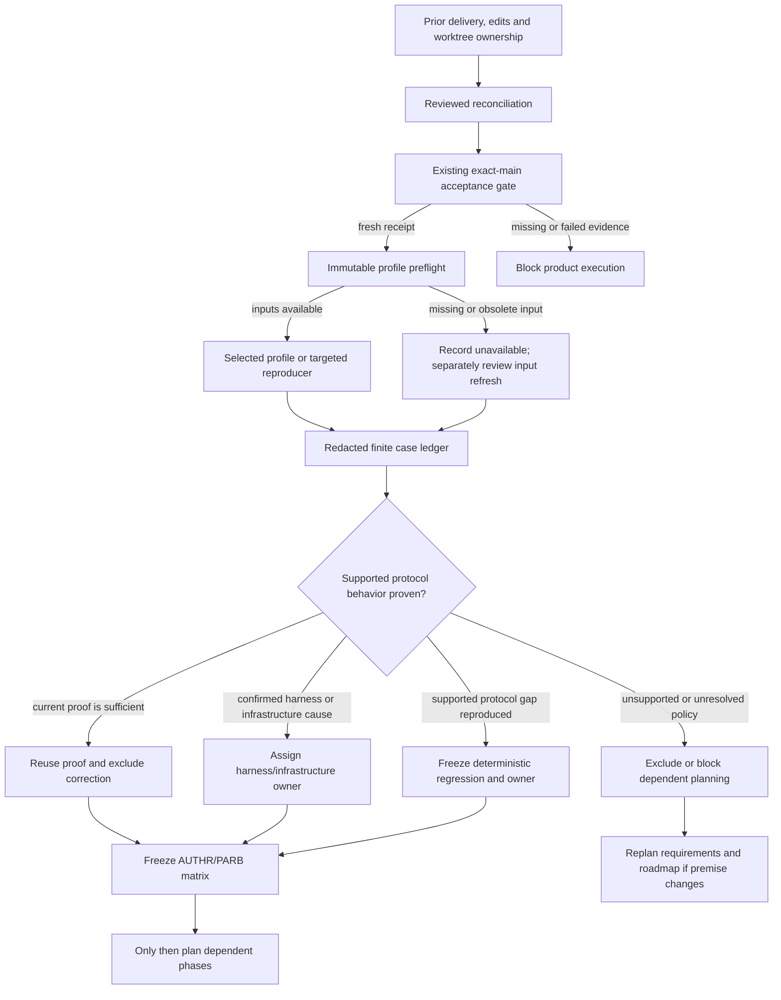

# Phase 171: Accepted Baseline & Finding Qualification - Research

**Researched:** 2026-10-24
**Domain:** Repository delivery gates, immutable conformance inputs, OAuth/OIDC finding qualification
**Confidence:** HIGH for repository machinery and current source/test coverage; MEDIUM for normative interpretation grounded in current official standards; LOW for the content of historical raw suite failures, which is unavailable.

## User Constraints

No Phase 171 CONTEXT.md exists (`init.phase-op 171` reported `has_context: false`), so there are no phase-specific locked decisions or deferred ideas to copy. Preserve the project constraints below. [VERIFIED: `query init.phase-op 171`; `AGENTS.md:15-50`]

## Project Constraints (from AGENTS.md)

- Keep Lockspire a separate companion library embedded in the host Phoenix application; do not make a standalone auth service or a Sigra module. [CITED: `AGENTS.md:15-19`]
- Keep protocol core, storage, generators, Plug/Phoenix integration and LiveView/admin surfaces bounded. Keep account resolution, claims, login redirects, branding and product policy in the host app. [CITED: `AGENTS.md:19-20`]
- Do not expand v1 into SAML, LDAP/AD federation, hosted auth or a full CIAM suite. [CITED: `AGENTS.md:21`]
- Preserve the documented security defaults: PKCE S256, exact-match redirect validation, client-secret hashing at rest, short-lived single-use authorization codes, refresh rotation with family revocation on reuse, no implicit flow, no `alg=none`, and strong redaction. [CITED: `AGENTS.md:41-50`]
- No admin UI change is planned. If one becomes necessary, follow `PRODUCT.md` personas/vocabulary, update its vocabulary map for new concepts, and record retired wording as directed in AGENTS.md. [CITED: `AGENTS.md:52-57`]

## Phase Requirements

| ID | Description | Research Support |
|---|---|---|
| BASE-01 | “Maintainer can start product implementation from a fresh accepted main baseline after reviewed prior-delivery reconciliation, with exact SHA, complete local contributor checks, matching canonical CI/Release no-publish evidence, and explicit worktree/edit ownership.” | Reuse the existing exact-SHA hygiene acceptance command and receipt after a separate reviewed ownership/reconciliation record. Current feature checkout and dated baseline are not acceptance evidence. [VERIFIED: `.planning/REQUIREMENTS.md:12`] |
| BASE-02 | “Maintainer can run the selected existing conformance profiles with explicit provider/package, suite, image/helper and plan identities; missing or obsolete inputs fail visibly and any input update is reviewed separately from protocol corrections.” | Reuse the immutable OIDF lock, plan files, shared runner and allowlisted receipts; reject mutable or missing inputs and preserve distinct lock-update review. [VERIFIED: `.planning/REQUIREMENTS.md:13`] |
| FIND-01 | “Maintainer can inspect a finite redacted ledger attributing each selected historical/current finding to protocol behavior, harness/transport/browser setup, infrastructure, unsupported scope or already-correct/not-reproduced behavior, with normative/support references and a next owner.” | Use one bounded ledger tied to source/date and exact run identities; the historical `suite_failure` summaries lack raw assertions and cannot be promoted to current defects. [VERIFIED: `.planning/REQUIREMENTS.md:14`] |
| FIND-02 | “Downstream implementers can use a qualified case matrix that fixes expected outcomes, repro commands, regression owners and exclusions before dependent implementation plans are created or executed; qualification that removes the corrective premise explicitly narrows/replans the milestone.” | Freeze selected case IDs, supported surface, normative basis, expected result, command, proof owner, classification and disposition before plans for Phases 172–174. If no fix remains, update requirements/roadmap explicitly. [VERIFIED: `.planning/REQUIREMENTS.md:15`] |

## Summary

Phase 171 is a readiness and evidence-qualification gate, not an OAuth implementation phase. First reconcile prior delivery and unknown edits/worktree ownership; then obtain a fresh accepted-main receipt from the existing gate. The current checkout is on a feature branch, and the dated v1.47 baseline explicitly says it is not accepted main. Phase planning can happen here, but no finding can be treated as a current product defect from the historical summaries alone. [VERIFIED: `.planning/ROADMAP.md:34-43,80-86`; `.planning/research/v1.47-core-hardening/BASELINE.md:1-4`; read-only `git status --short --branch`, 2026-10-24]

Use the existing Phase 37 and FAPI profile inputs and runner as a diagnostic source, while keeping external results supplemental. Current repository tests already cover much of the likely authorization-error, silent-auth/freshness, PAR expiry/client-binding/replay, and required-PAR behavior. The phase should reuse that proof when applicable and select only material uncovered cases. Infrastructure failures, unavailability, integration-only runs and coarse historical suite summaries are not protocol passes. [CITED: `docs/maintainer-conformance.md`; `.planning/research/v1.47-core-hardening/INTEROPERABILITY.md`; `test/integration/phase37_protocol_strictness_e2e_test.exs`; `test/integration/phase15_par_authorization_e2e_test.exs`]

**Primary recommendation:** Plan Phase 171 in gate order: reviewed cumulative delivery/ownership reconciliation → existing exact-main acceptance receipt → exact-input profile availability/reproduction or explicit unavailability → finite, redacted finding/case ledger → freeze downstream matrix and revise roadmap/requirements where qualification removes a premise. Keep lock refreshes separate from protocol fixes. [CITED: `.planning/ROADMAP.md:80-86`; `.planning/research/v1.47-core-hardening/SCOPE.md`]

## Architectural Responsibility Map

| Capability | Primary Tier | Secondary Tier | Rationale |
|---|---|---|---|
| Main baseline acceptance and delivery ownership | Repository / CI | Maintainer workflow | Git identity, local contributor gate and canonical GitHub workflow evidence establish the implementation base; OAuth runtime code is not involved. [CITED: `.planning/REPO-HYGIENE-CHECKLIST.md`; `scripts/maintainer/repo_hygiene_check.sh`] |
| External profile input validation and execution | Maintainer tooling / CI | Disposable provider host | Local scripts validate immutable suite, image/helper and plan inputs, run through Compose, and retain an allowlisted receipt. The embedded Billingo host supplies a real provider surface while retaining host-owned account and UX policy. [CITED: `docs/maintainer-conformance.md`; `scripts/conformance/oidf_inputs.py`] |
| Protocol finding qualification | Protocol / API | Host integration and test harness | Expected OAuth/OIDC behavior must be grounded in standards and Lockspire's supported surface, then distinguished from proxy, TLS, browser and infrastructure setup. [CITED: `.planning/research/v1.47-core-hardening/INTEROPERABILITY.md`; `docs/supported-surface.md`] |
| Case evidence and downstream ownership | Planning artifact / test suite | Maintainer workflow | One bounded case ledger should drive the implementation slices and regression owners; an external suite receipt alone does not assign the cause. [CITED: `.planning/REQUIREMENTS.md:36-40`; `.planning/ROADMAP.md:40-43`] |

## Standard Stack

### Core

No package or platform upgrade is selected for Phase 171. Reuse the repository's existing Elixir/Mix tests, Bash exact-main gate, Python standard-library lock/receipt helpers, Docker Compose profile runner and GitHub workflow evidence. [CITED: `.planning/research/v1.47-core-hardening/SCOPE.md`; `scripts/conformance/oidf_inputs.py`; `scripts/maintainer/repo_hygiene_check.sh`]

| Existing component | Purpose | Planning guidance |
|---|---|---|
| `bash scripts/maintainer/repo_hygiene_check.sh --accept-sha <sha> --format json` | Exact synchronized-main acceptance receipt | Keep this as the only acceptance gate; it checks SHA identity before/after local checks and matched canonical CI/Release evidence. A clean branch or the dated baseline is not a substitute. [CITED: `.planning/REPO-HYGIENE-CHECKLIST.md`; `scripts/maintainer/repo_hygiene_check.sh`] |
| `mix lockspire.oidf_conformance --check` | Input and prerequisite preflight | Run before profile execution; it validates the checked-in lock/plans and required local tooling without starting the profiles. [CITED: `docs/maintainer-conformance.md:25-43`; `lib/mix/tasks/lockspire.oidf_conformance.ex`] |
| `bash scripts/conformance/run_ephemeral_oidf_profile.sh phase37` and `... fapi2` | Disposable-host profile invocations | Use only after accepted-main entry and with explicit disposable-database acknowledgement. Raw work/config is temporary; only validated receipts are retained. [CITED: `docs/maintainer-conformance.md:45-99`] |
| `MIX_ENV=test mix test ...` | Deterministic repository-owned behavior and tooling contracts | Reuse focused tests; don't add a second general test/conformance framework. [CITED: `mix.exs:90-125`; `.planning/REQUIREMENTS.md:38-40`] |

### Alternatives Considered

| Instead of | Could use | Tradeoff |
|---|---|---|
| Existing exact-main gate | A new Phase 171 acceptance script or checklist | Do not create a parallel acceptance authority; the current script already proves local exact SHA, local checks, canonical CI, Release no-publish and warning dispositions. [CITED: `.planning/REPO-HYGIENE-CHECKLIST.md`; `scripts/maintainer/repo_hygiene_check.sh`] |
| Existing immutable OIDF runner | Mutable upstream tag/latest or a new conformance framework | Mutable inputs destroy comparable reproduction; a second framework adds maintenance without a demonstrated gap. [CITED: `docs/maintainer-conformance.md:9-23`; `.planning/research/v1.47-core-hardening/SCOPE.md`] |

**Installation:** None. Phase 171 does not add external packages. Package legitimacy audit is not triggered. [CITED: `.planning/research/v1.47-core-hardening/SCOPE.md`]

## Architecture Patterns

### Evidence and decision flow



The flow preserves failure ownership: exact-input identity and startup are checked before interpreting suite results, and a failed profile is not automatically a Lockspire defect. [CITED: `docs/maintainer-conformance.md:125-143`; `.planning/ROADMAP.md:82-86`]

### Recommended Project Structure

Keep phase outputs in `.planning/phases/171-accepted-baseline-finding-qualification/`. Phase 171 needs a fresh acceptance receipt/projection, reviewed ownership reconciliation, one canonical finite finding/case ledger, and a frozen downstream case matrix. Prefer one human-readable canonical ledger with stable case IDs and fields over separate competing ledgers; link it from phase summaries and dependent plans. Do not modify archived phase 142/143 receipts. [CITED: `.planning/ROADMAP.md:82-86`; `.planning/research/v1.47-core-hardening/BASELINE.md`; `.planning/MILESTONE-GUIDE.txt`]

### Pattern 1: Exact-base acceptance

**What:** Use the repository-owned exact-SHA workflow and retain its JSON receipt. The checklist's exact command contains “`--accept-sha`” and “`--format json`”; run `bash ./scripts/maintainer/repo_hygiene_check.sh --accept-sha <40-lowercase-hex-current-main-sha> --format json`. The script refreshes `origin/main`, requires `HEAD`, local `main`, and refreshed remote main to equal the supplied SHA, checks clean checkout and `mix ci`, then proves exact-SHA CI and Release no-publish evidence. [VERIFIED: `.planning/REPO-HYGIENE-CHECKLIST.md:18-21`; `scripts/maintainer/repo_hygiene_check.sh`]

**When to use:** As the first execution gate before product work. It does not replace the separate review of cumulative prior delivery, unknown edits, commits and worktree ownership. The current baseline is historical and explicitly not this receipt. [CITED: `.planning/research/v1.47-core-hardening/BASELINE.md`; `.planning/research/v1.47-core-hardening/DELIVERY.md`]

### Pattern 2: Immutable profile and redacted receipt

**What:** Use checked-in lock and plans. The exact suite identity is quoted in maintainer docs as “`release-v5.1.43` at commit `16ad152b1b2c0baacd3d2519128340d95deb2b8c`”; its archive/helpers are SHA-256 bound, container images use immutable digests, and receipt data includes plan checksum. [VERIFIED: `docs/maintainer-conformance.md:9-23`; `scripts/conformance/oidf-suite-lock.json:1-42`]

The current Phase 37 plan is the strictness subset for browser-safe redirects/silent-auth plus fresh-session auth_time; its exact plan text includes “`oidcc-prompt-none-not-logged-in`”, “`oidcc-ensure-registered-redirect-uri`”, “`oidcc-redirect-uri-query-mismatch`”, “`oidcc-redirect-uri-query-OK`”, “`oidcc-prompt-none-logged-in`”, and “`oidcc-max-age-10000`”. The FAPI plan's exact upstream suite plan is “`fapi2-security-profile-final-test-plan`”, and its `modules` list is empty, delegating selection to that named plan. [VERIFIED: `scripts/conformance/phase37-plan.json:1-35`; `scripts/conformance/fapi2-plan.json:1-16`]

The existing receipt records suite, archive/helper/image hashes, plan checksum, runtime, status and classification, but it does not include a provider/package source identity. Its exact field names include “`suite`”, “`input_hashes`”, “`plan`”, “`runtime`”, and “`result`”. Record the provider source commit or packaged host artifact identity/checksum separately in the finite ledger; never add private provider configuration to retained evidence. [VERIFIED: `scripts/conformance/build_redacted_evidence.py:37-50`; `scripts/conformance/run_oidf_profile.sh:63-89`]

The documented classifications are exactly “`infrastructure_failure`”, “`suite_failure`”, “`integration_only`”, and “`success`”. Treat them by their documented meaning; notably, `integration_only` never represents a conformance pass and `success` remains supplemental/non-certifying. [VERIFIED: `docs/maintainer-conformance.md:125-143`]

**When to use:** For comparable suite runs and any input refresh. A changed lock or plan changes the experiment: review and record it separately from protocol behavior, and never describe a new-input run as a same-input historical reproduction. [CITED: `docs/maintainer-conformance.md:20-23,70-99`; `.planning/research/v1.47-core-hardening/SCOPE.md`]

### Pattern 3: Case-level cause attribution

**What:** Give each selected case a stable ID, source/date and exact provider/package, suite, image/helper and plan identity; record the supported mount/profile, safe module/condition, normative/support reference, observed versus expected behavior, classification, deterministic repro, regression owner, disposition and verification identity. Store no secrets, raw provider configuration, tokens, personal data, raw exception dumps or browser logs. [CITED: `.planning/research/v1.47-core-hardening/SCOPE.md`]

Use the existing taxonomy quoted from the scope decision table: “Protocol assertion; harness/origin/TLS/browser; infrastructure; unsupported profile; already-correct/not reproduced”. A suite-level label is an observed classification, not a case-level cause. [VERIFIED: `.planning/research/v1.47-core-hardening/SCOPE.md:20-23`]

**When to use:** Before dependent case selection or implementation planning. If the raw historical artifact is unavailable, preserve that fact as unavailable and create a new dated reproducer; do not invent an old assertion or infer its exact cause. [CITED: `.planning/research/v1.47-core-hardening/SCOPE.md`; `.planning/research/v1.47-core-hardening/INTEROPERABILITY.md`]

## Don't Hand-Roll

| Problem | Don't Build | Use Instead | Why |
|---|---|---|---|
| Accepted-main evidence | A second shell gate, duplicate checklist, or inferred green-main claim | Existing `repo_hygiene_check.sh --accept-sha ... --format json` plus reviewed prior-delivery reconciliation | One authority already binds local checks and exact remote receipts; the reconciliation separately captures ownership unknowns. [CITED: `.planning/REPO-HYGIENE-CHECKLIST.md`; `scripts/maintainer/repo_hygiene_check.sh`] |
| External-suite pinning | Mutable tag/image, branch head, unverified helper or fallback | `scripts/conformance/oidf-suite-lock.json` plus `oidf_inputs.py` validator | Current validator rejects mutable suite references, incomplete helper/image identity and checksum mismatch. [CITED: `scripts/conformance/oidf_inputs.py`; `docs/maintainer-conformance.md:9-23`] |
| Protocol acceptance | A hand-written proxy assertion inferred from a suite label | Normative case expectation plus supported-surface and repo-native HTTP regression; use OIDF as supplemental evidence | Normative requirements and actual support determine behavior; harness/TLS/browser failures need separate ownership. [CITED: `.planning/research/v1.47-core-hardening/INTEROPERABILITY.md`; `docs/maintainer-conformance.md:145-151`] |
| Crypto, token, provider, or account policy | New primitives or Lockspire-owned login/session policy | Existing vetted OTP/framework primitives and narrow host integration seam | This phase does not authorize security primitive replacement or host account/login ownership changes. [CITED: `AGENTS.md:15-21,41-50`; `.planning/REQUIREMENTS.md:38-40`] |

**Key insight:** The most expensive planning error is conflating a profile failure with the protocol cause. Pin and verify inputs first, observe the actual endpoint/transport path, then compare one supported case to a normative expectation and existing deterministic proof. [CITED: `docs/maintainer-conformance.md:74-76,125-151`; `.planning/research/v1.47-core-hardening/INTEROPERABILITY.md`]

## Common Pitfalls

### Pitfall 1: Treating historical suite failures as present defects

**What goes wrong:** A broad historic `suite_failure` turns directly into implementation plans.
**Why it happens:** Retained receipt is deliberately redacted and does not expose individual assertion output; it only preserves identity and bounded status. [CITED: `docs/maintainer-conformance.md:85-99`; `.planning/research/v1.47-core-hardening/INTEROPERABILITY.md`]
**How to avoid:** Re-run exact inputs where available or mark historical details unavailable and make a new dated repro. Require supported-surface scope, normative section, observed outcome, expected outcome and deterministic repo-native repro before a correction.
**Warning signs:** No module/condition, no exact suite/plan/image identity, raw logs missing, or no test that fails against current supported behavior.

### Pitfall 2: Counting infrastructure as protocol evidence

**What goes wrong:** Docker startup, runner preflight, missing Python modules, TLS/proxy/WebRunner failure, or integration-only execution is reported as a protocol pass/fail.
**Why it happens:** Setup and suite assertion are separate subprocess stages with separate receipt classifications. [CITED: `docs/maintainer-conformance.md:70-76,125-143`; `scripts/conformance/run_oidf_profile.sh`]
**How to avoid:** Keep unavailable/setup failure visible, repair the environment or separately reviewed lock input, and rerun the same protocol source/input identity. A profile result requires the suite runner to reach its selected assertions.
**Warning signs:** No complete exact-input receipt, no application request at the intended public endpoint, or only `integration_only` status.

### Pitfall 3: Confusing FAPI empty modules with no profile tests

**What goes wrong:** The plan is treated as an empty test suite.
**Why it happens:** The checked-in FAPI plan intentionally names an upstream plan while its modules array is empty. [VERIFIED: `scripts/conformance/fapi2-plan.json:6-15`]
**How to avoid:** Record the exact named suite plan and preserve its lock identity; qualify individual assertions only from actual receipt/raw ephemeral observations and applicable support boundaries.

### Pitfall 4: Inferring ownership from a clean checkout or old baseline

**What goes wrong:** A clean checkout is used to close unknown edits, unique commits or agent worktrees.
**Why it happens:** The gate's clean-tree condition proves the current checkout is clean, not that every historical or neighboring worktree has an owner/disposition. The dated baseline explicitly retains worktrees with unresolved ownership. [CITED: `.planning/research/v1.47-core-hardening/BASELINE.md`; `.planning/research/v1.47-core-hardening/DELIVERY.md`]
**How to avoid:** Reconcile current branch/refs/worktrees and preexisting edits with owner, purpose, unique commits, hashes/snapshot and next action before exact-main acceptance. Preserve unresolved work; no cleanup by age/name.

### Pitfall 5: Selecting normative outcomes without checking current supported contract

**What goes wrong:** A standard requirement is assumed to expand Lockspire's support surface or ownership boundary.
**Why it happens:** Standards leave implementation policy and support profile choices that must be matched to `docs/supported-surface.md` and locked project decisions.
**How to avoid:** The standards establish the selected case's protocol expectation; support docs and host seam bound what the milestone promises. Escalate only unresolved security/API/support decisions that alter scope, and block dependent planning until settled. [CITED: `AGENTS.md:15-21`; `.planning/REQUIREMENTS.md:38-40`; `.planning/research/v1.47-core-hardening/SCOPE.md`]

## Code Examples

Run the safe immutable-input preflight before any selected profile. This command should not be described as a profile pass. [CITED: `docs/maintainer-conformance.md:25-43`]

```bash
mix lockspire.oidf_conformance --check
```

When profile inputs and disposable host prerequisites are available, execute the existing throwaway-provider wrapper; its required acknowledgement is intentional and prevents accidental database reset/seeding. These are execution-time commands and were not run during this research. [CITED: `docs/maintainer-conformance.md:45-65`]

```bash
LOCKSPIRE_OIDF_EPHEMERAL_DB=true \
  bash scripts/conformance/run_ephemeral_oidf_profile.sh phase37
LOCKSPIRE_OIDF_EPHEMERAL_DB=true \
  bash scripts/conformance/run_ephemeral_oidf_profile.sh fapi2
```

Current repo-owned proof owners worth mapping into cases include:

- `test/integration/phase37_protocol_strictness_e2e_test.exs`: exact trailing-slash redirect mismatch has no `Location`; unauthenticated `prompt=none` returns `login_required` to the registered callback without host login redirection; stale `max_age` also returns `login_required`; fresh auth emits `auth_time`. [VERIFIED: `test/integration/phase37_protocol_strictness_e2e_test.exs:105-177,179-180`]
- `test/lockspire/web/authorize_controller_test.exs`: unknown client and mismatch stay first-party/no redirect (`:106-125`); valid-callback error preserves state and invalid prompt/max_age are redirect-safe (`:195-250`); prompt-none avoids host login and returns consent/auth errors (`:378-441`); expired, foreign, replayed and wrong-client PAR references fail at browser boundary (`:577-671`). [VERIFIED: cited source lines]
- `test/lockspire/protocol/authorization_flow_test.exs`: exact existing expected values include “`login_required`”, “`consent_required`”, “`interaction_required`”, and successful silent consent reuse (`:158-255`). [VERIFIED: cited source lines]
- `test/lockspire/protocol/pushed_authorization_request_test.exs` and `test/integration/phase15_par_authorization_e2e_test.exs`: expired PAR references are not active, the PAR aggregate consumes once for its bound client, and required-PAR rejects direct authorize while the canonical PAR/auth-code/PKCE route succeeds (`:120-171`, `:92-150`). [VERIFIED: cited source lines]

The source-profile host is the throwaway Billingo adoption app (`scripts/conformance/run_ephemeral_oidf_profile.sh` starts `examples/adoption_demo` and invokes the profile runner). Packaged clean-room evidence has a different owner: `mix test.clean-room.e2e` calls `scripts/acceptance/clean_room_saas_journey.py`, whose package-input helpers validate and prepare the selected source/package. Keep Phase 171's source profile identity distinct from Phase 174's package/source identity proof; Phase 171 does not certify the packaged host. [VERIFIED: `scripts/conformance/run_ephemeral_oidf_profile.sh:6-10,92-105`; `mix.exs:102-104`; `scripts/acceptance/clean_room_saas_journey.py:30-45`; `.planning/ROADMAP.md:68-76`]

## State of the Art

| Old approach | Current approach | When changed | Impact |
|---|---|---|---|
| Mutable OIDF tags/images and upstream helper downloads | Commit, archive/helper checksum, image digest and plan checksum locks; fail closed on mutation | Phase 137; current lock documented in source | Makes comparable reproduction possible and puts upgrades through review. [CITED: `.planning/milestones/v1.37-phases/137-ci-conformance-and-release-proof/137-VERIFICATION.md`; `docs/maintainer-conformance.md:9-23`] |
| Retain raw suite logs/configuration for evidence | Retain allowlisted, bounded redacted receipts; raw artifacts remain ephemeral | Phase 137; maintained today | Historical raw assertions may be unavailable; preserve that gap and re-run safely rather than reconstructing from memory. [CITED: `docs/maintainer-conformance.md:85-99,141-143`] |
| Call all suite failures protocol defects | Separate infrastructure, suite assertion and integration-only classifications; all external results supplemental | Phase 137; maintained today | Require case-level attribution and repo-native proof before product edits. [CITED: `docs/maintainer-conformance.md:125-151`] |

**Deprecated/outdated:** Mutable suite tags, `latest` images, branch-head helper retrieval, checksum fallback, raw log retention and interpreting supplemental conformance as certification or required release gate. The input validator rejects mutable references and current maintainer documentation excludes certification/release-gate claims. [CITED: `scripts/conformance/oidf_inputs.py`; `docs/maintainer-conformance.md:3-23,125-143`]

## Assumptions Log

| # | Claim | Section | Risk if Wrong |
|---|---|---|---|
| A1 | None. Recommendations are bounded to current repository artifacts and standards cited below; live acceptance and profile outcomes remain unobserved by this research. | — | — |

## Open Questions

1. **Do retained historical artifacts still contain individual failed assertions or only summary-level findings?** — RESOLVED for Phase 171 selection (2026-10-24)
   - What we know: Phase 137 verification preserves `suite_failure` for both profiles and summarizes Phase 37 as authorization-error behavior and FAPI as PAR/TLS/WebRunner interoperability. It expressly retained no raw logs/configuration. [CITED: `.planning/milestones/v1.37-phases/137-ci-conformance-and-release-proof/137-VERIFICATION.md`; `.planning/research/v1.47-core-hardening/INTEROPERABILITY.md`]
   - What's unclear: Whether a separate, still-available hosted artifact has exact module-level output. This research did not query GitHub or run profiles.
   - Recommendation: During Phase 171's authorized evidence step, check only the documented receipt/artifact references. If unavailable, mark the old finding unavailable and run a fresh exact-input reproduction; do not infer a historical assertion.
   - Disposition — 2026-10-24: Delegated Codex maintainer, reviewing `171-02-SUMMARY.md` and canonical `171-QUALIFICATION.json`, resolves the selection boundary: Exact historical assertions and receipt bytes remain unavailable. Historical run `33139876101` remains summary-only `suite_failure`; no exact module/assertion or missing raw log/receipt is inferred or invented. This resolves the unavailable-evidence/owner boundary for Phase 171, not knowledge of those assertions. Owner: Phase 171 executing maintainer. no optional retry is selected; retain the existing documented-reference retrieval and exact-input retry actions in supplemental limitations for any separately scoped optional follow-up. The original recommendation to reproduce is preserved as planning context, not selected work.

2. **Which retained FAPI profile cases are actually within the current configured and publicly supported surface?** — RESOLVED for Phase 171 selection (2026-10-24)
   - What we know: RFC 9126 defines pushed requests as client-bound, single-use references with a lifetime, while the current FAPI plan invokes the named upstream profile with its own module selection. [CITED: [RFC 9126 §§2.1–2.3](https://www.rfc-editor.org/rfc/rfc9126.html); `scripts/conformance/fapi2-plan.json`; `docs/supported-surface.md`]
   - What's unclear: Which specific WebRunner/TLS/PAR assertion reached a configured supported endpoint, and whether its failure was protocol or transport.
   - Recommendation: Select only cases whose configured advertised endpoint, provider origin/TLS path and exact test condition are observable. Keep broader profile items supplemental or explicitly unsupported; do not broaden support claims to make the plan fit.
   - Disposition — 2026-10-24: Delegated Codex maintainer, reviewing `171-02-SUMMARY.md` and canonical `171-QUALIFICATION.json#cases` plus `matrix.requirement_dispositions`, selects the twelve recorded conditions: A171-001 through A171-006 and P171-001 through P171-006, mapped to AUTHR-01, AUTHR-02, AUTHR-03, PARB-01, PARB-02 and PARB-03. The qualified supported source-host conditions are ten reused proofs plus the two observed correction inputs A171-003 and P171-005. Configured issuer/discovery evidence and each selected condition's expected outcome remain distinct from unobserved external reachability. External TLS/proxy/browser/WebRunner conditions remain unavailable and supplemental. Full FAPI success is neither required nor certification; absence of an exact external assertion does not establish a product defect. This resolves case eligibility within the configured supported source-host boundary, not external profile success. Preserve both unlaunched profile records and their existing owner/actions and broader uncertainty; select no retry, new case, support claim or product work.

## Environment Availability

Read-only local probes were made on 2026-10-24. No environment was changed, no refs were fetched, and no remote or full acceptance/profile command was run. [VERIFIED: shell command/version probes; `git status --short --branch`]

| Dependency | Required by | Available | Version / observation | Fallback |
|---|---|---:|---|---|
| Git | Baseline identity and worktree inventory | ✓ | 2.41.0 | — |
| GitHub CLI | Exact-main hosted evidence query | ✓ | 2.101.0; authentication/live evidence not queried | If unavailable/auth fails, exact acceptance blocks; no historical substitute |
| Elixir/Mix | `mix ci`, Mix preflight, ExUnit | Not selected in this shell | asdf shim reports “No version is set for command mix”; project declares `elixir: "~> 1.18"` in `mix.exs`; `mise` is not on this shell's PATH | Activate the project's selected Elixir toolchain in the execution environment (including its mise activation path if configured); do not install/change it during research. [VERIFIED: `mix.exs:14`; read-only `mix --version`, `command -v mise` probes] |
| Erlang/OTP | Elixir runtime | ✓ | Erlang 29.1.1 visible, but no selected Elixir runtime | Elixir remains blocking until a compatible selected toolchain is available |
| Docker + Compose | Disposable profile host and immutable suite | ✓ | Docker 29.5.2; Compose v5.1.3; daemon reachable | — |
| Python | OIDF preparation/receipt helpers | ✓ | Python 3.14.4; CI pins 3.13.15 | The runner dependency lock targets 3.13; use the repository/CI pinned runtime for comparable runs. Version difference alone does not prove incompatibility. [CITED: `docs/maintainer-conformance.md:78-83`] |
| Python `httpx` / `pyparsing` | Pinned OIDF plan runner | ✗ / not fully verified | `httpx` import failed; combined import halted before confirming `pyparsing` | Install from the existing hash-locked requirements in the approved runner environment, or record infrastructure unavailable; no protocol conclusion |
| curl / jq | Conformance preflight and acceptance receipt | ✓ | curl 8.7.1; jq 1.7.1 | — |
| `LOCKSPIRE_OIDF_PROVIDER_CONFIG` | Direct hosted-provider profile | Not probed | Secret/config availability intentionally not inspected | Use the ephemeral-host wrapper after acceptance |

**Missing dependencies with no fallback:** Selected Elixir/Mix toolchain blocks current local ExUnit and `mix ci`. Exact-main acceptance cannot be produced here without a selected runtime. OIDF profile execution also lacks confirmed runner Python dependencies; classify a blocked setup as infrastructure, not a protocol result.

**Missing dependencies with fallback:** Direct provider configuration was not inspected; the repository documents a throwaway embedded-host wrapper for local profile execution. [CITED: `docs/maintainer-conformance.md:45-65`]

## Validation Architecture

Nyquist validation is enabled (`workflow.nyquist_validation` is `true`). [VERIFIED: `.planning/config.json:15-20`]

### Test Framework

| Property | Value |
|---|---|
| Framework | ExUnit through Mix (version not executable in this shell) |
| Config file | `config/test.exs`; Mix test aliases in `mix.exs` |
| Focused deterministic command | `MIX_ENV=test mix test test/lockspire/conformance_immutable_inputs_contract_test.exs test/lockspire/conformance_profile_execution_test.exs test/mix/tasks/lockspire/oidf_conformance_test.exs` |
| Main delivery gate | `bash scripts/maintainer/repo_hygiene_check.sh --accept-sha <sha> --format json` (remote exact-SHA evidence; do not run as research validation) |
| Supplemental profile | `LOCKSPIRE_OIDF_EPHEMERAL_DB=true bash scripts/conformance/run_ephemeral_oidf_profile.sh phase37` and `... fapi2` (external services and downloads; not source-only tests) |

### Phase Requirements → Test Map

| Req ID | Behavior | Test/evidence type | Automated command or artifact | Exists? |
|---|---|---|---|---|
| BASE-01 | Prior-delivery ownership reconciliation plus synchronized accepted main | Deterministic script contract + external exact-main acceptance receipt | Focused cases in `test/lockspire/release/repository_hygiene_contract_test.exs`; then exact gate command above | Script/tests exist; fresh phase receipt and reviewed reconciliation do not |
| BASE-02 | Inputs/plan identities fail visibly and immutable profile execution records bounded evidence | Unit/contract + test-double execution; optional external profile | Focused command above; `python3 scripts/conformance/oidf_inputs.py --lock scripts/conformance/oidf-suite-lock.json --validate-only`; profile commands in `docs/maintainer-conformance.md` | Input and runner tests exist; fresh profile receipt not produced |
| FIND-01 | Every selected item has source, classification, expected/observed result, support/normative basis and next owner | Ledger contract/static validation plus maintainer review of unavailable historical sources | Phase 171 ledger and its bounded validation command (to be created by plan); current candidate source tests listed under Code Examples | Ledger/validator absent |
| FIND-02 | Frozen finite downstream cases, repro commands, owner and exclusions precede dependent plans | Matrix-to-requirement contract plus plan sequencing check | Phase 171 matrix and a focused contract test (to be created by plan); amendment/replan evidence if scope drops | Matrix/contract absent |

Current behavior tests worth mapping before adding anything include the Phase 37 integration test, authorization controller/flow/request tests, PAR controller/protocol tests, and Phase 15 required-PAR end-to-end test. The OIDF contract tests use test doubles and validate runner wiring/redaction/classification; they do not claim a live external protocol result. [CITED: `mix.exs:121-125`; `test/lockspire/conformance_profile_execution_test.exs`; `test/lockspire/conformance_immutable_inputs_contract_test.exs`]

### Sampling Rate

- **Per artifact/contract change:** Run the focused ledger/input/hygiene contract tests that own the changed invariant.
- **Per phase gate:** Produce reviewed prior-delivery/ownership record and fresh exact-main receipt; then validate the frozen finite matrix. A hosted receipt or successful container startup is not the case matrix acceptance.
- **External profile cadence:** Run selected profiles only after their exact inputs and disposable host are available; keep them supplemental and distinguish infrastructure from assertions.

### Wave 0 Gaps

- [ ] Create the Phase 171 canonical finding/case ledger with stable IDs, required provenance, expected/observed behavior, deterministic reproduction, regression owner, disposition and redaction constraints.
- [ ] Add the smallest deterministic contract check for required ledger fields, stable finite IDs, classification validity and downstream matrix/requirement consistency.
- [ ] Record a fresh reviewed ownership reconciliation and exact-main receipt during phase execution. Current dated artifacts do not satisfy the fresh gate.
- [ ] Decide whether individual historical raw suite artifacts exist; if not, mark unavailable and schedule new exact-input reproduction rather than fabricate a historical result.
- [ ] Provide a project-selected Elixir/Mix runtime and OIDF Python dependencies in the execution environment before local tests/profile runs.

## Security Domain

This phase handles authorization response, redirect and PAR evidence, so security enforcement applies. Keep the host app authoritative for login/account/session policy and preserve existing S256 PKCE, exact redirect matching, hashed secrets, single-use codes, refresh rotation/reuse revocation, no implicit flow, no `alg=none` and strong redaction. [CITED: `AGENTS.md:15-21,41-50`; `.planning/REQUIREMENTS.md:38-40`]

### Applicable ASVS 5.0.0 Categories

| ASVS category | Applies | Standard control / phase treatment |
|---|---|---|
| V2 Validation and Business Logic | Yes | Validate authorization/PAR request inputs and parameter conflicts against the supported protocol contract. [CITED: OWASP ASVS 5.0.0 chapter list; RFC 9126 §§2.1–2.3] |
| V3 Web Frontend Security | Yes | Keep browser-facing redirects/status behavior safe and separate TLS/proxy/WebRunner behavior from protocol assertions. [CITED: OWASP ASVS 5.0.0 chapter list; OIDC Core §3.1.2.6] |
| V4 API and Web Service | Yes | Validate the mounted `/authorize` and `/par` HTTP surfaces, request formats, responses and error boundaries. [CITED: OWASP ASVS 5.0.0 chapter list; RFC 9126 §§2.1–2.3] |
| V5 File Handling | No | No file upload or file-processing behavior is in Phase 171. [CITED: OWASP ASVS 5.0.0 chapter list; `.planning/ROADMAP.md:34-43`] |
| V6 Authentication | Yes | Keep account/auth-time evidence host-owned; verify `prompt=none` and `max_age` protocol outcomes without moving login policy into Lockspire. [CITED: OWASP ASVS 5.0.0 chapter list; OIDC Core §§3.1.2.2–3.1.2.6] |
| V7 Session Management | Yes | Preserve host session/account authority; Lockspire must not silently invoke interactive host login for `prompt=none`. [CITED: OWASP ASVS 5.0.0 chapter list; `AGENTS.md:9,20`] |
| V8 Authorization | Yes | Bind each PAR reference to its posting client, expiry and one-use consumption; retain client/profile policy enforcement. [CITED: OWASP ASVS 5.0.0 chapter list; RFC 9126 §2.2] |
| V9 Self-contained Tokens | Conditional | No token-format redesign is selected; include only if a qualified case reaches token claims such as `auth_time`. [CITED: OWASP ASVS 5.0.0 chapter list; `.planning/ROADMAP.md:51-54`] |
| V10 OAuth and OIDC | Yes | Primary category for authorization errors, response/state handling, silent auth and PAR behavior. [CITED: OWASP ASVS 5.0.0 chapter list; OIDC Core; RFC 9126] |
| V11 Cryptography | Conditional | No new cryptographic implementation is planned; preserve unpredictable opaque PAR references and existing vetted token/hash primitives. Any crypto policy expansion blocks dependent planning. [CITED: OWASP ASVS 5.0.0 chapter list; RFC 9126 §2.2; `.planning/REQUIREMENTS.md:50-59`] |
| V12 Secure Communication | Conditional | TLS/proxy/origin is a qualification boundary for PAR/FAPI probes; only include a Lockspire transport defect when the configured public endpoint is observed. [CITED: OWASP ASVS 5.0.0 chapter list; `.planning/research/v1.47-core-hardening/INTEROPERABILITY.md`] |
| V16 Security Logging and Error Handling | Yes | Keep durable evidence allowlisted and redacted; test error surfaces without retaining secrets, raw provider config or logs. [CITED: OWASP ASVS 5.0.0 chapter list; `docs/maintainer-conformance.md:85-99,141-143`] |

### Known Threat Patterns for OAuth/OIDC authorization and PAR

| Pattern | STRIDE | Standard mitigation |
|---|---|---|
| Attacker-controlled or mismatching redirect target | Spoofing / elevation | Exact registered redirect validation; do not send user agent to invalid URI; return state only through a valid callback. [CITED: OIDC Core §3.1.2.6; RFC 9126 §2.3] |
| Replayed or swapped PAR request_uri | Tampering / replay | Unpredictable, client-bound, single-use reference with bounded lifetime; qualify current failure contract with deterministic tests. [CITED: RFC 9126 §2.2 and §§7.1, 7.3–7.5] |
| Logging secret/browser traces in durable evidence | Information disclosure | Retain only allowlisted redacted receipts; raw provider config, token, cookie, browser and suite logs stay ephemeral. [CITED: `docs/maintainer-conformance.md:85-99,141-143`] |
| Calling harness/TLS failure a protocol defect | Tampering of evidence / repudiation | Record exact source/input identities and separate infrastructure/harness from protocol assertion; preserve unavailable facts honestly. [CITED: `docs/maintainer-conformance.md:125-143`] |

## Sources

### Primary (HIGH confidence)

- [OpenID Connect Core 1.0 incorporating errata set 2](https://openid.net/specs/openid-connect-core-1_0.html) — §§3.1.2.2–3.1.2.6 for authorization request, `prompt=none`, `max_age`, redirect-safe error and state expectations. [CITED: openid.net]
- [RFC 9126: OAuth 2.0 Pushed Authorization Requests](https://www.rfc-editor.org/rfc/rfc9126.html) — §§2.1–2.3 for form-encoded pushed requests, request URI, expiry, client binding, single use and error boundaries. [CITED: rfc-editor.org]
- [OWASP ASVS 5.0.0](https://github.com/OWASP/ASVS/tree/v5.0.0/5.0/en) — versioned chapter names used in the security mapping; the current version groups OAuth/OIDC under V10, authentication under V6, and cryptography under V11. [CITED: github.com/OWASP/ASVS]
- `docs/supported-surface.md` — canonical Lockspire support and certification boundaries. [CITED: repository source]
- `docs/maintainer-conformance.md`, `scripts/conformance/oidf-suite-lock.json`, `scripts/conformance/phase37-plan.json`, `scripts/conformance/fapi2-plan.json`, `scripts/conformance/oidf_inputs.py`, `scripts/conformance/run_oidf_profile.sh` — current input lock, profiles, execution and evidence policy. [VERIFIED: repository files read this session]
- `scripts/maintainer/repo_hygiene_check.sh`, `.planning/REPO-HYGIENE-CHECKLIST.md`, `.planning/DEVELOPMENT-TRAIN.md` — exact-main acceptance and delivery train. [VERIFIED: repository files read this session]

### Secondary (MEDIUM confidence)

- `.planning/research/v1.47-core-hardening/{SCOPE,SUMMARY,BASELINE,DELIVERY,INTEROPERABILITY}.md` — selected scope, decisions, dated baseline and retained historical limitations. [VERIFIED: repository files read this session]
- `.planning/ROADMAP.md`, `.planning/REQUIREMENTS.md`, `.planning/STATE.md`, `.planning/MILESTONE-GUIDE.txt`, `.planning/REPO-HYGIENE-CHECKLIST.md`, `.planning/DEVELOPMENT-TRAIN.md` — phase outcomes, gates and project constraints. [VERIFIED: repository files read this session]
- `.planning/milestones/v1.37-phases/137-ci-conformance-and-release-proof/137-VERIFICATION.md` — historical supplemental profile outcomes and stated limits. [VERIFIED: repository file read this session]
- `test/integration/phase37_protocol_strictness_e2e_test.exs`, `test/integration/phase15_par_authorization_e2e_test.exs`, authorization controller/protocol tests, conformance contract tests, and `mix.exs` — existing deterministic owners. [VERIFIED: repository files read this session]

## Metadata

**Confidence breakdown:**
- Standard stack: HIGH — this is repository tooling research; no new package choice is warranted.
- Architecture: HIGH — exact-main and conformance ownership are explicit in executable scripts and maintained docs.
- Pitfalls: HIGH for input/evidence boundaries; MEDIUM for historic suite causes because raw assertions are unavailable.
- Normative behavior: MEDIUM — grounded in official OIDC Core and RFC 9126; each selected case still needs comparison with Lockspire's supported contract.

**Research date:** 2026-10-24
**Valid until:** 2026-11-23 for repository patterns; rerun exact-main acceptance and refresh remote/profile observations immediately before execution.
