<user_constraints>
## User Constraints (from CONTEXT.md)

### Locked Decisions

### Protocol authority

- **D-01:** A real valid pushed request with stored `scope=openid email` and conflicting outer `scope=profile` reaches consent with exactly pushed scopes, pushed state and pushed nonce. Ignore outer authorization parameters without union or override. RFC 9126 section 4 incorporates RFC 9101's authority rules; Phase 171 settled this reference chain. Preserve plain form-encoded PAR; do not add signed-request-object/JWT requirements.
- **D-02:** Use the existing protocol resolution boundary. The stored request already reconstructs a fresh parameter map; remove the blanket rejection that prevents reaching that boundary rather than introducing a merge, controller exception, new abstraction or response framework. Reconcile the existing protocol test that expects blanket `request_uri_conflict`. Preserve the distinct `request` plus `request_uri` collision rejection.
- **D-03:** Preserve current client lookup/eligibility, policy resolution, reference validation, client binding, expiry, locked one-use consumption and existing wrong-client burn behavior. Validate stored parameters under current policy before host handoff; outer PKCE, redirect, scopes, state or nonce must not modify pushed authority. Preserve required-PAR and host account/session/login ownership.

### Regression and preserved proof

- **D-04:** Put the durable exact P171-005 regression in the existing Phase 15 PAR integration owner. Perform real PAR POSTs, use a reference-only positive control first and a separately pushed reference for the conflicting-scope candidate. The control cannot consume the candidate's one-use reference. Require exact relative consent-route recognition and persisted interaction equality for client, pushed scopes, state and nonce; do not rely only on redirect status or a path substring.
- **D-05:** Demonstrate actual normative RED at the current qualified behavior before the correction and GREEN afterward with the same durable test. Setup, database, scope, missing nonce or replay failures do not establish RED. Record commands, source/file identities and actual output in Phase 173 summary/verification. Preserve the old Phase 171 probe as historical counterexample evidence.
- **D-06:** Reuse existing P171-001/002/003 lifecycle, P171-004 required-PAR and P171-006 configured issuer/discovery owners. Verify shared authorization/strict/PKCE and Phase 172 response-mode behavior against the selected change. Add only materially uncovered assertions needed to guard the selected boundary; do not invent additional corrections or a broad PAR feature project.

### Evidence and execution limits

- **D-07:** Declare canonical Phase 171 ledger ownership for intentional existing regression-file changes and the Phase 172–173 roadmap selector. Audit only actual reviewed identities and ordered aggregate digest using existing append-only old/new/source/reason records. Preserve cases, original source/observation identities, receipts/probes, frozen timestamp and qualification SHA. Planning and completion metadata can each alter the selector; reconcile deliberately. Covered report changes require the verifier owner to regenerate, never blind restamping.
- **D-08:** No dependency, framework, public API, schema/migration, input refresh, new flow, host-policy change or admin/UI copy. Reuse existing Elixir/Phoenix/ExUnit/private helpers, strict formatting/lint and focused integration/contract checks. Runtime/owned DB: Elixir 1.19.5, OTP 28.5, lockspire_171_main_20261024b through process-local environment.
- **D-09:** External provider-origin/TLS/proxy/browser profiles remain unavailable, unlaunched, supplemental and non-certifying. Reuse source-host metadata proof without claiming external reachability. Do not install profile inputs or turn this phase into infrastructure preparation. Packaged-host proof, combined acceptance/CI and delivery remain Phase 174.

### the agent's Discretion

All five assumptions were Confident. The executing maintainer selected the narrow existing-boundary recommendation under the user's explicit authority to unblock, follow recommendations and keep going. This records agent judgment, not fabricated human confirmation. A new product/API/security/support boundary would require explicit resolution; none was identified. Stop additional research when it no longer changes a consequential decision or test.

### Deferred Ideas (OUT OF SCOPE)

Phase 174 packaged proof/candidate/CI/delivery. Optional external profiles and any automatic overlap/interruption guarantees. Future SEC-01, KMS, storage-scale and unrelated auth work retain their existing owners/triggers.

### Reviewed Todos (not folded)

No matching selected Phase 173 todo was identified.
</user_constraints>

<phase_requirements>
## Phase Requirements

| ID | Description | Research Support |
|----|-------------|------------------|
| PARB-01 | “A client using selected pushed-request cases observes the supported client binding, expiry and one-use semantics; invalid, mismatched or reused references fail according to the qualified contract.” [VERIFIED: `.planning/REQUIREMENTS.md:25`] | Reuse the Phase 171 lifecycle owners and Phase 15 real-router regression owner; current consume path and integration cases are documented below. |
| PARB-02 | “A client receives the qualified outcome for selected pushed-versus-front-channel parameter conflicts and required-PAR profile cases, preserving existing PKCE and security-profile boundaries.” [VERIFIED: `.planning/REQUIREMENTS.md:26`] | Correct only P171-005's conflict gate; retain P171-004 and strict-profile/PKCE owners. |
| PARB-03 | “A host/integrator can distinguish public issuer/TLS/proxy/browser-harness failures from the selected PAR/profile assertions, with advertised endpoints and tested configured surface agreeing for those cases.” [VERIFIED: `.planning/REQUIREMENTS.md:27`] | Carry forward P171-006 source-host metadata/discovery proof; external origin, TLS/proxy and browser profiles stay unavailable and supplemental. |
</phase_requirements>

# Phase 173: Conditional PAR & Profile Boundaries — Research

**Researched:** 2026-10-24
**Domain:** Elixir/Phoenix OAuth authorization request validation and pushed authorization requests (PAR)
**Confidence:** HIGH

## Summary

The correction belongs at `AuthorizationRequest.resolve_authorization_params/2`: a valid Lockspire `request_uri` should keep going through the existing validation and consumption flow, then validate the fresh map rebuilt from stored PAR fields. The blanket outer-parameter gate is the only selected behavior to remove; do not merge front-channel values into the stored request or move the fix into the controller. [VERIFIED: `lib/lockspire/protocol/authorization_request.ex:91-113,318-347,871-947`; `.planning/phases/173-conditional-par-profile-boundaries/173-CONTEXT.md:18-20`]

The durable P171-005 regression belongs in `test/integration/phase15_par_authorization_e2e_test.exs` and should exercise real form PAR POSTs through the router. A reference-only valid control must reach the exact relative consent route before a separately pushed candidate is submitted with conflicting outer scope; read the persisted interaction and compare client, scopes, state and nonce. Prove the same test fails at qualified behavior before the code change and passes after it. [VERIFIED: `.planning/phases/171-accepted-baseline-finding-qualification/171-QUALIFICATION.json:1125-1168,1201-1208`; `.planning/phases/173-conditional-par-profile-boundaries/173-CONTEXT.md:24-26`; `test/integration/phase15_par_authorization_e2e_test.exs:55-90,132-182`]

**Primary recommendation:** Keep the change to the protocol boundary and its existing integration/protocol regression owners; carry lifecycle, required-PAR, strict-profile, discovery and qualification evidence forward with selective ledger/roadmap audit. No package or infrastructure work is selected. [VERIFIED: `.planning/phases/173-conditional-par-profile-boundaries/173-CONTEXT.md:18-32`; `.planning/ROADMAP.md:75-85`]

## Architectural Responsibility Map

| Capability | Primary Tier | Secondary Tier | Rationale |
|------------|-------------|----------------|-----------|
| Resolve pushed request authority and validate authorization parameters | API / Backend (protocol core) | — | The protocol validator consumes `request_uri`, replaces the incoming map with stored request parameters, then validates those parameters under the current client/policy. [VERIFIED: `lib/lockspire/protocol/authorization_request.ex:91-113,318-347`] |
| Consume and bind a one-use PAR reference | Database / Storage | API / Backend | The protocol boundary calls the repository consume operation with the hashed reference and client ID; retain the existing atomic store path. [VERIFIED: `lib/lockspire/protocol/authorization_request.ex:904-928`; `.planning/phases/173-conditional-par-profile-boundaries/173-CONTEXT.md:58-60`] |
| Hand off a validated request to login/consent | Frontend Server (SSR) | API / Backend | Lockspire passes validated interaction state through its host integration while account, session and login policy remain host-owned. [VERIFIED: `.planning/phases/173-conditional-par-profile-boundaries/173-CONTEXT.md:20,70`; `test/integration/phase15_par_authorization_e2e_test.exs:18-53`] |
| Advertise configured issuer/discovery surface | API / Backend | — | Reuse the existing source-host metadata owner; external origin and transport behavior are outside this phase's proof boundary. [VERIFIED: `.planning/ROADMAP.md:81-83`; `.planning/phases/173-conditional-par-profile-boundaries/173-CONTEXT.md:30-32`] |

## Standard Stack

### Core

| Library | Version | Purpose | Why Standard |
|---------|---------|---------|--------------|
| Elixir | 1.19.5 | Protocol implementation and ExUnit tests | The project locks this runtime for the owned database/test invocation. [VERIFIED: `.planning/phases/173-conditional-par-profile-boundaries/173-CONTEXT.md:31`; environment probe on 2026-10-24] |
| Erlang/OTP | 28.5 | Elixir runtime | The project locks this runtime for the owned database/test invocation. [VERIFIED: `.planning/phases/173-conditional-par-profile-boundaries/173-CONTEXT.md:31`; environment probe on 2026-10-24] |
| Phoenix / Plug.Conn | Existing project version | Router-level HTTP tests and embedded host handoff | The Phase 15 owner already uses `Phoenix.ConnTest`, `Plug.Conn`, and `Lockspire.Web.Router`. [VERIFIED: `test/integration/phase15_par_authorization_e2e_test.exs:1-8,132-182`] |
| Ecto SQL / PostgreSQL | Existing project version / PostgreSQL 14+ | Persist pushed requests and interactions under test | Existing repository stores and sandbox-backed integration owner cover this path. [VERIFIED: `AGENTS.md:23-31`; `test/integration/phase15_par_authorization_e2e_test.exs:55-70`; `lib/lockspire/storage/ecto/repository.ex:187-199,236-244`] |
| ExUnit | Bundled with Elixir | Regression and contract tests | Existing protocol, integration and ledger owners use ExUnit; no new test framework is warranted. [VERIFIED: `test/integration/phase15_par_authorization_e2e_test.exs:1-4`; `test/lockspire/protocol/authorization_request_test.exs:682-694`] |

### Supporting

| Library | Version | Purpose | When to Use |
|---------|---------|---------|-------------|
| Jason | Existing lockfile version | Decode the PAR JSON response in router-level integration tests | Use the existing helper in the Phase 15 integration owner. [VERIFIED: `test/integration/phase15_par_authorization_e2e_test.exs:147-152`] |

### Alternatives Considered

| Instead of | Could Use | Tradeoff |
|------------|-----------|----------|
| Existing protocol resolution boundary | Controller exception, parameter merge, or new response abstraction | Those move authority out of the existing stored-only resolution path and broaden the correction. The locked context explicitly chooses the current boundary. [VERIFIED: `.planning/phases/173-conditional-par-profile-boundaries/173-CONTEXT.md:18-20`] |
| Existing Elixir/Phoenix/ExUnit owners | New dependency or test framework | Adds no needed capability for the exact route/interaction assertion and is explicitly excluded. [VERIFIED: `.planning/phases/173-conditional-par-profile-boundaries/173-CONTEXT.md:31`] |

No package installation is selected; the Package Legitimacy Gate is therefore not applicable. [VERIFIED: `.planning/phases/173-conditional-par-profile-boundaries/173-CONTEXT.md:31,76`]

## Architecture Patterns

### System Architecture Diagram

```mermaid
flowchart LR
  A[Client form POST to PAR] --> B[PAR endpoint validates and stores request]
  B --> C[Client GET /authorize with client_id and request_uri]
  C --> D[AuthorizationRequest resolves client and effective policy]
  D --> E[Validate reference and consume bound one-use stored request]
  E --> F[Rebuild fresh authorization params from stored request]
  F --> G[Validate stored params under current policy]
  G --> H[Create interaction and call host login/consent seam]
  H --> I[Exact consent route and persisted interaction assertions]
```



Every stage is already present in the existing PAR and authorization path; the selected change removes the early rejection of nonempty outer authorization values so the flow can reach stored-map reconstruction. [VERIFIED: `lib/lockspire/protocol/authorization_request.ex:91-113,318-347,871-947`; `test/integration/phase15_par_authorization_e2e_test.exs:132-182`]

### Recommended Project Structure

```text
lib/lockspire/protocol/authorization_request.ex       # Existing stored-request resolution boundary
test/lockspire/protocol/authorization_request_test.exs # Existing blanket-conflict expectation to reconcile
test/integration/phase15_par_authorization_e2e_test.exs # Durable real-PAR regression owner
test/lockspire/web/discovery_controller_test.exs       # Existing source-host discovery proof owner
.planning/phases/171-accepted-baseline-finding-qualification/171-QUALIFICATION.json # Frozen evidence ledger
```

The test and protocol owners are tracked in the repository and named by the frozen case ownership. [VERIFIED: `git ls-files` for the paths above; `.planning/phases/171-accepted-baseline-finding-qualification/171-QUALIFICATION.json:1201-1204,1651-1665`]

### Pattern 1: Stored request is the authority

**What:** Validate the pushed reference, consume the bound stored record, then construct the complete authorization-parameter map from that record. [VERIFIED: `lib/lockspire/protocol/authorization_request.ex:318-347,904-947`]

**When to use:** Authorization enters with a Lockspire-issued `request_uri`; outer values must not become merged overrides. [VERIFIED: `.planning/phases/173-conditional-par-profile-boundaries/173-CONTEXT.md:18-20`]

**Example:** The existing constructor already makes a new map and carries stored values only:

```elixir
defp pushed_request_to_params(%PushedAuthorizationRequest{} = request) do
  %{
    "client_id" => request.client_id,
    "redirect_uri" => request.redirect_uri,
    "response_type" => "code",
    "scope" => Enum.join(request.scopes, " "),
    "resource" => request.resources_requested,
    "authorization_details" => request.authorization_details,
    "prompt" => prompt_param(request.prompt),
    "nonce" => request.nonce,
    "state" => request.state,
    "code_challenge" => request.code_challenge,
    "code_challenge_method" => Atom.to_string(request.code_challenge_method),
    "response_mode" => request.response_mode
  }
  |> Enum.reject(fn {_key, value} -> is_nil(value) end)
  |> Map.new()
end
```

Source: [VERIFIED: `lib/lockspire/protocol/authorization_request.ex:930-947`]. This example is quoted from the current source; no new parameter names or values are proposed.

### Regression pattern: independent control and candidate

The canonical P171-005 proof used two independent successful PAR POSTs: first a reference-only positive control, then a distinct reference carrying the candidate with outer `scope=profile`. Its expected projection is `"status_class": "redirect"`, `"location_kind": "host_consent"`, `"scopes": ["email", "openid"]`, and `state_matches`, `nonce_matches`, and `client_matches` all `true`. [VERIFIED: `.planning/phases/171-accepted-baseline-finding-qualification/171-QUALIFICATION.json:1132-1157`]

In the durable owner, extract and compare the parsed relative path to the exact consent route, then call `Repository.fetch_interaction/1` and assert the persisted fields. `Interaction` defines `client_id`, `scopes_requested`, `nonce`, and `state` as persisted fields, and the repository exposes `fetch_interaction/1`. [VERIFIED: `lib/lockspire/domain/interaction.ex:10-29,43-63`; `lib/lockspire/storage/ecto/repository.ex:187-199`]

### Anti-Patterns to Avoid

- **Merge outer values into the pushed map:** this gives front-channel input authority over stored redirect, scopes, state, nonce or PKCE values; preserve the fresh stored-only map. [VERIFIED: `.planning/phases/173-conditional-par-profile-boundaries/173-CONTEXT.md:18-20`; `lib/lockspire/protocol/authorization_request.ex:930-947`]
- **Delete the `request` plus `request_uri` collision check:** this is a distinct exclusion from ordinary duplicate outer parameters. [VERIFIED: `.planning/phases/173-conditional-par-profile-boundaries/173-CONTEXT.md:19`; `lib/lockspire/protocol/authorization_request.ex:331-347`]
- **Treat a redirect status or path substring as proof:** require exact route equality and interaction equality. [VERIFIED: `.planning/phases/173-conditional-par-profile-boundaries/173-CONTEXT.md:24`; `test/integration/phase15_par_authorization_e2e_test.exs:161-176`]
- **Count setup, database, replay, missing nonce or invalid-scope failures as RED:** only the intended assertion mismatch after successful controls demonstrates the selected defect. [VERIFIED: `.planning/phases/173-conditional-par-profile-boundaries/173-CONTEXT.md:25`]

## Don't Hand-Roll

| Problem | Don't Build | Use Instead | Why |
|---------|-------------|-------------|-----|
| Parameter authority for a PAR reference | Outer/stored parameter merge logic or controller special case | `resolve_authorization_params/2` plus the existing stored-only constructor | This path already consumes and reconstructs the authoritative request; a merge would change authority. [VERIFIED: `lib/lockspire/protocol/authorization_request.ex:318-347,930-947`] |
| Single-use and client binding | New PAR persistence/locking layer | Existing repository `consume_pushed_authorization_request/2` | It is the current lifecycle owner and must retain its locking/burn behavior. [VERIFIED: `lib/lockspire/protocol/authorization_request.ex:904-928`; `.planning/phases/173-conditional-par-profile-boundaries/173-CONTEXT.md:20,58-60`] |
| External profile attribution | New provider-origin/TLS/browser infrastructure | Existing P171-006 source-host metadata proof and recorded unavailable classification | External reachability is supplemental and unavailable, and this phase does not prepare infrastructure. [VERIFIED: `.planning/phases/173-conditional-par-profile-boundaries/173-CONTEXT.md:30-32`; `.planning/ROADMAP.md:83`] |

**Key insight:** The fix is a gate-order/boundary correction: remove the rejection that prevents reference resolution, and let already-existing stored-only authority plus ordinary current-policy validation do the remaining work. [VERIFIED: `lib/lockspire/protocol/authorization_request.ex:318-347,930-947`; `.planning/phases/173-conditional-par-profile-boundaries/173-CONTEXT.md:18-20`]

## Common Pitfalls

### Pitfall 1: Keep an obsolete blanket-conflict contract

**What goes wrong:** A protocol-level test continues to require `request_uri_conflict` for every raw authorization parameter, contradicting the selected duplicate-scope outcome. [VERIFIED: `test/lockspire/protocol/authorization_request_test.exs:682-694`; `.planning/phases/173-conditional-par-profile-boundaries/173-CONTEXT.md:19`]

**Why it happens:** The authorization resolver rejects any nonempty outer key other than `client_id` and `request_uri` before validating/consuming the reference. [VERIFIED: `lib/lockspire/protocol/authorization_request.ex:318-325,871-888`]

**How to avoid:** Reconcile that expectation with the pushed-scope authority case while retaining the separate `request`/`request_uri` collision test. [VERIFIED: `test/lockspire/protocol/authorization_request_test.exs:682-694,790`; `.planning/phases/173-conditional-par-profile-boundaries/173-CONTEXT.md:19`]

**Warning signs:** Candidate fails before a consent redirect or yields no persisted interaction, while control succeeds. Such a mismatch is meaningful only if the intended candidate assertion is the failing assertion and control has already passed. [VERIFIED: `.planning/phases/171-accepted-baseline-finding-qualification/171-QUALIFICATION.json:1125-1168`; `.planning/phases/173-conditional-par-profile-boundaries/173-CONTEXT.md:24-25`]

### Pitfall 2: Disturb preserved PAR lifecycle or policy validation

**What goes wrong:** Client binding, wrong-client burn, expiry, one-use, required-PAR, strict signing or S256 PKCE changes along with the scope conflict. [VERIFIED: `.planning/phases/173-conditional-par-profile-boundaries/173-CONTEXT.md:20,26`; `test/lockspire/protocol/authorization_request_test.exs:288-364,366-510`]

**How to avoid:** Keep client/policy resolution, reference validation and consumption in place; validate the reconstructed stored request through the existing security-profile pipeline. Reuse the existing tests and add only a materially missing assertion. [VERIFIED: `lib/lockspire/protocol/authorization_request.ex:91-113,318-325`; `.planning/phases/173-conditional-par-profile-boundaries/173-CONTEXT.md:20,26`]

### Pitfall 3: Rewrite frozen qualification evidence broadly

**What goes wrong:** Updating unrelated case records, historical observations, receipts, probes, frozen time or source hashes weakens evidence lineage. [VERIFIED: `.planning/phases/173-conditional-par-profile-boundaries/173-CONTEXT.md:30`; `.planning/phases/171-accepted-baseline-finding-qualification/171-QUALIFICATION.json:1169-1198,1635-1676`]

**How to avoid:** Declare canonical Phase 171 ledger ownership; append only the actual reviewed old/new/source/reason identity records. Audit only reviewed whole-file identities and the ordered aggregate digest. Reconcile actual changes to the Phase 172–173 roadmap selector, which planning/completion metadata can also affect; covered report changes need their verifier owner to regenerate. [VERIFIED: `.planning/phases/173-conditional-par-profile-boundaries/173-CONTEXT.md:30`; `.planning/phases/171-accepted-baseline-finding-qualification/171-QUALIFICATION.json:1853-1878`]

## Code Examples

### Preserve distinct request-object collision

The existing private guard rejects simultaneous nonempty `request` and `request_uri` values independently of the general outer-parameter handling. Keep this guard in the corrected path. [VERIFIED: `lib/lockspire/protocol/authorization_request.ex:331-347`; `test/lockspire/protocol/authorization_request_test.exs:790`]

### Assert persisted interaction projection

After extracting the interaction ID from the exact parsed consent path, fetch the interaction through the existing repository and compare `client_id`, `scopes_requested`, `state` and `nonce` against the independently submitted candidate's pushed values. The existing builder copies `client_id: validated.client_id`, `scopes_requested: validated.scopes`, `nonce: validated.nonce`, and `state: validated.state` into the persisted interaction. [VERIFIED: `lib/lockspire/domain/interaction.ex:10-29`; `lib/lockspire/protocol/authorization_flow.ex:329-350`; `lib/lockspire/storage/ecto/repository.ex:192-195`; `.planning/phases/173-conditional-par-profile-boundaries/173-CONTEXT.md:24`]

## State of the Art

| Old Approach | Current Approach | When Changed | Impact |
|--------------|------------------|--------------|--------|
| Reject every nonempty outer authorization parameter alongside `request_uri` (`:request_uri_conflict`) | For the selected valid PAR case, resolve and validate the stored request; ignore conflicting outer authorization values, while retaining the distinct `request` plus `request_uri` rejection | Phase 173 planned correction; not yet implemented | Pushed scopes/state/nonce remain authoritative; no merging or overriding. [VERIFIED: `lib/lockspire/protocol/authorization_request.ex:871-888,930-947`; `.planning/phases/173-conditional-par-profile-boundaries/173-CONTEXT.md:18-20`] |

**Deprecated/outdated:** The protocol test's blanket expectation that a nonempty outer `redirect_uri` must yield `:request_uri_conflict` is obsolete for the selected duplicate-parameter contract; update only that expectation and retain the separate collision owner. [VERIFIED: `test/lockspire/protocol/authorization_request_test.exs:682-694,790`; `.planning/phases/173-conditional-par-profile-boundaries/173-CONTEXT.md:19`]

## Assumptions Log

No `[ASSUMED]` implementation facts are used. The locked RFC interpretation and phase scope are carried forward from Phase 171/173 context; external provider-origin/TLS/proxy/browser behavior remains explicitly unavailable rather than inferred. [VERIFIED: `.planning/phases/171-accepted-baseline-finding-qualification/171-QUALIFICATION-DECISIONS.md:12-16`; `.planning/phases/173-conditional-par-profile-boundaries/173-CONTEXT.md:18,30-32`]

## Open Questions

None for implementation planning within D-01 through D-09. A new product, API, security or support boundary is expressly outside the resolved scope and would require explicit resolution. [VERIFIED: `.planning/phases/173-conditional-par-profile-boundaries/173-CONTEXT.md:36`]

## Environment Availability

| Dependency | Required By | Available | Version | Fallback |
|------------|------------|-----------|---------|----------|
| Elixir | Focused ExUnit/format commands | ✓ | 1.19.5 | — |
| Erlang/OTP | Elixir runtime | ✓ | 28.5 | — |
| PostgreSQL | Phase 15 integration owner | ✓ | `/tmp:5432` accepting connections | — |
| External provider origin/TLS/proxy/browser profile | Supplemental profile only | ✗ / not launched | — | Carry forward source-host metadata proof; not a Phase 173 blocker |

The runtime versions were probed with the phase-local ASDF selectors and `pg_isready`; no tests were run during research. [VERIFIED: environment probe on 2026-10-24] The selected test DB name is `lockspire_171_main_20261024b`, supplied through process-local environment by the phase context; database reachability does not itself prove that named database was selected. [VERIFIED: `.planning/phases/173-conditional-par-profile-boundaries/173-CONTEXT.md:31`]

## Validation Architecture

Nyquist validation is enabled; the config value is verbatim `"nyquist_validation": true`. [VERIFIED: `.planning/config.json:15-20`]

### Test Framework

| Property | Value |
|----------|-------|
| Framework | ExUnit (existing project test framework) |
| Config file | Existing `test/test_helper.exs`; no new configuration required |
| Quick run command | `ASDF_ELIXIR_VERSION=1.19.5-otp-28 ASDF_ERLANG_VERSION=28.5 LOCKSPIRE_TEST_DB_NAME=lockspire_171_main_20261024b mix test --include integration test/integration/phase15_par_authorization_e2e_test.exs` |
| Focused regression command | `ASDF_ELIXIR_VERSION=1.19.5-otp-28 ASDF_ERLANG_VERSION=28.5 LOCKSPIRE_TEST_DB_NAME=lockspire_171_main_20261024b mix test test/lockspire/protocol/authorization_request_test.exs` |
| Full suite command | `mix test` (candidate/full-suite obligation belongs to Phase 174) |

The environment and test commands are carried forward from Phase 171's selected integration invocation; commands are recommendations, not research execution. [VERIFIED: `.planning/phases/171-accepted-baseline-finding-qualification/171-QUALIFICATION.json:356-359`; `.planning/phases/173-conditional-par-profile-boundaries/173-CONTEXT.md:31`]

### Phase Requirements → Test Map

| Req ID | Behavior | Test Type | Automated Command | File Exists? |
|--------|----------|-----------|-------------------|-------------|
| PARB-01 / P171-001 | Reference bound to client, mismatch/burn, expiry and one-use | integration + protocol | Focused Phase 15 and authorization request tests | ✅ existing owners; carry forward |
| PARB-02 / P171-004 | Required-PAR behavior and accepted valid reference | protocol + integration | Focused authorization request and Phase 15 tests | ✅ existing owners; carry forward |
| PARB-02 / P171-005 | Independent real PAR control then conflicting outer-scope candidate; exact consent route and persisted interaction fields; RED/GREEN same durable assertion | integration | Phase 15 integration command above | ✅ existing owner; add selected regression |
| PARB-03 / P171-006 | Configured issuer/discovery surface matches existing source-host proof | controller contract | `mix test test/lockspire/web/discovery_controller_test.exs` | ✅ existing owner; carry forward |
| PARB-02 security boundary | PKCE, strict signing/profile, distinct `request` plus `request_uri` rejection, Phase 172 response mode | protocol/contract | Focused protocol, Phase 15, authorization controller and discovery tests | ✅ existing owners; inspect selector coverage |

### Sampling Rate

- **Per task commit:** Run the focused protocol test and Phase 15 PAR integration owner after source/test changes.
- **Per wave merge:** Run the selected focused integration/contract set; do not claim external profiles passed.
- **Phase gate:** Same durable candidate test must show valid control + intended RED before correction and pass after correction; record source/test identity and actual output. Broader candidate delivery gates remain Phase 174. [VERIFIED: `.planning/phases/173-conditional-par-profile-boundaries/173-CONTEXT.md:25,30-32`]

### Wave 0 Gaps

- Add the P171-005 assertion to `test/integration/phase15_par_authorization_e2e_test.exs`; do not create a second probe or test framework. [VERIFIED: `.planning/phases/173-conditional-par-profile-boundaries/173-CONTEXT.md:24,31`]
- Reconcile `test/lockspire/protocol/authorization_request_test.exs` blanket conflict expectation while preserving its `request` plus `request_uri` collision assertion. [VERIFIED: `.planning/phases/173-conditional-par-profile-boundaries/173-CONTEXT.md:19`; `test/lockspire/protocol/authorization_request_test.exs:682-694,790`]
- No framework/config install gap identified; test owners exist. [VERIFIED: `git ls-files test/integration/phase15_par_authorization_e2e_test.exs test/lockspire/protocol/authorization_request_test.exs test/test_helper.exs`]

## Security Domain

Security enforcement is enabled by default. Phase 171's decision record identifies ASVS L1 for the selected case evidence. [VERIFIED: `.planning/phases/171-accepted-baseline-finding-qualification/171-QUALIFICATION-DECISIONS.md:32-36`]

### Applicable ASVS Categories

| ASVS Category | Applies | Standard Control |
|---------------|---------|-----------------|
| V2 Authentication | Yes, by preserved client eligibility/authenticated PAR context | Keep current client resolution and PAR client binding; no new authentication mechanism. [VERIFIED: `lib/lockspire/protocol/authorization_request.ex:91-105,318-325`; `.planning/phases/173-conditional-par-profile-boundaries/173-CONTEXT.md:20`] |
| V3 Session Management | No new session behavior | Host account/session/login ownership stays unchanged. [VERIFIED: `.planning/phases/173-conditional-par-profile-boundaries/173-CONTEXT.md:20,70`] |
| V4 Access Control | Yes | Consume only the reference bound to the resolved client; retain wrong-client burn behavior. [VERIFIED: `lib/lockspire/protocol/authorization_request.ex:904-928`; `.planning/phases/173-conditional-par-profile-boundaries/173-CONTEXT.md:20`] |
| V5 Input Validation | Yes | Validate reconstructed stored parameters under current client/security policy; preserve distinct request-object collision validation. [VERIFIED: `lib/lockspire/protocol/authorization_request.ex:104-113,331-347`; `.planning/phases/173-conditional-par-profile-boundaries/173-CONTEXT.md:19-20`] |
| V6 Cryptography | No new cryptography | Preserve S256 PKCE and existing strict signing profile checks; do not add JWT/JAR requirements. [VERIFIED: `AGENTS.md:41-50`; `test/lockspire/protocol/authorization_request_test.exs:288-364`; `.planning/phases/173-conditional-par-profile-boundaries/173-CONTEXT.md:18,26`] |

### Known Threat Patterns for PAR authorization intake

| Pattern | STRIDE | Standard Mitigation |
|---------|--------|---------------------|
| Front-channel scope/nonce/state/PKCE/redirect attempts to alter pushed authority | Tampering | Reconstruct from stored record only, then validate that map under current policy. [VERIFIED: `.planning/phases/173-conditional-par-profile-boundaries/173-CONTEXT.md:18-20`; `lib/lockspire/protocol/authorization_request.ex:930-947`] |
| Reference replay, expiration or wrong-client presentation | Elevation of privilege / replay | Retain repository consume, client binding and current invalid-reference errors; existing lifecycle owners provide proof. [VERIFIED: `lib/lockspire/protocol/authorization_request.ex:904-928`; `test/lockspire/protocol/authorization_request_test.exs:488-510`; `test/lockspire/web/authorize_controller_test.exs:639-733`] |
| Treating a local source-host test as external provider/TLS/browser proof | Repudiation / false attribution | Label P171-006 source-host evidence precisely and retain external profiles as unavailable, supplemental and non-certifying. [VERIFIED: `.planning/phases/173-conditional-par-profile-boundaries/173-CONTEXT.md:30-32`] |

## Project Constraints (from AGENTS.md)

- Preserve Lockspire as an embedded companion library, not a standalone service or Sigra module; retain boundaries among protocol core, storage and Phoenix integration. [VERIFIED: `AGENTS.md:7-21`]
- Keep account resolution, claims, login redirects and product policy host-owned; this change must not move those responsibilities into Lockspire. [VERIFIED: `AGENTS.md:17-21`]
- Keep the v1 scope bounded; do not add unrelated federation or CIAM surfaces. [VERIFIED: `AGENTS.md:17-21`]
- Preserve the AGENTS.md values verbatim: `PKCE S256 required by default`; `Exact-match redirect URI validation`; `Client secrets hashed at rest`; `Authorization codes short-lived and single-use`; `Refresh token rotation with family-wide revocation on reuse`; `No implicit flow`; “No `alg=none`”; and `Strong redaction in logs and operator surfaces`. For this phase, confirm S256 and exact redirect behavior remain intact. [VERIFIED: `AGENTS.md:41-50`]
- Admin copy rules do not apply because this phase changes no admin UI. [VERIFIED: `AGENTS.md:52-57`; `.planning/phases/173-conditional-par-profile-boundaries/173-CONTEXT.md:31`]

## Sources

### Primary (HIGH confidence)

- `lib/lockspire/protocol/authorization_request.ex` — authorization validation order, PAR conflict gate, reference consumption, stored-only map reconstruction.
- `test/integration/phase15_par_authorization_e2e_test.exs` — existing real PAR router owner, host resolver and PKCE flow.
- `test/lockspire/protocol/authorization_request_test.exs` — existing blanket conflict expectation and preserved protocol/profile owners.
- `.planning/phases/171-accepted-baseline-finding-qualification/171-QUALIFICATION.json` — frozen P171-005 expected projection, historical counterexample and owner identity.
- `.planning/phases/171-accepted-baseline-finding-qualification/171-QUALIFICATION-DECISIONS.md` — linked RFC 9126 §4 → RFC 9101 §§5, 6.3, 10.7 interpretation already settled in Phase 171.
- `.planning/phases/173-conditional-par-profile-boundaries/173-CONTEXT.md` — locked D-01 through D-09 scope and evidence constraints.

### Secondary (MEDIUM confidence)

- `.planning/ROADMAP.md` Phase 173 — phase goal, three success criteria and Phase 174 boundary.
- `.planning/REQUIREMENTS.md` PARB-01/02/03 — selected requirement text and qualification mapping.
- `.planning/phases/172-authorization-responses/172-LEARNINGS.md` — controls-before-candidates, observable response contracts and source-bound RED/GREEN lessons.
- `.planning/METHODOLOGY.md` — codebase-first, least-surprise host seam and escalation constraints.

## Metadata

**Confidence breakdown:**
- Standard stack: HIGH — existing in-repo test owners and exact runtime were inspected/probed; no new packages are recommended.
- Architecture: HIGH — source code establishes the path and stored-only parameter map.
- Pitfalls: HIGH — exact blanket rejection, preserved test owners and frozen qualification evidence are directly recorded.

**Research date:** 2026-10-24
**Valid until:** 2026-11-23 for these stable in-repo contracts; re-read implementation if source identity changes.
