# Phase 174: Packaged Proof & Delivery Handoff - Research

**Researched:** 2026-10-24
**Domain:** Packaged embedded Phoenix acceptance, source-bound evidence, and milestone delivery
**Confidence:** HIGH for repository interfaces and sequencing; MEDIUM for the narrow new receipt/index shape

<user_constraints>
## User Constraints (from CONTEXT.md)

### Locked Decisions

### Selected proof and packaged host

- **D-01:** Keep the canonical twelve-case selection authoritative. Reuse the ten existing proof owners and link the two actual corrections to their recorded normative RED/GREEN regressions. Preserve original case/source/observation identities, receipts/probes and frozen IDs. Use existing IDs in any source/package evidence index rather than inventing another qualification matrix.
- **D-02:** Demonstrate applicable selected authorization/PAR outcomes through a package-clean embedded Phoenix host using real HTTP and recorded source/archive/tree/vendor/resolved/compiled identities. Reuse `clean_room_saas_journey.py` and `clean_room/package_input.py` machinery. Prefer a bounded scenario group in the existing journey; a thin sibling may share those helpers only if existing lifetime receipt coupling materially obstructs a clean extension. Do not clone the acceptance framework or add a dependency.
- **D-03:** Add only the synthetic host-fixture capabilities required by the selected cases: appropriate `openid`/`email` scopes and host-supplied authentication-time proof. The current fixture resolves accounts without auth_time and omits email from known scopes, so ordinary happy-path login is insufficient. Keep account/session/login/claims/consent policy host-owned; do not change Lockspire's product seam or add a public debug surface to manufacture proof.
- **D-04:** Require actual response/status/headers and safe persisted projections as appropriate, including valid neighboring controls and exact callback/consent boundaries. Source-host discovery or loopback package HTTP does not prove public TLS/proxy/browser reachability. Preserve external profiles as unavailable, unlaunched, supplemental and non-certifying; no implied full-suite release gate.

### Identity, freshness and gates

- **D-05:** Freeze final shipped source/harness/guidance inputs before expensive package/candidate runs. Keep source/package/candidate/main identities distinct, use existing binding checks, and regenerate affected evidence when actual covered bytes change. Do not restamp a result at another revision. Later planning-only metadata must be explicitly reconciled rather than presented as new runtime execution.
- **D-06:** Repair prior verification-owner freshness through scoped reassessment and relevant current GREEN proof after covered inputs settle. Phase 171/172 reports legitimately cover changed protocol/tests/ledger and planning documents; leave original historical observations intact and let verifier owners regenerate. Never rerun the old deliberate-RED qualification probe as a green gate or reconstruct the original main receipt. Phase 174 roadmap edits outside the frozen Phase 172–173 selector do not justify refreshing that selector or unowned ledger entries.
- **D-07:** Use focused checks during implementation, then complete local `mix ci` and the existing seven required hosted CI jobs at the exact candidate head. Local success does not establish hosted Dialyzer, exact-floor, coverage or demo results. Keep guidance/support boundaries synchronized with delivered behavior and retain the exact legacy-floor advisory/isolation caveat; no floor or platform upgrade is selected.

### Delivery, retained resources and limits

- **D-08:** Use the existing development/release/hygiene train for reviewed integration and fresh synchronized-main acceptance when delivery reaches main. A read-only GitHub observation at discussion time still finds protected main `fe38beee987b135e87c99e7aa7f2488b4c8613e8`; it accepts the earlier base, not this milestone branch. Record exact candidate, CI, PR/integration and main status or concrete remaining delivery blockers. An honest blocked handoff is not a green-main claim and does not authorize the next milestone's product execution.
- **D-09:** Own and clean only this run's temporary hosts, ports, databases, containers and files, using existing cleanup/redaction controls. Persistent source-test DB `lockspire_171_main_20261024b` remains owned while work continues. Preserve historical Phase 142/143 material, three retained prior-agent worktrees/unique commits, unknown edits and retained adoption-demo data under recorded custody, purpose and next review action. Do not delete them to make status look clean.
- **D-10:** Keep the embedded-library shape and existing security defaults. No new dependency/framework, flow, product API, schema/migration, host product policy, admin redesign, external profile install/run, manual tag, Hex publication or release dispatch. `LOCKSPIRE_RELEASE_AUTOMERGE_ENABLED` remains false pending its recorded owner review. Refresh the rolling ranking with actual evidence; SEC-01 stays provisional, not automatic next-milestone execution authority.

### Autonomous judgment lifecycle

- **D-11:** Preserve original automatic prohibition provenance, then record an actual resolved/judgment lifecycle after scoped review evidence exists. In autonomous mode retain prominent non-authoritative `unverified-prohibition — human review recommended` flags under the documented soft-gate. Do not invent mechanical enforcement or human confirmation, suppress flags, or block solely because a completed judgment was left in an unresolved enum. Actual behavioral gaps and genuinely required human actions still block. Record exact flag counts in final handoff and keep generic unclassified/concurrency limits honest.

### the agent's Discretion

Assumptions were Confident except the package-harness shape, which was Likely. Auto mode selected the recommended existing-journey extension with a narrowly bounded shared-helper fallback. Routine source/harness/gate sequencing and scoped maintainer judgments are delegated by the user's explicit unblock/follow-recommendations/keep-going instruction. This is agent judgment, not fabricated user confirmation. A newly required product/API/security/support expansion must be explicitly resolved; none is selected here.

### Deferred Ideas (OUT OF SCOPE)

Public publication, external profile preparation/certification, general overlap/interruption guarantees, SEC-01 migration, KMS/Vault and unrelated storage/UI work. Historical ownership and retained data review remain separate from owned cleanup.
</user_constraints>

<phase_requirements>
## Phase Requirements

| ID | Description | Research Support |
|----|-------------|------------------|
| CPROOF-01 | Each selected behavior has a deterministic automated owner; corrections retain same-case RED/GREEN, applicable negative/security evidence, and valid existing proof for already-correct cases. | Frozen Phase 171 ledger and existing ten owner files; preserve the two correction summaries' same-regression identities and rerun focused GREEN after covered inputs settle. |
| CPROOF-02 | A package-clean embedded Phoenix host proves selected client-visible authorization/PAR outcomes at source/package identities; external results remain supplemental and non-certifying. | Existing clean-room package assembly, candidate binding, real-HTTP journey, fixture and teardown; add a bounded scenario group and an index keyed only by the twelve frozen IDs. |
| DELIV-01 | Current source-bound verification/audit, focused security review, required candidate gates, and matching support/guidance are reviewable. | Existing verification/security owners, `mix ci`, required exact-candidate hosted CI, and `docs/supported-surface.md`; report planned evidence as pending until actually regenerated. |
| DELIV-02 | A dated handoff supports resumption with reviewed integration/main acceptance or blockers, resource/worktree custody, unknown work, and refreshed ranked direction. | Development/release/hygiene trains plus exact main acceptance receipt, with publication kept separate and retained resources explicitly assigned owners and next actions. |
</phase_requirements>

## Project Constraints (from AGENTS.md)

- Preserve the embedded companion library and its boundaries: protocol core, storage, generators, Plug/Phoenix, and LiveView/admin remain separate; the host owns account resolution, claims, login redirect, branding and product policy. Do not widen to SAML, LDAP/AD, hosted auth or full CIAM. [VERIFIED: AGENTS.md:15-21]
- Keep package/host proof aligned to the repo stack. Exact declared values are `Phoenix 1.8.5`, `Phoenix LiveView 1.1.28`, `Ecto SQL 3.13.5`, `PostgreSQL 14+`, `Bandit (host apps, the adoption demo and clean-room hosts only; not a Lockspire dependency)`, `Oban 2.21.x`, `OpenTelemetry 1.6.0`. Bandit is a clean-room host dependency, not a new Lockspire dependency. [VERIFIED: AGENTS.md:23-31]
- Preserve existing security defaults. Exact directives are `PKCE S256 required by default`, `Exact-match redirect URI validation`, `Client secrets hashed at rest`, `Authorization codes short-lived and single-use`, `Refresh token rotation with family-wide revocation on reuse`, `No implicit flow`, `No alg=none`, and `Strong redaction in logs and operator surfaces`. [VERIFIED: AGENTS.md:41-50]
- Do not add admin UI work for this phase. If any admin copy change is introduced during planning/execution, first read `PRODUCT.md` personas/vocabulary, use its “UI says” wording, update the vocabulary map for a new domain concept, and add replaced wording to the retired-wording table; explain actual behavior rather than implied setting names. [VERIFIED: AGENTS.md:52-57]

## Package Legitimacy Audit

No external package is selected for installation. Reuse existing Mix, Python standard-library, Phoenix host-template and PostgreSQL dependencies only; no registry or package-legitimacy check is required for this phase. This phase's local `mix hex.build` invocation creates an acceptance input and does not publish a package. [VERIFIED: .planning/phases/174-packaged-proof-delivery-handoff/174-CONTEXT.md, D-02 and D-10; scripts/acceptance/clean_room/package_input.py:179-188]

## Summary

The project already has the package-proof boundary needed for this phase. `clean_room_saas_journey.py` drives real HTTP/cookies against a generated disposable Phoenix host, while `package_input.py` builds the local archive and binds source revision, archive/tree, vendored tree, resolved dependency and compiled state. `build_provider.py` installs that artifact into a clean host and checks host ownership boundaries. Extend this journey with one bounded authorization/PAR group and small synthetic fixture changes. Keep the existing 12 frozen IDs as the join key for evidence; do not expand the qualification ledger or clone the harness. [VERIFIED: scripts/acceptance/clean_room_saas_journey.py:1332-1347; scripts/acceptance/clean_room/package_input.py:179-188,218-245,287-342; scripts/acceptance/clean_room/build_provider.py:150-168,475-560]

The receipt seam is the narrow design choice for planning. The current journey's `--receipt` and checker are constrained to the `dcr_lifetime` group, so a selected-case receipt should not be forced into the DCR lifetime schema. First try extending the same journey with a bounded group and an allowlisted source/package evidence index using the frozen IDs and existing case owners. A thin sibling is justified only if adapting the DCR-only receipt control materially couples unrelated lifecycles. Package proof must be completed against frozen shipped inputs before exact-candidate gates; planning metadata after that point requires explicit reconciliation, never a new runtime claim. [VERIFIED: scripts/acceptance/clean_room_saas_journey.py:1335-1345,1375-1380; scripts/acceptance/clean_room/lifetime_receipts.py:11-12,68-118]

**Primary recommendation:** Freeze implementation, fixture, proof-runner and support-guidance inputs; run named focused GREEN owners, then the package-clean selected group with the existing identity and redaction machinery; regenerate affected verification/security owners; finish with local `mix ci` and the seven exact-head hosted CI jobs. Follow reviewed PR integration and only obtain fresh main acceptance when delivery actually reaches main. No publication, profile launch, new dependency or release dispatch belongs in this phase. [VERIFIED: .planning/DEVELOPMENT-TRAIN.md:17-37; scripts/maintainer/repo_hygiene_check.sh:426-442; .planning/phases/174-packaged-proof-delivery-handoff/174-CONTEXT.md, D-04–D-10]

## Frozen Owner Map

The canonical ledger's selected IDs are exactly `A171-001`, `A171-002`, `A171-003`, `A171-004`, `A171-005`, `A171-006`, `P171-001`, `P171-002`, `P171-003`, `P171-004`, `P171-005`, and `P171-006`; keep these identities byte-for-byte as the package index keys. The ledger lists original source owners, while the current correction owners are the named Phase 172/173 regressions. [VERIFIED: .planning/phases/171-accepted-baseline-finding-qualification/171-QUALIFICATION.json:311,381,451,566,641,716,786,856,926,996,1071,1217; .planning/phases/171-accepted-baseline-finding-qualification/171-QUALIFICATION-DECISIONS.md:28]

| Frozen ID | Existing proof owner to rerun/currently reference | Deterministic packaged observation to plan |
|-----------|----------------------------------------------------|--------------------------------------------|
| A171-001 | `phase37_protocol_strictness_e2e_test.exs`, test `exact redirect_uri mismatches stay on the browser-safe surface` | Mismatched callback receives HTTP 400 and no `Location`; include valid registered callback neighbor. |
| A171-002 | `authorize_controller_test.exs`, test `redirect-safe validation failures redirect with oauth error params and preserved state` | Valid registered callback preserves unrelated query and current state while returning expected OAuth error fields. |
| A171-003 | Phase 172 correction owner `authorize_controller_test.exs`, test `A171-003 unsupported response_mode returns a first-party HTTP 400 after a valid query control`; PAR preservation owner remains in `pushed_authorization_request_controller_test.exs` | Query-mode control succeeds first; unsupported mode returns first-party HTTP 400 without callback `Location` or structured OAuth response parameters. Preserve the same-test Phase 172 RED/GREEN reference. |
| A171-004 | `phase37_protocol_strictness_e2e_test.exs`, test `prompt=none with no visible host session returns login_required without host login redirection` | Redirect safely to registered callback with `login_required` and original state; no interactive host login redirect. |
| A171-005 | `phase37_protocol_strictness_e2e_test.exs`, test `prompt=none plus stale auth_time under max_age returns login_required` | A host-supplied stale integer auth time remains stale; return `login_required` without interaction under `prompt=none`. |
| A171-006 | `phase37_protocol_strictness_e2e_test.exs`, test `fresh auth emits integer auth_time in the ID token when max_age or explicit auth_time demand is present` | Fresh host-supplied time is represented as the expected integer token claim when requested. |
| P171-001 | `phase15_par_authorization_e2e_test.exs`, test `required-PAR rejects direct authorize but still completes the canonical PAR auth-code plus PKCE flow` | Valid PAR authorization completes with S256; a second use of the consumed reference is rejected. |
| P171-002 | `authorize_controller_test.exs`, test `wrong-client par attempts are rejected and burn the request_uri` | Foreign client use is HTTP 400 and burns the reference; subsequent owner use is rejected. |
| P171-003 | `authorize_controller_test.exs`, test `expired par request_uris fail safely at the browser surface` | Expired reference returns first-party HTTP 400 without callback redirect. |
| P171-004 | `phase15_par_authorization_e2e_test.exs`, required-PAR test above | Direct required-PAR request is rejected safely; valid pushed code+PKCE completes; replay is rejected. |
| P171-005 | Phase 173 correction owner `phase15_par_authorization_e2e_test.exs`, test `P171-005 pushed scope remains authoritative after an independent reference-only consent control` | Independent reference-only control first reaches exact relative consent; candidate with outer `scope=profile` reaches consent with persisted pushed `openid email`, client, state and nonce. Preserve the same-test Phase 173 RED/GREEN reference. |
| P171-006 | `discovery_controller_test.exs`, test `GET /.well-known/openid-configuration publishes truthful mounted metadata` | Configured issuer and endpoint metadata match the mounted route; this is source-host metadata, not proof of public origin/TLS/browser access. |

The exact case IDs are read verbatim from the ledger; test names above are quoted from the live source or the correction summaries. Correction details and their actual RED/GREEN hashes stay in `172-01-SUMMARY.md` and `173-01-SUMMARY.md`, not in a replacement matrix. [VERIFIED: .planning/phases/171-accepted-baseline-finding-qualification/171-QUALIFICATION.json:311-320,381-390,451-459,566-575,641-650,716-725,786-795,856-865,926-935,996-1005,1071-1080,1217-1226; test/integration/phase37_protocol_strictness_e2e_test.exs:105-205; test/lockspire/web/authorize_controller_test.exs:116-336,639-701; test/integration/phase15_par_authorization_e2e_test.exs:92-159,235-279; test/lockspire/web/discovery_controller_test.exs:96-126]

These are recommendations for scenario wiring and deterministic assertions, not claimed Phase 174 results. The already existing tests establish source-host owner behavior; package proof is a separate planned execution at archive identity. For P171-005, do not turn the historic qualification test path under `.planning` into a live owner: Phase 173's actual regression is the Phase 15 integration test. [VERIFIED: .planning/phases/171-accepted-baseline-finding-qualification/171-QUALIFICATION.json:1071-1140; .planning/phases/173-conditional-par-profile-boundaries/173-01-SUMMARY.md]

## Architectural Responsibility Map

| Capability | Primary Tier | Secondary Tier | Rationale |
|------------|-------------|----------------|-----------|
| OAuth/OIDC authorization and PAR decision behavior | API / Backend | Database / Storage | Lockspire owns protocol validation and persisted pushed-request/interaction behavior; prove through its public mounted routes and persisted projections, not by calling internals. |
| Account resolution, login, authentication time, and consent presentation | Browser / Client (host-owned interface) | API / Backend (host fixture) | The synthetic Phoenix host supplies these values and pages; Lockspire consumes the narrow host seam. Extend only synthetic fixture behavior. |
| Package identity and clean host install | API / Backend (acceptance runner) | Database / Storage | Runner builds/unpacks source archive, validates vendor/resolver/compile bindings, then drives host HTTP against that package. |
| Resumable delivery and main acceptance | API / Backend (maintainer train) | — | The development train owns PR integration; hygiene acceptance observes exact synchronized main. Release publication is a separate train. |

Evidence: the generated provider config names the account resolver, interaction handler, known scopes and mount; package preparation verifies candidate/vendor/dependency/compiled state before starting the host. [VERIFIED: scripts/acceptance/clean_room/build_provider.py:157-166,494-560; scripts/acceptance/clean_room/package_input.py:287-342]

## Standard Stack

### Core

| Library / tool | Version | Purpose | Why Standard |
|----------------|---------|---------|--------------|
| Existing Elixir/Mix project and package tooling | Current locked project toolchain; exact phase test runtime recorded as Elixir 1.19.5 / OTP 28.5 | Build source package and run the existing acceptance/CI train. | Existing package and aliases are repository-owned; no new dependency is selected. |
| Existing disposable Phoenix provider host | Locked project dependency set | Exercise packaged Lockspire over real HTTP with host-supplied accounts, scopes, auth-time and consent. | `build_provider.py` uses generated host templates and package install, then verifies candidate binding. |
| Python standard library acceptance runner | Current interpreter available at execution | HTTP requests, owned resources, receipt/index writing and cleanup. | Existing journey uses stdlib HTTP/cookie/temp/process primitives; do not add a framework. |

No external package install is planned. `package_input.py` invokes the existing `mix hex.build` path for a local archive and validates the extracted tree; this is not a Hex publication. [VERIFIED: scripts/acceptance/clean_room/package_input.py:179-188; .planning/phases/174-packaged-proof-delivery-handoff/174-CONTEXT.md, D-10]

### Alternatives Considered

| Instead of | Could Use | Tradeoff |
|------------|-----------|----------|
| Extending the existing journey | A thin sibling runner sharing `package_input.py` and `build_provider.py` | Choose the sibling only if the DCR lifetime receipt's scenario/checker coupling materially obstructs an independent selected-case receipt. Otherwise it splits ownership of cleanup and transport from the current journey. |
| Existing frozen IDs and proof owners | New qualification matrix / cloned acceptance framework | Recreates canonical selection and provenance, contrary to D-01 and unnecessary for package/source binding. |
| Existing required candidate CI | New bespoke full-suite gate or external conformance run | Expands scope without adding selected-behavior proof; external profile outcomes remain unavailable/supplemental/non-certifying. |

## Architecture Patterns

### System Architecture Diagram

```mermaid
flowchart LR
  A[Maintainer freezes source, harness, guidance] --> B[Existing package_input builds local archive]
  B --> C[Verify source revision, archive and unpacked tree]
  C --> D[build_provider installs package in isolated Phoenix host]
  D --> E[Verify vendored, resolved and compiled identities]
  E --> F[Bounded real HTTP authorization/PAR cases]
  F --> G[Safe status/header and persisted projection assertions]
  G --> H[Indexed evidence keyed by frozen A171/P171 IDs]
  H --> I[Scoped verification and security owner regeneration]
  I --> J[mix ci]
  J --> K[Seven required hosted jobs on exact candidate SHA]
  K --> L[Reviewed milestone PR]
  L --> M{Delivery reaches main?}
  M -->|yes| N[Fresh synchronized-main acceptance receipt]
  M -->|blocked| O[Exact blockers and resumable handoff]
```



### Recommended Project Structure

Keep runner changes in `scripts/acceptance/clean_room_saas_journey.py`, host fixture changes in existing `scripts/acceptance/clean_room/build_provider.py` and `test/clean_room/provider_host` sources, and any narrowly scoped evidence index under the Phase 174 planning directory. Avoid changing runtime product API/schema to expose proof. [VERIFIED: scripts/acceptance/clean_room_saas_journey.py:48-55; scripts/acceptance/clean_room/build_provider.py:157-168; .planning/phases/174-packaged-proof-delivery-handoff/174-CONTEXT.md, D-02–D-03]

### Pattern 1: Extend with a bounded selected-case group

**What:** Add a dedicated `--only` group to the journey. Keep its scenarios finite and reference only existing IDs/owners; valid neighboring controls precede candidate requests. Assert actual response status, headers, callback or consent boundary, and persisted interaction projection where applicable.

**When to use:** The package acceptance must show behavior in a clean embedded host without duplicating the source-host regression framework.

**Implementation notes:** Existing choices are `happy_path`, `boundary`, `lifecycle`, `negative`, `dpop`, and `dcr_lifetime`; the receipt parser currently restricts receipt use to `dcr_lifetime`. Add a compatible selected group with its own narrow receipt/index validation rather than weakening DCR receipt validation. [VERIFIED: scripts/acceptance/clean_room_saas_journey.py:1335-1345,1375-1380]

### Pattern 2: Treat host proof as host-owned fixture data

**What:** Add `email` to the synthetic host's allowed scopes and supply an explicit integer authentication time through the existing host account/session flow for the selected freshness case. Keep login/session and claims source in the host fixture.

**When to use:** Selected cases require pushed `openid email` and `max_age`/`auth_time` behavior in the package host.

The current package host config uses `known_scopes: ["openid", "profile", "read:billing", "offline_access"]`; the fixture should add only the missing scope and the specific auth-time capability. Do not add a Lockspire debug path or make host policy library-owned. [VERIFIED: scripts/acceptance/clean_room/build_provider.py:157-166; .planning/phases/174-packaged-proof-delivery-handoff/174-CONTEXT.md, D-03]

### Pattern 3: Preserve independent source and package identities

**What:** Bind the case result to source revision and package archive/tree, then reuse existing vendor/resolved/compiled checks before host reuse. Keep candidate CI and main acceptance as separate later identities.

**When to use:** Every final packaged-host proof and required candidate gate.

Existing `PackageIdentity` carries source revision, archive SHA-256 and tree SHA-256; host binding checks vendored tree, resolved dependency and compiled candidate. Do not rewrite an older receipt to a new source SHA. [VERIFIED: scripts/acceptance/clean_room/package_input.py:39-58,229-245,287-342]

### Anti-Patterns to Avoid

- **Treating the package journey as public deployment proof:** It uses ephemeral loopback HTTP; it does not observe external TLS termination, proxies or browser reachability. [VERIFIED: scripts/acceptance/clean_room_saas_journey.py:48-52; .planning/phases/171-accepted-baseline-finding-qualification/171-QUALIFICATION.json]
- **Reusing DCR receipt semantics for authorization proof:** The current receipt checker requires DCR lifetime-specific scenario IDs; don't relax its expected-set invariant. [VERIFIED: scripts/acceptance/clean_room_saas_journey.py:1351-1367,1377-1380; scripts/acceptance/clean_room/lifetime_receipts.py:68-127]
- **Writing raw protocol or secret material into receipts/logs:** Preserve `safe_oauth_error_code`, redactor and safe-failure summary behavior; store allowlisted facts and IDs only. [VERIFIED: scripts/acceptance/clean_room_saas_journey.py:147-169,1535-1551]
- **Refreshing all frozen-ledger hashes because the roadmap changed:** Only an owned selector/input with actual changed bytes gets a selective audit; unrelated Phase 174 roadmap edits are outside the Phase 172–173 selector. [VERIFIED: .planning/phases/173-conditional-par-profile-boundaries/173-LEARNINGS.md; .planning/phases/173-conditional-par-profile-boundaries/173-DISPOSITIONS.md]
- **Promoting judgment or supplemental evidence to mechanical green:** Preserve two explicit non-authoritative flags, three unresolved generic edges, and unlaunched external profiles as distinct statuses. [VERIFIED: .planning/phases/173-conditional-par-profile-boundaries/173-VERIFICATION.md:1-31; .planning/phases/173-conditional-par-profile-boundaries/173-DISPOSITIONS.md]

## Don't Hand-Roll

| Problem | Don't Build | Use Instead | Why |
|---------|-------------|-------------|-----|
| Package source/artifact identity | Independent hash and resolver scheme | `package_input.py` functions `build_package`, `verify_candidate_input`, `verify_candidate_host`, and `candidate_host_provenance` | Existing code binds archive, extracted tree, vendor tree, resolved path and compiled state. |
| Disposable process/database cleanup | New shell cleanup or broad `pkill` | Journey run-root marker, allocated loopback ports, random DB URLs, process-group teardown and owned root cleanup | Cleanup is tied to the run and fails closed on owner mismatch. |
| Secret redaction | Receipt-side filtering after broad logging | Existing `Redactor`, sentinels, `safe_failure_summary`, and allowlisted response projections | Raw response bodies and tokens must not escape the owned process. |
| Case selection and qualification history | New matrix or new qualification pass | Frozen Phase 171 IDs and existing case owners; evidence index only joins package observations to those IDs | Prevents selection drift and preserves original source/observation/receipt identity. |
| Candidate/main acceptance | Custom workflow or local approximation | Existing `mix ci`, exact-SHA hosted CI, development train and repo hygiene acceptance | Local checks cannot stand in for remote jobs or synchronized-main receipt. |

**Key insight:** This phase is chiefly evidence assembly and boundary fidelity. The hard problem is maintaining honest identity and ownership across source tests, the built archive, the embedded host, candidate CI and main; new test/dependency abstractions would create another authority surface.

## Runtime State Inventory

Not a rename/refactor/migration phase. Runtime inventory is not applicable. Phase 174 has temporary acceptance resources and retained worktree/demo custody; those are explicit cleanup/handoff items below, not data migrations.

## Common Pitfalls

### Pitfall 1: Package proof accidentally runs checkout code

**What goes wrong:** A host compiles against the source tree or stale vendor tree and appears to prove the archive.
**Why it happens:** Package build, dependency resolution and host compilation are distinct events.
**How to avoid:** Preserve source/archive/tree/vendor/resolved/compiled checks and fail closed on identity mismatch before the HTTP journey. Freeze inputs first.
**Warning signs:** Candidate revision, archive hash or vendor/resolved/compiled identity missing or inconsistent. [VERIFIED: scripts/acceptance/clean_room/package_input.py:229-245,287-342]

### Pitfall 2: Fixture makes the host seam look library-owned

**What goes wrong:** Test-only auth time, session, login or consent logic is added to Lockspire or exposed through a public debug route.
**How to avoid:** Make the minimum fixture changes in the generated host source; assert Lockspire's response to host-supplied data. `build_provider.py` already verifies the host runtime and installer overlay boundaries. [VERIFIED: scripts/acceptance/clean_room/build_provider.py:4-6,157-168]

### Pitfall 3: A valid RED/GREEN is lost or fabricated during final verification

**What goes wrong:** Historic qualification RED is rerun as a gate, or a later report is stamped at a SHA it did not execute.
**How to avoid:** Keep the frozen Phase 171 observation immutable. Reuse the recorded same-test RED/GREEN in Phase 172/173 summaries and rerun only current focused GREEN after final covered bytes settle. Bind every new proof run to its real source and package identities. [VERIFIED: .planning/phases/172-authorization-responses/172-01-SUMMARY.md; .planning/phases/173-conditional-par-profile-boundaries/173-01-SUMMARY.md]

### Pitfall 4: Completion metadata invalidates prior owner reports

**What goes wrong:** Reports are called current based on pass status while their `covered_files` digest is stale.
**How to avoid:** Once code, tests, ledger, plans and relevant report inputs are final, ask each verification owner to inspect its actual `covered_files`, reassess relevant green proof, and regenerate only its own report/fingerprint. Phase 171 covers protocol, tests, ledger, docs and planning artifacts; Phase 172 covers the protocol file and two controller tests plus its plan/summary/disposition artifacts; Phase 173 covers the protocol file, Phase 15 test, protocol unit test and its plan/summary. Do not infer global coverage outside those listed sets. The previous verification results are historical evidence, not regenerated current reports. [VERIFIED: .planning/phases/171-accepted-baseline-finding-qualification/171-VERIFICATION.md:1-45; .planning/phases/172-authorization-responses/172-VERIFICATION.md:1-20; .planning/phases/173-conditional-par-profile-boundaries/173-VERIFICATION.md:1-29]

### Pitfall 5: Main acceptance and publication are conflated

**What goes wrong:** Candidate CI, PR merge, main acceptance, or release publication is reported as another.
**How to avoid:** State each identity and result separately. Use the existing development/release/hygiene train; a blocked integration or main result is an honest handoff. Keep `LOCKSPIRE_RELEASE_AUTOMERGE_ENABLED` false and publication/dispatch out of scope. [VERIFIED: .planning/DEVELOPMENT-TRAIN.md:17-37; .planning/RELEASE-TRAIN.md; docs/maintainer-release.md:36]

### Pitfall 6: Cleanup erases retained maintainer work

**What goes wrong:** Historical Phase 142/143 records, three prior-agent worktrees, unknown edits or adoption-demo data are removed to make the tree appear clean.
**How to avoid:** Clean only the current marked temp root, owned child databases, ports/process groups and run files. Carry forward the Phase 171 delivery's custody, purposes, unique history, unknown original operator identities and preserve-in-place disposition into the dated handoff. Current worktrees are `.claude/worktrees/agent-p02-1791328922`, `.claude/worktrees/agent-p142-retry-1791337920`, and `.claude/worktrees/agent-p2-1791320528`; the delegated maintainer run is custodian, but original operator identities remain unknown. Record each next review action and preserve historical demo data. [VERIFIED: scripts/acceptance/clean_room_saas_journey.py:112-129,1541-1563; .planning/phases/171-accepted-baseline-finding-qualification/171-DELIVERY.md:250-310; git worktree list at research time]

## Code Examples

Existing package identity interface (reuse; do not replace):

```python
# Source: scripts/acceptance/clean_room/package_input.py
@dataclass(frozen=True)
class PackageIdentity:
    kind: str
    version: str
    sha256: str
    archive_sha256: str | None = None
    tree_sha256: str | None = None
    source_revision: str | None = None
```

The actual package build runs `mix hex.build --output <run-owned-path>` and unpacks the resulting local tarball before any clean host starts. [VERIFIED: scripts/acceptance/clean_room/package_input.py:39-58,179-188]

Current focused source-owner commands already recorded in Phase 173 include:

```sh
ASDF_ELIXIR_VERSION=1.19.5-otp-28 ASDF_ERLANG_VERSION=28.5 LOCKSPIRE_TEST_DB_NAME=lockspire_171_main_20261024b mix test --include integration test/integration/phase15_par_authorization_e2e_test.exs --trace --only phase173_par_authority
ASDF_ELIXIR_VERSION=1.19.5-otp-28 ASDF_ERLANG_VERSION=28.5 LOCKSPIRE_TEST_DB_NAME=lockspire_171_main_20261024b mix test --include integration test/integration/phase37_protocol_strictness_e2e_test.exs
```

Those are existing commands and historical results, not a claim that Phase 174's current source has already passed them. `ASDF_ELIXIR_VERSION=1.19.5-otp-28`, `ASDF_ERLANG_VERSION=28.5`, and `LOCKSPIRE_TEST_DB_NAME=lockspire_171_main_20261024b` are quoted exactly from the Phase 173 summary. [VERIFIED: .planning/phases/173-conditional-par-profile-boundaries/173-01-SUMMARY.md]

## Environment Availability

Availability was not probed during research. Phase execution should verify its existing dependencies through the package runner's read-only preflight and the exact candidate/CI gates; no install or profile launch is selected.

| Dependency | Required By | Available | Version | Fallback |
|------------|-------------|-----------|---------|----------|
| Elixir/Mix | Local package build, focused tests, `mix ci` | Not re-probed | Required project runtime; recorded focused owner runtime Elixir 1.19.5 / OTP 28.5 | None for project tests/package build |
| PostgreSQL | Disposable provider host and repository tests | Not re-probed | Runner selects a random role-scoped DB name | Existing runner fails preflight if unavailable |
| Loopback ports | Real HTTP journey | Not re-probed | Dynamically allocated | None; runner should fail before scenario execution |
| GitHub CLI/API access | Exact hosted CI and, if reached, synchronized-main acceptance | Read-only main lookup succeeded; workflow access not otherwise probed | Main SHA observed `fe38beee987b135e87c99e7aa7f2488b4c8613e8` | If access/results unavailable, retain an explicit delivery blocker |

The journey's environment probe requires `mix` and `pg_isready`, tests loopback binding, and `clean_room_database_url()` gives each provider/client a UUID database. It does not use the persistent source-test database for child hosts. [VERIFIED: scripts/acceptance/clean_room/package_input.py:66-92; scripts/acceptance/clean_room/package_input.py:97-105]

## Validation Architecture

### Test Framework

| Property | Value |
|----------|-------|
| Framework | ExUnit and repository-owned Python acceptance runner; no new test framework |
| Config file | Existing `mix.exs` aliases and `.github/workflows/ci.yml` |
| Quick run command | Existing focused current-owner Mix commands from the phase summaries (above); after implementing the new group, invoke that group directly through `python3 scripts/acceptance/clean_room_saas_journey.py --only <new-group>` (planned interface, not yet present) |
| Full suite command | `mix ci` |

### Phase Requirements → Test Map

| Req ID | Behavior | Test Type | Automated Command | File Exists? |
|--------|----------|-----------|-------------------|-------------|
| CPROOF-01 | Twelve frozen cases map to their deterministic existing owners; A171-003 and P171-005 retain recorded RED/GREEN. | Integration + source-bound evidence review | Existing named ExUnit owners in Phase 171/172/173 summaries; rerun relevant current GREEN after final input changes | Yes, source owners exist; phase-174 index does not |
| CPROOF-02 | Applicable selected authorization/PAR cases pass via packaged Phoenix host at bound package identity. | Package HTTP acceptance | `python3 scripts/acceptance/clean_room_saas_journey.py --only <new-group>` (proposed; current parser does not include it) | Runner exists; new group/index Wave 0 gap |
| DELIV-01 | Verification/security owners reflect final covered bytes; local and hosted candidate gates match exact SHA; supported surface/guidance matches. | Owner verification + full CI + docs review | `mix ci`; inspect the seven required hosted jobs on exact candidate SHA | CI exists; refreshed phase-174 artifacts pending |
| DELIV-02 | Dated handoff records candidate/PR/main truth or blockers plus retained custody and next ranked direction. | Manual artifact review + conditional exact acceptance | Existing reviewed PR train; if delivery reaches main run `bash ./scripts/maintainer/repo_hygiene_check.sh --accept-sha <current-main-sha> --format json` with required explicit WARN dispositions | Train/checklist exists; Phase 174 handoff pending |

Do not rerun the historical combined qualification RED probe or reconstruct the Phase 171 main receipt. Preserve original correction RED/GREEN records; reverify focused GREEN only against current final input bytes. [VERIFIED: .planning/phases/171-accepted-baseline-finding-qualification/171-MAIN-ACCEPTANCE.json; .planning/phases/171-accepted-baseline-finding-qualification/171-QUALIFICATION.json; .planning/phases/172-authorization-responses/172-01-SUMMARY.md; .planning/phases/173-conditional-par-profile-boundaries/173-01-SUMMARY.md]

### Sampling Rate

- **During implementation:** Run focused changed owner(s) and the new bounded package group; use the existing package boundary.
- **Before expensive candidate gates:** Freeze source, runner, fixture, evidence index and support guidance; run package proof and rebind all evidence to the exact source/package identities.
- **Candidate gate:** Run local `mix ci`, then inspect all required hosted jobs on the exact candidate SHA. Required job names are exactly `Dialyzer`, `Release Hygiene Drift`, `Fast Checks`, `Minimum Supported Elixir/OTP`, `Integration Checks`, `Complete Coverage Evidence`, and `Adoption Demo Smoke`; the maintainer checker requires exactly seven successful jobs. [VERIFIED: scripts/maintainer/repo_hygiene_check.sh:426-442]
- **Main gate:** Only when delivery reaches main, run fresh synchronized exact-main acceptance; do not infer it from candidate CI or the preserved old receipt.

### Wave 0 Gaps

- [ ] Add a bounded selected authorization/PAR scenario group to the existing journey and a narrowly validated evidence index/receipt keyed by the 12 frozen IDs.
- [ ] Extend the generated host fixture only for `email` scope and host-provided integer `auth_time`; keep host policy ownership intact.
- [ ] Map every ID to its existing source owner and package scenario; include valid controls and applicable status/header/persisted projection assertions.
- [ ] After final source/test/ledger/planning inputs settle, request scoped reassessment and fingerprint regeneration from each affected phase verifier owner; preserve original reports and lifecycle flags.
- [ ] Regenerate current milestone verification/audit and focused security review from final evidence; retain two judgment flags and all three unresolved generic edge limitations.
- [ ] Produce a dated delivery handoff recording exact base/head, package proof, CI/PR/main identities or blockers, temp cleanup, retained worktrees/demo data, unknown edits/unique commits, and refreshed ranked roadmap with sources/triggers.

## Security Domain

Security enforcement is in scope; this is protocol acceptance plus evidence handling, not a new authentication product surface. ASVS 5.0.0 is the current stable version at research time. [CITED: https://asvs.owasp.org/]

### Applicable ASVS Categories

| ASVS Category | Applies | Standard Control |
|---------------|---------|-----------------|
| V1 Encoding and Sanitization | Yes | Exact redirect/callback boundaries, safe query encoding, safe output and no response-body leakage. |
| V2 Validation and Business Logic | Yes | Validate unsupported response modes, PAR reference binding/expiry/replay, pushed-versus-front-channel authority and sequence. |
| V4 API and Web Service | Yes | Verify actual HTTP status, headers, body media type and client-visible boundary through real router/package host. |
| V6 Authentication | Limited | Verify `max_age`/host-supplied `auth_time` consumption only; host authentication credentials/login policy remain host-owned and are not certified here. |
| V7 Session Management | Limited | Host session participates in the synthetic journey; no general session lifecycle, browser transport or host auth guarantee is added. |
| V8 Authorization | Yes | Preserve client binding, scope authority, consent boundary and trusted service-layer decisions. |
| V9 Self-contained Tokens | Yes | Preserve source-host token claim checks for `auth_time`; existing S256 and token protections remain covered by their owners. |
| V10 OAuth and OIDC | Yes | Validate selected authorization-code, PKCE and PAR boundary behavior as bounded by the frozen cases. |
| V12 Secure Communication | Limited | The packaged proof is loopback HTTP only; it cannot establish public TLS/proxy or browser reachability. |
| V14 Data Protection | Yes | Keep credentials, codes, tokens, cookies and raw bodies out of receipts/logs; use existing redaction and allowlisted projections. |

ASVS 5.0.0 category names differ from older versions: the official versioned CSV names V1 `Encoding and Sanitization`, V2 `Validation and Business Logic`, V4 `API and Web Service`, V6 `Authentication`, V7 `Session Management`, V8 `Authorization`, V9 `Self-contained Tokens`, V10 `OAuth and OIDC`, V12 `Secure Communication`, and V14 `Data Protection`. These are scoped verification references, not an ASVS certification claim. [CITED: https://github.com/OWASP/ASVS/blob/v5.0.0/5.0/docs_en/OWASP_Application_Security_Verification_Standard_5.0.0_en.csv]

### Known Threat Patterns for packaged OAuth/PAR proof

| Pattern | STRIDE | Standard Mitigation |
|---------|--------|---------------------|
| Untrusted callback mismatch or query confusion | Tampering / Information disclosure | Exact registered redirect matching; assert rejected redirects have no `Location`, and valid callback errors preserve expected state/query only. |
| PAR reference replay, wrong-client use, expiry, or outer parameter override | Tampering / Elevation of privilege | Independent positive references; verify one-use/client binding/expiry; assert stored interaction fields and exact consent boundary. |
| Secret/token in output or receipt | Information disclosure | Existing redactor/sentinels and safe error code summaries; never persist raw body, token, cookie, verifier or secret. |
| Wrong code compiled into package host | Tampering | Bind exact source, archive, tree, vendor/resolver and compiled identities before HTTP acceptance. |
| Cleanup removes unrelated data or misses descendants | Denial of service / Tampering | Per-run root marker, owned DB/ports/temp dirs and process-group teardown; retain all pre-existing resources. |

Preserve all documented product defaults: PKCE S256 required by default, exact redirect URI matching, hashed client secrets, short-lived single-use codes, refresh rotation/family revocation on reuse, no implicit flow, no `alg=none`, and strong redaction. No selected change weakens them. [VERIFIED: AGENTS.md:41-50; .planning/phases/174-packaged-proof-delivery-handoff/174-CONTEXT.md, D-10]

## State of the Art

| Old Approach | Current Approach | When Changed | Impact |
|--------------|------------------|--------------|--------|
| Source-host success or a local test substituted for adopter/package evidence | Build exact package archive, install in isolated generated Phoenix host, verify package/dependency/compiled binding, then exercise HTTP | Existing package tooling (Phase 170 mechanics); retained for Phase 174 | Proves the embedded distribution boundary but still not public TLS/browser or hosted CI. |
| Phase completion trusts an old report's `passed` label | Verification owner checks the report's explicit `covered_files` and current fingerprint, then regenerates after changed covered inputs settle | Established in Phases 172/173 learnings | Prevents stale report status from being mistaken for current evidence. |
| Unresolved automatic prohibition or silent pass | Scoped `resolved/judgment` with prominent non-authoritative human-review flags in autonomous mode | Phase 173 lifecycle resolution | Preserves provenance and makes confidence limits visible without inventing human confirmation. |

**Deprecated/outdated:** Do not use the frozen Phase 171 accepted-main receipt as current v1.47 main acceptance; it is historical base evidence. Do not use local `mix ci` as a stand-in for hosted CI. Do not present unavailable external profiles as negative or positive product results.

## Assumptions Log

| # | Claim | Section | Risk if Wrong |
|---|-------|---------|---------------|
| A1 | New packaged-proof artifact should be a small selected-case evidence index/receipt with its own validation, keyed to frozen case IDs, not an extension of the DCR lifetime receipt schema. | Summary; Architecture Pattern 1 | A poorly chosen schema couples unrelated lifecycles or creates a second qualification ledger. Validate against the extension-versus-sibling condition in D-02. |
| A2 | All twelve selected IDs should be represented in the Phase 174 source/package evidence index, with package-host observations only for applicable cases and existing owner evidence linked for the remaining proof. | Summary; Validation map | Index might overstate the package host's scope or duplicate an owner; check against the canonical selection before implementation. |
| A3 | V6 and V7 are limited rather than full applicable verification categories because login/session remain host-owned and external transport is out of scope. | Security Domain | Could cause host responsibilities to be mistaken for Lockspire guarantees; retain explicit scope boundary. |

## Open Questions

1. **Which evidence artifact shape minimally binds the package journey to the frozen cases?**
   - What we know: Existing DCR receipt validation is lifetime-specific and the package binder already exposes source/archive/tree/vendor/resolved/compiled identity.
   - What's unclear: Whether a small new receipt/validator inside the current journey is cleaner than a thin sibling.
   - Recommendation: Start with a bounded group and narrow validator in the existing journey. Choose the sibling only if reuse of DCR receipt lifetime logic materially obstructs this path; share helpers and do not clone package or cleanup machinery.

2. **Which selected cases are package-host observable without expanding the host fixture?**
   - What we know: Scope needs `email` and freshness needs a host-supplied authentication time; the current fixture lacks both. Other boundaries need actual HTTP response/control and, for PAR, persisted fields.
   - What's unclear: Final scenario grouping and which assertions can be shared without obscuring case identity.
   - Recommendation: Map each frozen ID and existing proof owner first; group only cases sharing a real journey, preserve independent controls, and mark package observation scope explicitly.

3. **Will integration reach protected main in this phase?**
   - What we know: Current branch is `milestone/v1.47-core-hardening` at `4444b7f9f2b92d34fbe8446efcff9f673517ba87`; read-only GitHub main lookup returned `fe38beee987b135e87c99e7aa7f2488b4c8613e8`. Existing train uses one milestone PR and main acceptance is exact synchronized SHA.
   - What's unclear: Future review/merge/hosted job outcomes.
   - Recommendation: Keep main acceptance conditional on actual delivery to main; if any delivery gate is blocked, record the exact blocker and next action without claiming green main or authorizing the next milestone.

## Sources

### Primary (HIGH confidence)

- `.planning/phases/174-packaged-proof-delivery-handoff/174-CONTEXT.md` — locked decisions D-01–D-11 and deferred scope.
- `.planning/REQUIREMENTS.md` — CPROOF-01/02 and DELIV-01/02.
- `.planning/phases/171-accepted-baseline-finding-qualification/171-QUALIFICATION.json`, `171-QUALIFICATION-DECISIONS.md`, `171-MAIN-ACCEPTANCE.json`, `171-DELIVERY.md` — frozen case selection, original receipt and delivery history.
- `.planning/phases/172-authorization-responses/172-01-SUMMARY.md`, `172-LEARNINGS.md`, `172-VERIFICATION.md` — A171-003 RED/GREEN and its report coverage.
- `.planning/phases/173-conditional-par-profile-boundaries/173-01-SUMMARY.md`, `173-LEARNINGS.md`, `173-VERIFICATION.md`, `173-DISPOSITIONS.md` — P171-005 RED/GREEN, retained proof, unresolved edges and judgment flags.
- `scripts/acceptance/clean_room_saas_journey.py`, `scripts/acceptance/clean_room/package_input.py`, `scripts/acceptance/clean_room/build_provider.py`, `scripts/acceptance/clean_room/lifetime_receipts.py` — actual package, host, transport, receipt and cleanup interfaces.
- `.planning/DEVELOPMENT-TRAIN.md`, `.planning/RELEASE-TRAIN.md`, `.planning/REPO-HYGIENE-CHECKLIST.md`, `.planning/METHODOLOGY.md`, `docs/supported-surface.md`, `.github/workflows/ci.yml`, `mix.exs` — current delivery, support and validation boundaries.
- `AGENTS.md` — project boundary, security defaults, stack and handoff constraints.
- Read-only GitHub API observation of `main` at research time: `fe38beee987b135e87c99e7aa7f2488b4c8613e8`.

### Secondary (MEDIUM confidence)

- None required for repository implementation findings.

### Tertiary (LOW confidence)

- None.

## Metadata

**Confidence breakdown:**
- Standard stack: HIGH — reuse-only path and exact interfaces were opened in repository source.
- Architecture: HIGH — package, host and clean-up boundaries are implemented in the existing runner.
- Pitfalls: HIGH — reports and phase summaries document stale fingerprints, owner scopes and lifecycle limitations.
- New evidence artifact shape: MEDIUM — receipt DCR coupling is confirmed; the smallest selected-proof validator remains a planning decision bounded by D-02.

**Research date:** 2026-10-24
**Valid until:** 2026-11-23; execution-state facts (branch, main, CI, retention ownership) must be refreshed at implementation and delivery time.
