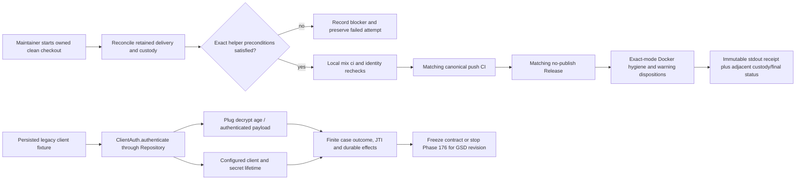

# Phase 175: Accepted Baseline & Verifier Compatibility Contract - Research

**Researched:** 2026-10-25
**Domain:** Lockspire baseline acceptance, legacy `client_secret_jwt` verifier compatibility, finite qualification contracts
**Confidence:** HIGH for code/repository seams; MEDIUM for Plug.Crypto public metadata-reader feasibility; LOW/UNRESOLVED for actual-caller age outcomes and policy selection

<user_constraints>
## User Constraints (from CONTEXT.md)

### Locked Decisions

- **D-01:** Adopt the coherent scoped recommendations from this discussion under the owner's explicit instruction to research through subagents and automatically follow the synthesized recommendations. Do not repeat technical preference questions already answered by repository evidence. This delegation does not turn unperformed qualification into a passing result or waive material scope-revision gates.
- **D-02:** Phase 175 execution owns retained-delivery reconciliation and fresh exact-main acceptance. Review the v1.48 planning branch's archival/interview/delivery delta against the intended current-main lineage, preserve unique commits and unknown work, and avoid blindly merging old milestone ancestry. Use an owned clean checkout and the existing acceptance helper, not a second acceptance mechanism.
- **D-03:** Acceptance must bind synchronized HEAD/local main/refreshed remote main, full local contributor checks, the helper's matching canonical push-CI and no-publish Release graph, and explicit dispositions for the exact-mode warnings actually emitted. Preserve stdout receipt bytes, exit status, command, observation time and digest; keep annotations beside the receipt. Preserve failed attempts separately. Broad hygiene warnings belong in the separate custody record unless exact mode actually emits them. Record a final checkout-status observation beside the receipt as well.
- **D-04:** Reuse Phase 174 as historical evidence without restamping it. Record resource purpose, custodian (or explicitly unknown original owner), identity/unique-work disposition, blocker and next action. Retention is a valid disposition for historical worktrees, databases, demo data, containers, volumes and build artifacts; cleanup is not an acceptance objective. Package publication remains separate.

### Finite contract and qualification ownership

- **D-05:** Produce a finite ledger with stable case IDs, requirement, actual caller/source seam, client/lifecycle state, code/config/key/write stage, storage composition, operation, expected return/protocol result, permitted mutations, preserved fields, redaction expectation, proof owner/phase, evidence identity/status and blocking disposition. Expand meaningful boundaries into individual cases; avoid an unrestricted Cartesian product or a duplicate release/proof framework.
- **D-06:** Phase 175 owns baseline, actual-caller legacy qualification and the frozen contract. Phase 176 owns configuration/envelope/writer/reader/rollout behavior. Phase 177 owns maintenance, contention/rollback, status, recovery and disclosure proof. Phase 178 owns both existing packaged dependency pairs, declared adapter composition, focused reviews and delivery. These are acceptance owners, not speculative downstream task plans.

### Credential identity and helper compatibility

- **D-07:** Dedicated persisted envelopes must bind the canonical persisted `client_id` and a verifier-specific purpose. Select the final client ID before material generation in direct registration and DCR; operator rotation uses the existing ID. Never use temporary identities or persist an identity-free dedicated fallback. Preserve coherent hash/verifier persistence and the existing one-time plaintext handoff on all credential-producing paths, including Basic/post clients that currently receive verifier material.
- **D-08:** Preserve the public zero-argument `rotate_secret_hash/0` return contract without newly requiring client identity or custody configuration: hash-only generation should not create discarded verifier material. Phase 175 must enumerate documented/exported material helpers, binary endpoint-secret overloads and explicit options, then freeze compatible behavior for legacy mode and clear failure for dedicated material calls missing identity. A genuinely necessary breaking public API change requires a recorded GSD revision before dependent planning.
- **D-09:** Preserve the current ciphertext-sensitive verified-credential fingerprint. If rewrap commits between JWT authentication and guarded issuance, retain fail-closed credential-change rejection, with no successful token/grant side effects. The assertion JTI may already be consumed; retry requires a new assertion/JTI. Do not remove ciphertext from the fingerprint, clear replay state or retry the same assertion to hide maintenance. Phase 177 must prove this race and the successful fresh-assertion retry using real PostgreSQL contention.
- **D-10:** Before promoting a row to dedicated/current-key custody, establish that the decrypted verifier agrees with the stored secret hash. Missing/invalid hash or divergent material is non-ready and remains unchanged with explicit recovery guidance. Do not add a per-request expensive hash check incidentally; this is a migration/check qualification boundary. Real secret rotation must continue invalidating stale credential authority.

### Purpose-specific configuration and strict representation

- **D-11:** Use existing OTP/Plug/Ecto primitives and a separate purpose-specific verifier configuration, independent of endpoint/session secrets and signing KEKs. Recommend one block with keys, selected write key, explicit legacy/dedicated write mode and explicit allow/reject legacy-read policy. The exact public names and accepted input grammar must be frozen in Phase 175's contract rather than improvised separately by later phases.
- **D-12:** Freeze these states: absent configuration with declared existing legacy compatibility; staged dedicated readers with legacy reads/writes; dedicated writes with legacy reads; dedicated writes with legacy rejection. Staging reader keys must not activate writes. Reader-only staging need not select a dedicated current write key; dedicated writing must. Legacy writes plus legacy rejection is contradictory. Invalid present configuration is never treated as absence or fallback.
- **D-13:** Qualify operation-local failure handling under SEC-02: malformed/missing verifier configuration must fail affected reads, verifier-producing writes and maintenance clearly and without disclosure, while existing unrelated supported authentication using hashes remains available. Do not copy signing configuration's raising boot path into a surprise whole-host outage. Startup/config diagnostics must make invalid custody visible; a process surviving invalid configuration must retain an invalid state, not silently become a legacy writer. Freeze exact typed internal results and their protocol/task mappings, including missing-key errors that the existing reader does not currently match.
- **D-14:** Prefer a resolved immutable runtime context per node until restart/redeploy. Task/diagnostic resolution must label its configuration observation and must not certify a different serving-node snapshot. No hot reload API or fleet coordinator is needed. Where explicit overrides are already supported, validate a complete context rather than partially merging keys/modes with ambient values. Keep legacy endpoint selection explicit at the integration boundary; do not add ambient application scanning to dedicated crypto.
- **D-15:** Enforce unique bounded key IDs and correctly decoded 32-byte keys, reject duplicate/unknown options and malformed encodings, and compare decoded bytes for duplicate keys and known configured cross-purpose reuse. Do not claim detection of arbitrary derived keys, unknown historic keys or remote-node reuse. Prefer matching existing safe key-input conventions over inventing another encoding dialect. Phase 175 freezes exact bounds after checking currently accepted caller inputs; proposed small limits are not existing guarantees.
- **D-16:** Use a distinct canonical ASCII text envelope, provisionally `LSCV1.<key_id>.<base64url_unpadded(payload)>`, with AES-256-GCM, a fresh 12-byte IV and exactly a 16-byte tag. Authenticate an unambiguous encoding of purpose, version/header/key ID and exact canonical client-ID bytes. Reserve the dedicated family marker: malformed/unknown dedicated input must never retry as legacy. Bound input before decoding, require canonical encoding and exact structural lengths, and reject unsupported versions, substitution and trailing payload data. Leave signing-envelope bytes and semantics unchanged. Phase 175 freezes exact bytes, authenticated inner metadata and compatible size limits before runtime planning; the example is a proposal until that qualification.

### Legacy age is an explicit policy gate

- **D-17:** Qualify real persisted clients through the actual ClientAuth/lifecycle caller with fresh valid assertions and distinct JTIs. Cover usable fresh legacy, authentic aged legacy, finite age boundaries, future timestamp, malformed/wrong-key material, missing verifier, disabled/expired app, configured secret expiry before/equal/after decision time, and legacy-v0 unlimited-lifetime controls. Use the real salt/key and authenticated historical `signed_at` fixtures without changing production age options. Record exact source/dependency identities and durable side effects. Injected assertion/lifecycle time does not age Plug's wall-clock payload.
- **D-18:** Preserve the distinction between Plug 2.2.1 finite-age behavior (future timestamps invalid; expiry when deadline is strictly before its wall clock) and configured client/secret expiry (expired at equality). Never use `max_age: :infinity` as a compatibility shortcut: it also skips Plug's future-time check. A two-day-old fixture demonstrates dependency behavior through the caller, not an adopter outage.
- **D-19:** No resurrection and no silent extension of migrated legacy validity. A usable 23-hour-old row must not gain a new day or lose its age boundary merely by rewrap. Recommend retaining its original authenticated timestamp/deadline in the dedicated payload, alongside existing configured lifetime checks. High-level Plug decrypt does not expose that metadata; Phase 175 must qualify a narrowly pinned authenticated metadata reader using existing public lower-level APIs, or classify unsupported/unrecoverable rows explicitly. Do not decrypt unauthenticated terms, depend on private functions, rewrap opaque endpoint-encrypted bytes, or claim age preservation from unchanged expiry columns alone.
- **D-20:** **Material qualification gate:** Native dedicated storage-age semantics and supported historical payload shapes must receive an explicit recorded disposition in Phase 175 before Phase 176 planning. The recommended native design uses configured credential lifetime rather than perpetuating Plug's incidental one-day storage timer; migrated finite-age rows retain their original boundary. This recommendation is not silently locked as a security-policy change by this discussion. Qualify its effect on current callers/support and use an explicit GSD policy revision if required. If safe metadata extraction cannot be proved, or the proposed split cannot fit approved policy, stop dependent planning with one coherent revision recommendation. Authorized secret rotation/reprovision remains recovery; do not weaken reads to force migration success.

### Store authority, preservation and truthful operations

- **D-21:** Support the built-in Ecto store and the declared existing shared-PostgreSQL delegating client/transaction adapter composition. Do not claim arbitrary backends. Direct registration/operator reads and configured DCR/rotation have asymmetric existing seams; enumerate them explicitly and prove the declared composition sees the same authoritative rows. No maintenance fallback to default Repo when the selected adapter is unsupported.
- **D-22:** Recommend an optional separately validated maintenance capability, leaving the existing lifetime contract unchanged. It must establish exhaustive bounded inventory with stable continuation/completion semantics, locked current-row authority, conditional verifier-only replacement and shared audit/transaction authority. Freeze public callback/capability/error semantics in Phase 175; ordinary internal module decomposition stays discretionary. Missing capability or mismatched authority fails before maintenance inspection/mutation rather than silently producing a partial default-store report.
- **D-23:** Under the selected transaction, use the row returned after lock wait, compare expected credential material, and never write ciphertext derived from stale unlocked material. Preserve every client field except verifier ciphertext, including hash, active state, metadata, management credentials, lifetime version/deadlines, rotation timestamps, `inserted_at` and `updated_at`; the atomic audit supplies the maintenance time. Separate actual secret rotation from custody maintenance. Conflicts, already-current results and failures are distinct. Audit failure must roll back ciphertext and successful-change audit together.
- **D-24:** Inventory all stored material, including Basic/post, inactive/expired clients, malformed and absent fields. Use bounded stable ordering rather than the ordinary name-sorted UI list. A restarted run may rescan from the beginning and skip verified current-key rows; no durable job platform is required. Partial scans, unreadable/unknown/mismatched rows and uninspected material cannot establish readiness. A database scan and local config do not certify fleet key parity, quiescence, backups or rollback safety.
- **D-25:** Freeze reader-first rollout: stage compatible code/read keys everywhere while retaining legacy writes; then explicitly activate dedicated writes. After any dedicated write, merely switching writes back does not permit old code. Retain compatible readers/keys for supported rollback; any old-code/data restoration needs separately proved compatibility. Later key retirement requires complete fresh inventory plus host-owned rollout/drain and backup/rollback disposition.
- **D-26:** Disclosure proof includes existing verifier-touching full-row reads/writes/locks, registration/DCR result structures, schema/domain Inspect, changesets, SQL diagnostics, raw query telemetry, logs, crypto/config errors, task reports, audits and protocol bodies. Use the existing sensitive-query mechanism for both logging and telemetry, plus appropriate schema/struct redaction and allowlisted errors. Neither `log: false` alone nor custom Inspect sanitizes raw telemetry/arbitrary maps. Sentinel proof must cover success and failure; do not publish sentinels/material in evidence.

### the agent's Discretion

- Choose concise qualification artifact filenames and fixture organization, reuse existing race/clean-room/helper patterns, and resolve routine implementation details within these contracts. Do not make every alternative a new dependency or reusable framework.
- Expand the finite case families in Specific Ideas into stable ledger rows, with a clear proof owner and blocker for each. No downstream implementation task count is prescribed.
- No UI redesign or new operator concept is selected. If later scoped copy changes are necessary, read `PRODUCT.md` first and use current `brandbook/` rather than the old prompt brand book.

### Deferred Ideas (OUT OF SCOPE)

- Runtime implementation, rewrap tooling and package journeys remain Phases 176–178; their proof ownership is frozen here without prematurely implementing them.
- Public API breaks, broadened adapter support or changed native/legacy lifetime policy require the explicit qualification/revision gate above, not casual downstream discretion.
- KMS/Vault, hot reload/fleet coordination, durable migration-job infrastructure, generic secrets platforms, new algorithms/protocol methods, schema/signing-format changes and new dependencies are outside the approved recommendation.
- UI quality remains the next substantial milestone candidate with its completed interview preserved. No UI redesign, Storybook installation, broad grant concurrency redesign, old-worktree deletion or package publication is selected.
</user_constraints>

<phase_requirements>
## Phase Requirements

| ID | Description | Research Support |
|----|-------------|------------------|
| VBASE-01 | "Maintainer can begin product implementation only after retained-delivery reconciliation and fresh exact-main acceptance through the existing helper, including local contributor checks, matching required CI/Release evidence and explicit resource custody." `[VERIFIED: .planning/REQUIREMENTS.md:12]` | Existing helper contract, immutable Phase 174 receipt/resource record, and exact-baseline execution tasks; fresh acceptance remains unperformed. |
| VBASE-02 | "Maintainer can inspect a finite acceptance contract covering format/key configuration, every verifier writer/reader, legacy ciphertext age, mixed-version rollout/rollback and supported storage adapters; unresolved policy changes stop dependent implementation." `[VERIFIED: .planning/REQUIREMENTS.md:13]` | Source seam map, actual-caller fixture path, API compatibility points, age reader feasibility, and finite ledger/proof ownership below. |
</phase_requirements>

## Summary

Phase 175 is a planning/evidence phase. It owns retained-delivery reconciliation and fresh exact-main acceptance using the existing `scripts/maintainer/repo_hygiene_check.sh --accept-sha` helper; it does not implement dedicated verifier encryption or run that acceptance during research. Historical Phase 174 already has a byte-preserved main receipt and resource custody inventory; retain it as historical evidence and generate a separate new receipt only when Phase 175 executes. The exact helper currently runs local `mix ci`, verifies synchronized SHA identity around checks, requires matching push CI and no-publish Release evidence, captures Docker hygiene, requires dispositions for exactly the warnings it emits, then prints its machine receipt. `[VERIFIED: scripts/maintainer/repo_hygiene_check.sh:597-629]` The helper supports `--accept-sha SHA`, `--warn-disposition LABEL=DISPOSITION`, and `--format json`; do not substitute a second acceptance mechanism. `[VERIFIED: scripts/maintainer/repo_hygiene_check.sh:17-40]`

The repository has an actual persisted DCR and lifetime integration fixture, while the existing JWT equality test uses process-local client and replay stores. `[ASSUMED]` A new/extended integration test should be able to persist a real legacy verifier, call `ClientAuth.authenticate` through `Repository`, and use fresh unique JTI assertions; this must be demonstrated as a Phase 175 case. The synthetic dependency probe in the milestone research proves only Plug behavior; it does not supply caller compatibility evidence or settle native age policy. `[VERIFIED: test/integration/client_secret_lifetime_registration_test.exs:13-24,45-75; test/lockspire/protocol/client_secret_lifetime_jwt_boundary_test.exs:15-57,81-105]`

The local pinned Plug.Crypto source shows a feasible narrow metadata reader: public `Plug.Crypto.KeyGenerator.generate/2` and `Plug.Crypto.MessageEncryptor.decrypt/3` recover authenticated message bytes before Plug's private age decoder. `[ASSUMED]` That path will remain usable and compatible on both supported dependency pairs until verified there. The public decrypt alone does not qualify accepted historical payloads or preserve safe decoding; Phase 175 must prove the exact decoded shapes and supported inputs through the actual caller, without using private functions or unauthenticated term decoding. `[CITED: https://raw.githubusercontent.com/elixir-plug/plug_crypto/v2.2.1/lib/plug/crypto.ex#L364-L386; https://plug-crypto.hexdocs.pm/2.2.0/Plug.Crypto.MessageEncryptor.html]`

**Primary recommendation:** Plan finite qualification artifacts and executable cases around the exact existing seams; leave unresolved native age/API/store policy as explicit blockers and require a GSD revision before dependent Phase 176 planning if qualification changes approved scope.

## Architectural Responsibility Map

| Capability | Primary Tier | Secondary Tier | Rationale |
|------------|-------------|----------------|-----------|
| Exact-main acceptance and retained-history custody | Repository/release tooling | Maintainer evidence | This is a helper-mediated repository acceptance task, not product runtime behavior. |
| Legacy verifier age and caller compatibility | Protocol/API | Database/storage | `ClientAuth` reads persisted verifier material and combines Plug payload-age semantics with configured client/secret eligibility. |
| Verifier writer/API compatibility contract | Domain/application boundary | Protocol registration and storage | Direct registration, DCR and operator rotation generate persisted credentials through different existing seams; public helper behavior is separately observable. |
| Future custody configuration/envelope and maintenance capability | Security core | Storage adapter | Purpose/key policy belongs in Lockspire's security boundary; inventory and atomic update require selected client/transaction authority. |

## Project Constraints (from AGENTS.md)

- Keep Lockspire a separate companion library and embedded Phoenix shape; do not move it into Sigra or require a standalone auth service.
- Preserve boundaries between protocol core, storage, generators, Plug/Phoenix, and LiveView/admin surfaces; keep the host seam narrow (accounts, claims, redirects, branding and product policy remain host-owned).
- Do not broaden v1 into SAML, LDAP/AD federation, hosted auth or full CIAM.
- Preserve the declared stack: Phoenix 1.8.5, LiveView 1.1.28, Ecto SQL 3.13.5, PostgreSQL 14+, Oban 2.21.x, OpenTelemetry 1.6.0; Bandit is for host/demo use, not a Lockspire dependency.
- Preserve PKCE S256, exact redirect matching, hashed client secrets, short-lived single-use authorization codes, refresh rotation/family revocation, no implicit flow, no `alg=none`, and strong redaction.
- Before any admin copy change, read PRODUCT.md personas/vocabulary; use “UI says” wording, add new concepts to the vocabulary map, and record retired wording. Phase 175 selects no UI changes.

## Standard Stack

### Core

| Library/tool | Version | Purpose | Why standard |
|---------|---------|---------|--------------|
| Lockspire existing Mix project | project-defined | Contract and ExUnit/integration evidence | Phase is repository qualification; no product dependency change is approved. `[ASSUMED]` The no-schema/no-new-runtime-dependency premise remains viable until Phase 175 qualification closes. |
| Plug.Crypto | `2.2.1` locked | Current legacy verifier envelope and age semantics | Existing direct dependency through Plug/Phoenix; no additional package. `[VERIFIED: mix.lock:44]` |
| ExUnit + Ecto SQL Sandbox | repository-locked | Real persisted caller fixture and narrow regression cases | Existing tests use Sandbox with `Lockspire.TestRepo`; `mix test.integration` is the repository integration alias. `[VERIFIED: test/integration/client_secret_lifetime_registration_test.exs:13-23; mix.exs:90-101]` |
| `repo_hygiene_check.sh` | repository-owned | Fresh exact-main baseline acceptance | Only approved exact-main acceptance mechanism. `[VERIFIED: scripts/maintainer/repo_hygiene_check.sh:17-40,597-629]` |

### Supporting

| Tool | Version | Purpose | When to use |
|------|---------|---------|-------------|
| Git / GitHub CLI (`gh`) / `jq` | local versions vary | Helper's synchronized main and hosted workflow checks | Phase 175 execution only; helper explicitly requires all three commands plus `mix`. |
| Docker | local version varies | Exact helper's demo-container hygiene checks | Required by helper's repo-owned Docker hygiene path; retain resources per D-04. |
| PostgreSQL-backed `Lockspire.TestRepo` | project test DB | Persisted legacy verifier and real `ClientAuth` caller qualification | Needed for actual stored-row evidence; use sandbox setup and no injected Plug wall-clock assumption. |

### Alternatives Considered

| Instead of | Could use | Tradeoff |
|------------|-----------|----------|
| Existing exact-main helper | New acceptance script/receipt schema | Prohibited duplication; existing helper already binds local gate and canonical remote workflows. |
| Actual persisted caller fixture | Current in-memory JWT boundary test alone | The in-memory test proves configured secret expiry equality but cannot establish decryption-age behavior through repository persistence. |
| Public low-level authenticated decrypt | Private Plug decoder or unsafe term parsing | Private APIs are unstable and bypass the explicit authenticity/shape qualification boundary. |

**Installation:** None. No external package is installed by this phase.

## Architecture Patterns

### Recommended qualification artifacts

Keep a compact source-to-case index and finite ledger in the Phase 175 evidence area; keep immutable helper stdout receipt bytes separate from annotations and custody records. Do not create another general receipt framework. The baseline reference already names the accepted historical receipt SHA-256 `f50652c307019bbe57ad2f4a2a24bbefbc830bfd6f00010431b68971b4c095dd`; Phase 175 must preserve those bytes and hash rather than re-stamping them. `[VERIFIED: .planning/milestones/v1.47-phases/174-packaged-proof-delivery-handoff/174-DELIVERY.md:30,65-67]`

| Artifact | Minimum content |
|----------|-----------------|
| Finite compatibility ledger | Stable case ID, requirement, caller/source seam, client/lifecycle state, persisted material, config/key/write stage, store composition, operation, expected protocol/task return, allowed mutation, fields preserved, redaction, proof phase, evidence identity/status and blocker. |
| Fresh acceptance receipt | Exact helper stdout bytes, actual exit status, exact command, observation timestamp, SHA-256, exact accepted SHA and helper's complete gate result. |
| Adjacent custody record | Retained worktree/resource, purpose, custodian or unknown original owner, unique-work/identity disposition, blocker, next action, and final checkout status. Keep prior attempts separate from any passing receipt. |
| Legacy-age qualification record | Dependency/source identity, persisted row projection (redacted), signed_at age, fresh assertion/JTI identity, result, durable JTI/audit/grant effects and configured expiry comparison. Never claim an adopter outage from a synthetic two-day fixture. |

### System flow and boundaries



This is the Phase 175 evidence flow only; it does not imply any of these acceptance runs or client fixtures have executed.

### Legacy caller qualification seam

`test/integration/client_secret_lifetime_registration_test.exs` starts `Lockspire.TestRepo`, enables manual SQL Sandbox, registers via `Registration.register`, fetches the persisted client, and authenticates via `ClientAuth.authenticate(..., client_store: Repository)`. Extend this actual database path or add a focused adjacent integration case: persist an authentic legacy verifier encrypted with the same endpoint secret base and salt as `Policy`, create a fresh HS256 assertion with distinct JTI per attempt, then authenticate via the repository-backed caller. Use `Plug.Crypto.encrypt(..., signed_at: ...)` only to create authentic test fixtures; do not alter production age config. Injected `now` controls assertion/client expiry, not Plug's `System.os_time` payload age. `[VERIFIED: test/integration/client_secret_lifetime_registration_test.exs:13-75; lib/lockspire/security/policy.ex:178-212; deps/plug_crypto/lib/plug/crypto.ex:233-241,412-425]`

Qualification cases should distinguish (at minimum) fresh valid, finite age just inside/at/over the one-day boundary, future signed_at, malformed/wrong-key, missing verifier, inactive or app-expired client, configured secret deadline before/equal/after injected time, and legacy-v0 unlimited configured lifetime. Use different JTIs so each observed auth attempt is independent and inspect replay/audit/grant effects separately. Ensure a 23-hour-old usable legacy verifier is tested against any proposed migration/deadline design so rewrap cannot rejuvenate it. Phase 175 records the explicit native age policy disposition; no Phase 176 plan may assume one until that gate is closed.

### Authenticated metadata-reader qualification

Current `Policy.unseal_client_secret_jwt_verifier/2` intentionally returns only plaintext verifier material; `Plug.Crypto.decrypt/4` then privately checks payload shape and age. The tagged implementation visibly calls public `MessageEncryptor.decrypt/3`, returning authenticated message bytes, before private `decode_message/1`. Public `Plug.Crypto.non_executable_binary_to_term/2` exists, but a qualification reader must still validate allowed historical shapes, exact timestamp units/ranges and age rules after authenticated decrypt. Never call private `decode_message/1` or interpret bytes before decrypt succeeds. `[CITED: https://raw.githubusercontent.com/elixir-plug/plug_crypto/v2.2.1/lib/plug/crypto.ex#L364-L386; https://raw.githubusercontent.com/elixir-plug/plug_crypto/v2.2.1/lib/plug/crypto.ex#L23-L41]`

```elixir
# Qualification sketch only; pin the parameters and shapes against the project's
# Plug.Crypto 2.2.1 source before using this in a migration/runtime.
derived = Plug.Crypto.KeyGenerator.generate(secret_key_base, salt)
{:ok, authenticated_bytes} = Plug.Crypto.MessageEncryptor.decrypt(ciphertext, derived, "")
authenticated_term = Plug.Crypto.non_executable_binary_to_term(authenticated_bytes, [:safe])
```

The sketch proves feasibility from public functions, not support for every historical payload or safe policy. Existing source recognizes the three authenticated term forms `{data, signed, max_age}`, `{data, signed}` and `%{data: data, signed: signed}`; the latter two inherit the one-day age. The standard tuple's signed time is milliseconds internally, while encryption's `signed_at` option is seconds. Phase 175 must reproduce each supported shape through `ClientAuth`; unsupported or unrecoverable material gets an explicit disposition and recovery path. `[CITED: https://raw.githubusercontent.com/elixir-plug/plug_crypto/v2.2.1/lib/plug/crypto.ex#L233-L241,364-386]`

### Public API/helper compatibility inventory

Freeze behavior for actual exported calls before writing downstream implementation plans. Existing source provides:

> `@spec rotate_secret_hash() :: {String.t(), String.t()}`
> `def rotate_secret_hash do`
> `  material = rotate_secret_material()`
> `  {material.client_secret_hash, material.client_secret}`
> `end`
> `[VERIFIED: lib/lockspire/clients.ex:86-90]`

> `@spec rotate_secret_material(keyword()) :: %{`
> `client_secret: String.t(),`
> `client_secret_hash: String.t(),`
> `client_secret_jwt_verifier_encrypted: String.t()`
> `}`
> `def rotate_secret_material(opts \\ []) when is_list(opts) do`
> `[VERIFIED: lib/lockspire/clients.ex:92-105]`

`Policy` also has binary endpoint-secret-base overloads and keyword-option forms for `seal_client_secret_jwt_verifier/2` and `unseal_client_secret_jwt_verifier/2`. Preserve the old no-identity compatibility behavior and one-time secret handoff where required; freeze how dedicated calls that lack canonical `client_id` fail. Do not encode proposed public names or exact API types as settled until the ledger/decision record explicitly qualifies them. `[VERIFIED: lib/lockspire/security/policy.ex:178-212]`

The current direct-registration order calls `normalize_client_attrs` and generates confidential shared secret material before it selects/generates `client_id`; DCR `generate_credentials/2` creates secret material before calling `Clients.generate_client_id`. This makes the stable-identity binding requirement a real implementation seam, not a presumed current guarantee. Operator rotation already has the persisted client available, but `Admin.Clients.rotate_client_secret/2` calls the no-identity material helper today. `[VERIFIED: lib/lockspire/clients.ex:139-150,190-225,244-251; lib/lockspire/protocol/registration.ex:484-503; lib/lockspire/admin/clients.ex:156-222]`

## Don't Hand-Roll

| Problem | Don't Build | Use Instead | Why |
|---------|-------------|-------------|-----|
| Exact-main delivery acceptance | A parallel SHA/CI/release checker or second receipt dialect | Existing `scripts/maintainer/repo_hygiene_check.sh --accept-sha` | It already validates same-SHA local and hosted evidence and warning dispositions. |
| Legacy authenticated encryption | A custom parser/decryptor for opaque old ciphertext | Pinned public Plug.Crypto KeyGenerator/MessageEncryptor APIs for qualification, then freeze the supported boundary | Only authenticated bytes can be interpreted; private internals and unauthenticated terms are unsupported. |
| Actual verifier compatibility evidence | Synthetic helper-only test treated as route proof | Existing repository-backed `ClientAuth.authenticate` integration fixture | It proves storage, caller, crypto and persisted replay effects at the relevant seam. |
| Contract ledger | Unbounded Cartesian matrix or duplicate proof framework | Stable finite cases assigned to Phases 175–178 per D-05/D-06 | Keeps proof ownership explicit and each unsupported case a visible blocker. |

**Key insight:** The biggest risk is an apparently successful qualification that tests the dependency in isolation or the caller with an in-memory client; neither establishes persisted legacy caller behavior, policy or side-effect boundaries.

## Common Pitfalls

### Mixing Plug payload age and configured client expiry

**What goes wrong:** Injecting a test clock may appear to test old ciphertext while only advancing JWT/client expiry; or using `max_age: :infinity` may accept future timestamps.
**Why it happens:** Plug uses wall-clock `System.os_time`; client/secret eligibility uses Lockspire's injected clock. Plug rejects future signed times and uses a strict `< now` deadline comparison, while Lockspire configured secret expiry is expired at equality.
**How to avoid:** Manufacture authenticated `signed_at` payloads relative to real wall clock, use independent unique assertions, and record both clocks/results. Compare source `validate_age` and actual caller outcomes.
**Warning signs:** Aged test only changes `now:`; repeated assertion reuses a JTI; acceptance changes age options to `:infinity` without future-time negative coverage. `[CITED: https://raw.githubusercontent.com/elixir-plug/plug_crypto/v2.2.1/lib/plug/crypto.ex#L412-L423; VERIFIED: test/lockspire/protocol/client_secret_lifetime_jwt_boundary_test.exs:15-47]`

### Treating a synthetic two-day payload as an adopter incident

The isolated probe confirms Plug.Crypto 2.2.1's default age behavior only. It did not authenticate a persisted Lockspire client or prove a production incident. Promote only a caller result with exact fixture/source/dependency identity and durable side-effect observations; keep native age semantics explicitly open until policy is recorded. `[VERIFIED: .planning/research/v1.48-client-auth-key-isolation/legacy_lifetime_probe.exs; .planning/research/v1.48-client-auth-key-isolation/PITFALLS.md]`

### Losing or changing immutable evidence

Do not copy annotations into helper stdout, edit a prior receipt, or interpret broad hygiene warnings as exact-mode emitted warnings. Preserve failed helper attempts separately. Historical worktree/resource owners can be unknown; say unknown and retain resource instead of inferring ownership or cleaning it up. Phase 174 records a failed first invocation with excess WARN dispositions, followed by a passing corrected invocation and exact stdout digest. `[VERIFIED: .planning/milestones/v1.47-phases/174-packaged-proof-delivery-handoff/174-DELIVERY.md:46-67]`

### Assuming the current code already binds verifier ciphertext to stable identity

Direct registration and DCR create verifier material before final `client_id`; client rotation currently calls the generic material helper. Ledger these as concrete compatibility/API qualification cases. Do not preserve ciphertext-sensitive credential fingerprints by weakening their identity input or make a zero-argument hash helper unexpectedly require verifier configuration. `[VERIFIED: lib/lockspire/clients.ex:86-105,139-150,190-225; lib/lockspire/protocol/registration.ex:484-503; lib/lockspire/admin/clients.ex:156-222]`

### Claiming custom-store support from ordinary client callbacks

Current `ClientStore` and `TransactionStore` contracts include lifetime and transaction callbacks but no dedicated verifier maintenance capability. The existing repository has mixed configured/default paths. Freeze only built-in Ecto and the declared shared-PostgreSQL delegating composition; an unsupported maintenance capability must fail before fallback inspection/mutation. `[VERIFIED: lib/lockspire/storage/client_store.ex:10-50; lib/lockspire/storage/transaction_store.ex:8-20; lib/lockspire/client_lifecycle.ex:14-35,69-97]`

## Validation Architecture

### Test Framework

| Property | Value |
|----------|-------|
| Framework | ExUnit; Python `unittest` for acceptance-helper/receipt contracts |
| Config file | `mix.exs` aliases and `test/test_helper.exs`; PostgreSQL test configuration in `config/test.exs` |
| Quick run command | `mix test test/lockspire/protocol/client_secret_lifetime_jwt_boundary_test.exs` (existing non-persisted control; not actual age qualification) |
| Full suite command | `mix ci` (exact helper's local contributor gate); `mix test.integration` (all integration tests) |

### Phase Requirements → Test Map

| Req ID | Behavior | Test Type | Automated Command | File Exists? |
|--------|----------|-----------|-------------------|-------------|
| VBASE-01 | Existing helper binds one exact synchronized main SHA to local `mix ci`, canonical CI, no-publish Release and exact warnings | acceptance/manual hosted evidence | `bash scripts/maintainer/repo_hygiene_check.sh --accept-sha "$ACCEPTED_SHA" --format json` plus only actual `--warn-disposition LABEL=DISPOSITION` values | ✅ helper; new immutable receipt/custody artifact required; no new acceptance helper |
| VBASE-01 | Historical receipts/resources remain unchanged and final checkout state is recorded | artifact/hash check | `sha256sum .planning/milestones/v1.47-phases/174-packaged-proof-delivery-handoff/174-MAIN-ACCEPTANCE.json` and reviewed phase custody checklist | ✅ receipt and `174-DELIVERY.md`; Phase 175 evidence artifact required |
| VBASE-02 | Real persisted legacy verifier age through caller, with separate Plug wall clock and configured expiry clock | PostgreSQL integration | `MIX_ENV=test mix test --include integration test/integration/client_secret_lifetime_registration_test.exs` (extend/add focused actual-caller cases) | ⚠️ existing persisted DCR/basic lifetime and synthetic JWT controls; caller-age matrix absent |
| VBASE-02 | Public metadata-reader payload shape and age mapping for supported legacy forms | focused ExUnit + integration | Add focused test beside integration fixture; execute through `ClientAuth.authenticate` for accepted forms and negative cases | ❌ qualification-specific test absent |
| VBASE-02 | Finite writers/readers, public helper behavior, states, store support, rollout and proof ownership | contract test/artifact review | Extend stable ledger with existing architecture/compatibility contract tests where appropriate; no command alone proves unrun future Phase 176–178 cases | ❌ Phase 175 ledger and API disposition not yet produced |

`mix test.integration` is defined as `test.setup` followed by `test --only integration test/integration`; `mix ci` runs QA/docs/audit/package build, fast tests, and integration tests. `[VERIFIED: mix.exs:90-101,130-156]` The checked-in test DB is configured as `LOCKSPIRE_TEST_DB_NAME || "lockspire_test"`, and `test_helper` prepares integration targets when explicitly requested; actual Postgres availability was not probed. `[VERIFIED: config/test.exs:18; test/test_helper.exs:1-17]`

### Sampling Rate

- **Per contract edit:** Run the narrow new test/artifact validation command for the changed ledger/receipt schema.
- **Per phase evidence merge:** Run the focused persisted-caller age test and any added contract validators.
- **Phase gate:** Fresh exact-main helper receipt and explicit unresolved blockers; exact-main acceptance is a Phase 175 execution task and was not run as research.

### Wave 0 Gaps

- [ ] Add a persisted `client_secret_jwt` actual-caller fixture using `ClientAuth` + `Repository` + `Lockspire.TestRepo`, with authentic age material and distinct JTIs.
- [ ] Add explicit metadata-reader shape/boundary tests only after confirming the public API path and safe term handling.
- [ ] Create the finite qualification ledger and receipt/custody record filenames; do not add a new framework or second acceptance helper.

## Environment Availability

| Dependency | Required By | Available | Version | Fallback |
|------------|-------------|-----------|---------|----------|
| Elixir / Mix | focused qualification and helper local gate | partial | `elixir` resolves to 1.20.4 / OTP 29; `mix` shim reports no ASDF version selected | Select a repository-supported Elixir/Mix pair before running qualification or exact acceptance; available ASDF installs include 1.19.5/OTP 28 and 1.18.4/OTP 27 |
| Git | source identity and worktree reconciliation | ✓ | 2.41.0 | — |
| GitHub CLI (`gh`) | exact hosted acceptance evidence | ✓ executable | 2.101.0; authentication not observed | No fallback; gate remains blocked until authenticated exact workflow evidence is readable |
| `jq` | helper receipt/response processing | ✓ | 1.7.1 | — |
| Docker | helper demo resource hygiene | ✓ executable | 29.5.2 | No fallback for exact helper Docker checks |
| PostgreSQL test service | actual persisted-caller qualification | unknown | not probed | No in-memory substitute for satisfying caller qualification; preserve as blocker if unavailable |

**Missing dependencies with no fallback:** An active Mix version, PostgreSQL service readiness, and authenticated GitHub access were not established. The exact helper will not be a valid pass until its runtime is selected and remote evidence can be read. No acceptance or test run was performed in this research.

## Code Examples

### Authenticated legacy metadata probe boundary

```elixir
# Qualification-only pseudocode using public Plug.Crypto APIs.
derived_key = Plug.Crypto.KeyGenerator.generate(secret_key_base, salt)
{:ok, authenticated_message} = Plug.Crypto.MessageEncryptor.decrypt(token, derived_key, "")
term = Plug.Crypto.non_executable_binary_to_term(authenticated_message, [:safe])
```

Source: [Plug.Crypto v2.2.1 tagged source](https://raw.githubusercontent.com/elixir-plug/plug_crypto/v2.2.1/lib/plug/crypto.ex#L23-L41) and [MessageEncryptor call boundary](https://raw.githubusercontent.com/elixir-plug/plug_crypto/v2.2.1/lib/plug/crypto.ex#L364-L386). This is not a complete reader: planner should create qualification tasks to verify exact key-derivation/cache parity, historical term shapes, timestamp conversion, safe decoding, age mapping, and execution through a persisted client. Do not copy it into product runtime without those outcomes.

## Assumptions Log

| # | Claim | Section | Risk if Wrong |
|---|-------|---------|---------------|
| A1 | `[ASSUMED]` A focused integration test can persist signed_at fixtures and then exercise the actual repository-backed JWT caller without changing production age options. | Architecture Patterns | If the test seam cannot isolate wall-clock payload age from configured expiry, VBASE-02 needs a revised qualification method before planning closes. |
| A2 | `[ASSUMED]` The public Plug.Crypto authenticated-message APIs remain usable for a narrowly pinned metadata reader on both supported dependency pairs. | Architecture Patterns | If package pair/API compatibility fails, migrated payload age cannot be preserved with the proposed approach; Phase 176 must wait for a scope/policy revision or explicit unrecoverable classification. |
| A3 | `[ASSUMED]` The current approved no-schema/no-new-runtime-dependency premise remains viable after exact helper/API/store qualification. | Summary / Open Questions | Discovery of a schema, dependency, breaking public API or broader adapter requirement requires explicit GSD scope revision. |

These are implementation feasibility assumptions, not verified outcomes; the planner must schedule their proof and preserve blocker dispositions.

## Open Questions

1. **What age policy applies to newly native dedicated verifiers?**
   - What we know: current high-level legacy decrypt honors embedded age with a one-day default; Lockspire independently checks configured app/secret lifetimes.
   - What's unclear: whether native dedicated verifier storage should inherit a one-day storage age or use configured credential lifetime, and whether proposed compatibility behavior needs formal policy revision.
   - Recommendation: material gate per D-20; record qualified caller behavior and an explicit owner-approved policy disposition before Phase 176 planning.
2. **Can supported historical authenticated payloads be read safely without private Plug internals?**
   - What we know: public KeyGenerator and MessageEncryptor can derive/decrypt and expose authenticated bytes; source lists three legacy shapes.
   - What's unclear: which shapes exist in Lockspire rows and whether every shape can safely preserve original age through migration.
   - Recommendation: qualify each relevant source shape with the pinned package and actual caller; otherwise classify explicitly unrecoverable and preserve secret rotation/reprovision as recovery.
3. **What exact public names/types cover verifier configuration and maintenance capability?**
   - What we know: lifetime contracts exist but do not specify maintenance; current helper APIs include public hash/material and binary/keyword crypto forms.
   - What's unclear: final stable names/grammar and missing-identity error contract.
   - Recommendation: Phase 175 must freeze contract in the ledger and keep any breaking API/store change behind GSD revision.

## Security Domain

### Applicable ASVS Categories

| ASVS Category | Applies | Standard Control |
|---------------|---------|-----------------|
| V2 Authentication | yes | Exercise real client JWT verification and preserve per-method auth behavior. |
| V3 Session Management | no direct phase behavior | No session changes; preserve host ownership. |
| V4 Access Control | yes | Distinguish inactive/expired clients and verifier-read failures; no false readiness. |
| V5 Input Validation | yes | Bound and strictly classify future envelope/key configuration cases in contract; malformed values fail closed. |
| V6 Cryptography | yes | Use pinned Plug/OTP primitives; authenticate before reading legacy metadata; never hand-roll cryptographic APIs or weaken existing fingerprint/JTI semantics. |

### Known Threat Patterns for Phoenix/Elixir embedded OAuth library

| Pattern | STRIDE | Standard Mitigation |
|---------|--------|---------------------|
| Stale or tampered verifier material accepted as live | Tampering / Elevation of privilege | Test authenticated legacy fixtures through persisted caller, separate configured expiry from storage age, fail malformed/wrong-key closed. |
| Old ciphertext silently rejuvenated by rewrap | Elevation of privilege | Preserve original authenticated deadline; compare pre/post successful legacy access boundary; stop if unsupported payload shape. |
| Invalid dedicated config silently falls back to legacy writer | Tampering / Repudiation | Invalid-present state must remain diagnosable and operation-local; explicitly test unrelated hash auth still works. |
| Receipt or resource ownership inferred/altered | Repudiation / Tampering | Preserve immutable receipt bytes and unknown owner status; record annotation separately. |

## Sources

### Primary (HIGH confidence)

- `AGENTS.md`; `.planning/REQUIREMENTS.md`; `.planning/STATE.md`; `.planning/ROADMAP.md`; `.planning/phases/175-accepted-baseline-verifier-compatibility-contract/175-CONTEXT.md` — project boundaries, requirements, decisions, and scope.
- `.planning/research/v1.48-client-auth-key-isolation/{BASELINE,ARCHITECTURE,PITFALLS,STACK}.md` and `legacy_lifetime_probe.exs` — predecessor evidence and probe limits.
- `scripts/maintainer/repo_hygiene_check.sh` — exact-main helper interface and execution contract.
- `.planning/milestones/v1.47-phases/174-packaged-proof-delivery-handoff/174-DELIVERY.md` — immutable Phase 174 receipt, prior attempt and resource custody.
- `lib/lockspire/security/policy.ex`; `lib/lockspire/clients.ex`; `lib/lockspire/protocol/registration.ex`; `lib/lockspire/admin/clients.ex`; `lib/lockspire/protocol/client_auth/client_secret_jwt.ex`; `lib/lockspire/client_lifecycle.ex`; storage contracts and repository client store — existing runtime/API seams.
- `deps/plug_crypto/lib/plug/crypto.ex`, `deps/plug_crypto/lib/plug/crypto/key_generator.ex`, `deps/plug_crypto/lib/plug/crypto/message_encryptor.ex`; `mix.lock` — locally installed Plug.Crypto 2.2.1 implementation and exact dependency lock.
- `test/integration/client_secret_lifetime_registration_test.exs`; `test/lockspire/protocol/client_secret_lifetime_jwt_boundary_test.exs`; `mix.exs`; `config/test.exs`; `test/test_helper.exs` — verified existing test seams and commands.

### Secondary (MEDIUM confidence)

- [Plug.Crypto v2.2.1 tagged source](https://raw.githubusercontent.com/elixir-plug/plug_crypto/v2.2.1/lib/plug/crypto.ex) — authenticated decrypt flow, public API/private decoder boundary, payload shapes and finite-age comparison; cross-checked against local `deps/` source.
- [Plug.Crypto.MessageEncryptor docs v2.2.0](https://plug-crypto.hexdocs.pm/2.2.0/Plug.Crypto.MessageEncryptor.html) — documents authenticated lower-level encryption/decryption API; exact v2.2.1 behavior is locally pinned and checked in source.

## Metadata

**Confidence breakdown:**
- Standard stack: HIGH — local `mix.lock`, `mix.exs`, and helper source read; no new package recommendation.
- Architecture: HIGH — source paths and call order read directly; unperformed tests remain clearly labeled.
- Legacy age metadata reader: MEDIUM — official tagged source and local package source agree on public decrypt path and payload format, but no implementation or caller qualification was run.
- Baseline acceptance outcome: LOW/UNRESOLVED — Phase 175 exact-main acceptance is explicitly unperformed; prior Phase 174 receipt is historical only.

**Research date:** 2026-10-25
**Valid until:** 2026-11-24 for repository paths/contract; recheck tool/runtime availability and remote main/CI evidence at Phase 175 execution.
