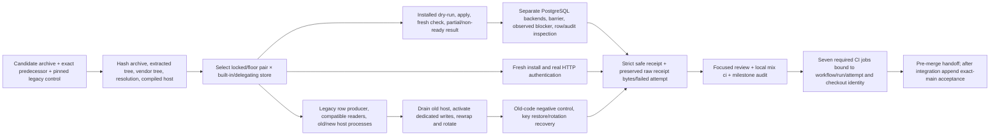

# Phase 178: Packaged Upgrade Proof & Delivery Handoff - Research

**Researched:** 2026-10-26  
**Domain:** Package-installed Elixir/Phoenix acceptance proof, PostgreSQL storage concurrency, evidence provenance, CI/release handoff  
**Confidence:** HIGH

<user_constraints>
## User Constraints (from CONTEXT.md)

### Locked Decisions

- **D-01:** Use the stable Phase 175 case IDs and acceptance contract. Preserve the Phase 176/177 exhaustive source owners and their exact tested identities; add actual installed-package evidence for the remaining adoption/composition boundaries. Source proof alone is insufficient, and an unrestricted product of every endpoint, parser failure, prefix, key and deployment stage is unnecessary. Missing required package cases are failures/blockers, never passing skips.
- **D-02:** Run the core fresh, legacy-upgrade, activation, key-rotation/rejection and recovery journeys in four cells: exact locked Phoenix 1.8.13 / LiveView 1.2.10 and exact floor Phoenix 1.8.5 / LiveView 1.1.28, each with built-in storage and the declared shared-PostgreSQL delegating client/transaction composition. Use shared scenario definitions and record actual host dependency locks/resolution plus Elixir/OTP/PostgreSQL identity. Keep the existing locked/floor CI runtime partitions; no floor upgrade is selected.
- **D-03:** Use accepted pre-verifier main `173059a166e9ade0f5f57c9980b7b2400a98538c` as the exact installed old-code predecessor for the bounded mixed-version journey. Separately execute a checksum-pinned public 1.6.1 legacy-producer/adopter control on the locked pair using the established prerequisite lifetime-upgrade path. Label its narrower environment/coverage and source identity independently; do not imply a complete public-release upgrade matrix from that control. Verify the existing pinned checksum/artifact before use. The lifetime-schema upgrade runner is precedent/prerequisite, not verifier-upgrade acceptance.
- **D-04:** Prove real old/new host processes reading/writing the same run-owned store while compatible readers retain legacy writes. Observe actual persisted writes and old/new read controls. Drain the old process before dedicated activation; then prove dedicated writes/reads, compatible-reader rollback and that switching writes back does not convert existing dedicated rows. Use an isolated negative control to demonstrate old-code rejection of dedicated material. Local processes do not prove host fleet parity, drain/quiescence, backup quality or rollback safety.
- **D-05:** Prove dedicated authentication over real mounted HTTP on the five existing JWT client-authentication endpoints (token, introspection, revocation, device authorization and CIBA), with fresh assertions/JTIs and the existing HS256/issuer-audience/replay/lifecycle rules. Preserve PAR rejection and FAPI exclusions, plus unaffected Basic/post controls. Exercise endpoint breadth once per dependency pair; do not repeat every endpoint at every transition or remove existing device/CIBA support.

### Harness shape, provenance and consumer boundaries

- **D-06:** Reuse package construction/binding, host preparation, process/DB ownership, redaction and strict-receipt helpers. Prefer a bounded verifier scenario group; a thin sibling runner sharing those helpers is appropriate if lifetime/admin coupling obscures the journey. Decouple generic dependency-pair selection from `admin_proof`; do not enable unrelated admin behavior to obtain floor dependencies. No cloned acceptance framework or new dependency.
- **D-07:** Record runner SHA separately from each artifact's proven source. Bind candidate and predecessor archive/tree, installed vendor tree, resolved dependency, compiled identity and host lock. `prepare_package` currently attributes the checkout SHA to external tar/Hex inputs: correct that attribution before relying on it. An old artifact's unknown source remains unknown unless independently established; a candidate requires a trustworthy source-to-artifact binding. A caller-supplied source string alone is insufficient. Preserve original receipt bytes and failed attempts.
- **D-08:** Extend the clean-room delegated store and its boundary allowlist narrowly with the existing maintenance behavior, inventory and compare-and-rewrap capabilities. Preserve selected client/transaction/audit participant agreement and callback witnesses. Prove unsupported/mismatched authority fails before inventory/fetch/write. Use ordinary host-owned modules and documented seams; never import checkout `test/support`, Lockspire's test Repo or a private production debug API into the installed host.
- **D-09:** Exercise installed `--dry-run`, apply and separate fresh `--check` commands, including partial/non-ready failure outcomes. Include one actual assembled running-release RPC smoke on the locked pair for the documented Mix-free API; distinguish its startup snapshot from bare Mix task-local configuration and unbooted `eval`. Fixture/control channels may prepare synthetic state and return allowlisted projections; public authentication outcomes must remain real HTTP observations.

### PostgreSQL, preservation and disclosure proof

- **D-10:** Execute selected contention/fault scenarios on both dependency pairs through the configured delegating composition, which uses the built-in PostgreSQL repository underneath. Use committed fixtures, independently checked-out connections, explicit barriers, distinct backend PIDs and the exact observed `pg_blocking_pids(contender)` relation before releasing the blocker. Cover rotation-first stale-maintenance conflict and maintenance-first coherent rotation; inspect authoritative rows after lock waits. Shared sandbox ownership or sleep-only assertions are insufficient.
- **D-11:** Prove actual valid audit INSERT failure with a reached-boundary witness (for example, the existing run-owned trigger/sequence pattern), unchanged ciphertext and absent committed audit. Invalid audit metadata now fails before mutation and is not equivalent. Also prove provisional low-level replacement followed by caller-owned outer rollback, and that the reporting API rejects an already-open transaction. Success reports/events must follow the selected outer commit. Compare sensitive rows in memory and emit safe booleans only.
- **D-12:** Prove unchanged hash/partner secret, lifetime version/deadlines, management material, metadata, last-secret-rotation time and inserted/updated timestamps through custody rewrap; only verifier ciphertext changes with its atomic audit. Cover repeat idempotence, partial progress/retry and fresh nil-cursor reconciliation. A wrapper that commits then simulates an unavailable response proves indeterminate-result handling, not real network-fault injection; label it accordingly. Do not claim rollback merely because the caller received an error.
- **D-13:** Reproduce maintenance after JWT authentication/JTI consumption and before the current-row issuance guard using a host adapter barrier and separate PostgreSQL connection. Require fail-closed stale identity, no successful issuance/grant side effects, same-JTI replay rejection and fresh-JTI retry success. Keep the ciphertext-sensitive fingerprint; no replay reset or hidden same-assertion retry.
- **D-14:** Preserve the approved native/configured-lifetime policy and authenticated migrated original finite deadline during package journeys. Expired migrated dedicated material may undergo custody-only rewrap but must remain ineligible to authenticate. Missing-key restoration preserves the partner secret; existing authorized secret rotation/reprovision replaces it through the one-time handoff. No age reset, hash reconstruction, automatic replacement or endpoint/signing custody changes.
- **D-15:** Register verifier plaintext, encryption-key bytes and ciphertext sentinels before child output/artifact processing. Capture representative installed success and forced crypto/storage failure across owned Logger, raw query telemetry, reports/CLI, audit and HTTP responses, while retaining exhaustive exact-source disclosure coverage. Preserve authorized explicit-secret transport and redact nested inspection. Host custom instrumentation and PostgreSQL server logging remain host-owned boundaries; do not silently change global logging policy.

### Evidence freshness, review and delivery

- **D-16:** Settle shipped source, proof harness, guidance and acceptance inputs before final expensive runs. Freeze a bounded input manifest and preserve source/package/candidate identities. Changed covered bytes require affected proof refresh; later evidence-only/GSD metadata requires explicit applicability reconciliation, not blanket reruns or relabeling old execution at a new SHA. Reassess affected prior verification owners without rewriting immutable historical observations or the frozen ledger.
- **D-17:** Complete focused security, source and integration review, all 18 requirement dispositions, canonical milestone audit, full local `mix ci` and the existing seven required hosted CI jobs. Bind evidence to exact candidate and executed checkout, workflow/event/run/attempt and complete job graph; preserve failed attempts. Local results do not prove hosted results. Do not assemble a green graph from incompatible attempts or waive actual behavior/gate gaps because document structure validates.
- **D-18:** Preserve GitHub PR CI's actual synthetic merge checkout identity separately from the reviewed head and package source. Record parents and tree/covered-input relationships when reconciling artifacts. Do not change checkout policy merely to simplify provenance or claim that a manually dispatched check automatically satisfies branch protection.
- **D-19:** Avoid a lifecycle cycle: pre-merge phase verification/milestone audit assesses implemented package outcomes and a truthful delivery handoff whose integration/main acceptance may be explicitly pending/blocked under roadmap criterion 4. Required package/security/candidate gaps still block their claims. After normal reviewed integration, append a dated acceptance/audit addendum. A pending integration handoff is not accepted main and cannot authorize the next milestone's implementation. Preserve actual merge/review authorization requirements; this research delegation is not exact-head merge approval.
- **D-20:** Use the single v1.48 milestone PR and existing exact-main helper after integration. Require synchronized `HEAD == local main == refreshed origin/main`, full contributor checks, matching canonical push-CI and no-publish Release graph, and dispositions for warnings actually emitted. Preserve stdout bytes plus command, exit, observation time, digest and final checkout status separately. Retain the original Phase 175 entry receipt unchanged; it cannot accept the integrated milestone.
- **D-21:** Align fresh-install/generator, upgrade, maintenance, diagnostics and support guidance with observed behavior and executable commands. Current supported-surface/release contracts and workflows override aspirational prompt guidance, including older tag-publish recommendations. No new admin surface is selected; any necessary UI wording still follows `PRODUCT.md` and current `brandbook/`, including retired wording. Keep maintainer evidence details out of adopter flows unless needed to make an operational decision.
- **D-22:** Record dated resource custody: identity, custodian or unknown original owner, purpose, unique-work disposition, retention/cleanup trigger, blocker and next action. Clean only exact run-owned ephemeral resources when safe; preserve unknown edits/history/worktrees/databases/demo data and immutable receipts. Refresh the rolling ranking using actual outcomes; UI quality remains next with completed Q1–Q10/final confirmation intact. OPS-03/KEK-04/token work retain evidence triggers. Publication stays separate under Release Please/protected exact-ref release controls.
- **D-23:** Retain Phase 177 E-09/E-10 and descriptorless non-authoritative prohibition flags with their original status/provenance, plus any other actual prior flags relevant to final review. Do not fabricate human review, suppress unresolved flags or relabel structural/judgment checks as runtime proof. Concrete behavioral gaps remain blocking independently of advisory lifecycle bookkeeping.

### the agent's Discretion

- Choose runner/module/receipt filenames, exact scenario grouping and bounded fixture/control plumbing within these decisions. Favor small auditable glue and existing Elixir/OTP/Plug/Ecto/Phoenix facilities.
- Resolve routine matrix deduplication, harness factoring and review/gate ordering without another preference interview. Escalate only a demonstrated security/public API/support/scope conflict or a genuinely required consequential-action authorization.
- Further research should target concrete unresolved compatibility/proof questions; three independent scoped analyses have reached diminishing returns for generic comparisons. Implementation and actual execution must settle remaining evidence.

### Deferred Ideas (OUT OF SCOPE)

- Package publication, manual tags/release dispatch, fleet coordination/hot reload, backup-key destruction, arbitrary-store support and a generic secrets platform.
- Full Cartesian repetition of source-only malformed-input cases, new chaos/provenance frameworks, speculative optimization/indexes and new runtime dependencies.
- UI quality implementation and Storybook remain a future milestone with the completed interview preserved; token lifecycle, OPS-03 and KEK-04 retain evidence triggers.
</user_constraints>

<phase_requirements>
## Phase Requirements

| ID | Description | Research Support |
|----|-------------|------------------|
| VPROOF-02 | Reproduce source-bound package-installed fresh/legacy-upgrade, mixed-key/version, rotation, rejection and recovery journeys on the supported dependency pairs, including actual PostgreSQL concurrency/rollback and a supported configured-store composition; unavailable cases remain blockers. | Four-cell acceptance group; source-bound archive/tree/installed-vendor/resolved-dependency/compiled-host receipt; configured adapter boundary and PG barrier witnesses; separately labeled pinned 1.6.1 control. |
| VDELIV-01 | Provide completed milestone audit, focused security/code review, all requirement dispositions, passing local and hosted candidate gates, and accurate install/upgrade/support guidance within current scope. | Review/audit order, `mix ci`, canonical seven-job workflow receipts, documentation reconciliation, exact identities, and explicit pre-merge pending state. |
| VDELIV-02 | Leave a dated delivery/main-acceptance and resource-custody handoff that preserves unknown work and refreshes the next-candidate ranking. | Existing exact-main hygiene helper, evidence freshness manifest, main acceptance addendum, custody inventory, UI quality next with completed interview preserved. |
</phase_requirements>

## Summary

Implement this phase as a small package-installed verifier scenario group that reuses `package_input.py`, `build_provider.py`, the clean-room provider template, redaction primitives, and strict selected receipts. The current source-level proof already covers the exhaustive algorithm and policy matrix; the new group should own package/adopter seams, two supported dependency pairs crossed with built-in and declared PostgreSQL delegating storage, the bounded mixed-version transition, installed maintenance CLI and one running-release RPC call. Keep endpoint breadth once per pair, as fixed by the context. [VERIFIED: 178-CONTEXT.md:16-45; scripts/acceptance/clean_room/build_provider.py:42-54]

Correct package provenance before emitting receipts. `prepare_package` currently assigns `source_revision()` to tar and Hex source identities even though those bytes are external; preserve the runner checkout SHA as a distinct field and bind the archive checksum, extracted tree digest, installed vendor digest/path, resolved dependency and compiled identity. The package candidate and the old-code predecessor require direct source-to-artifact proof; the checksum-pinned public 1.6.1 legacy control is a separate, narrower artifact case. [VERIFIED: scripts/acceptance/clean_room/package_input.py:408-457]

The high-risk evidence seam is installed-host storage authority. Extend only the test-owned delegated store and consumer boundary allowlist, then prove the same selected client/transaction/audit participants reach the PostgreSQL repository. Port the Phase 177 independently checked-out backend PID/barrier pattern to package hosts; capture `pg_blocking_pids(contender)` containing the blocker before releasing it, then inspect persisted client and audit rows. The release handoff must treat package proof, local `mix ci`, hosted workflow graph, and post-integration exact-main acceptance as separate evidence events. [VERIFIED: test/support/client_verifier_maintenance_concurrency.ex:18-87; .planning/phases/178-packaged-upgrade-proof-delivery-handoff/178-CONTEXT.md:29-45]

**Primary recommendation:** Add a bounded, receipt-validated `clean_room_verifier_upgrade` runner alongside the clean-room acceptance tooling; first decouple dependency-pair selection from `admin_proof` and fix artifact/source attribution. Reuse the existing provider builder, runtime identity checks, process/database ownership, package verifier, and public installed API. Do not add dependencies or modify the already accepted protocol/storage policy.

## Architectural Responsibility Map

| Capability | Primary Tier | Secondary Tier | Rationale |
|------------|-------------|----------------|-----------|
| Build/install package and bind artifacts | Test harness / package boundary | Phoenix host | Harness constructs the archive and validates that the host resolves the vendored package rather than checkout source. |
| OAuth/OIDC authentication outcomes | API / Backend | Browser/HTTP test client | Installed provider host owns routes and protocol outcomes; tests observe real mounted HTTP. |
| Verifier state, rotation and audit | Database / Storage | API / Backend | Storage adapter and PostgreSQL own persisted row authority, atomic writes and audit commit. |
| Maintenance CLI/RPC | API / Backend | Release runtime | Mix task runs in host context; Mix-free API is exercised through RPC against a booted release. |
| Evidence receipts and handoff | Test harness / maintainer workflow | CI | Allowlisted receipts bind source/artifact/runtime identities; workflows establish candidate and main evidence separately. |

## Standard Stack

### Core

| Library | Version | Purpose | Why Standard |
|---------|---------|---------|--------------|
| Elixir / Mix | Project and CI locked versions; do not raise floor | Acceptance runners, package install, focused tests, release build | The project is an Elixir library and its installer, tasks, and configured stores are Mix/Phoenix-facing. [VERIFIED: mix.exs:90-195; .github/workflows/ci.yml:258-280] |
| Phoenix / LiveView | Locked `1.8.13 / 1.2.10`; floor `1.8.5 / 1.1.28` | Supported host dependency pair selection | These are existing exact proof pairs; package suite should record actual resolved host dependencies. [VERIFIED: scripts/acceptance/clean_room/build_provider.py:42-54] |
| Ecto SQL / PostgreSQL | Existing dependency locks; PostgreSQL versions from current CI/runtime identity | Delegated client/transaction storage and contention evidence | The supported custom composition delegates into the built-in PostgreSQL repository; distinct connections expose database lock behavior. [VERIFIED: test/support/client_verifier_maintenance_concurrency.ex:18-87; .github/workflows/ci.yml:302-328] |
| Python 3 | Existing runtime | Package input, clean-room host runner, receipts and safe output projection | Existing acceptance harness and CI wrapper are Python/Bash; extend their seams instead of introducing a new framework. [VERIFIED: scripts/acceptance/clean_room/package_input.py; scripts/ci/run_host_integration_proof.sh] |

### Supporting

| Library/tool | Version | Purpose | When to Use |
|--------------|---------|---------|-------------|
| PostgreSQL `pg_backend_pid()` and `pg_blocking_pids()` | PostgreSQL 14+ API | Prove independent connections and real lock contention | Selected rotation-first and maintenance-first cases; compare observed blocker PID before releasing the transaction. [CITED: https://www.postgresql.org/docs/14/functions-info.html] |
| `:crypto`, Plug, Ecto, Phoenix | Existing locked dependencies / OTP | Existing verifier primitives and host integration | Reuse through installed Lockspire public facades and documented store callbacks; no dependency addition. |
| GitHub Actions | Existing canonical workflow | Candidate CI evidence and complete required-job graph | Record workflow event/run/attempt, head and actual checkout (including synthetic merge SHA), parents/tree and all jobs. [CITED: https://docs.github.com/en/actions/reference/workflows-and-actions/events-that-trigger-workflows] |

**Installation:** No new package installation is selected. Build the candidate archive and install it into the isolated clean-room host using the existing helper path. The acceptance run's external environment requires Mix/Elixir/OTP, reachable PostgreSQL, and existing Python/Bash. 

### Alternatives Considered

| Instead of | Could Use | Tradeoff |
|------------|-----------|----------|
| Reuse package-input and host-preparation helpers | Clone a separate acceptance framework | Rejected by locked D-06; cloning forks provenance, ownership and redaction logic. |
| Four bounded pair/store cells | Full cross-product of every endpoint × parser error × key × rollout state | Rejected by D-01/D-05; repeats already-owned exhaustive source proof without adding adopter-boundary evidence. |
| A thin sibling verifier runner | Enable `admin_proof` to get floor dependencies | The current builder gates floor selection behind `admin_proof`; that option couples unrelated browser/admin preparation into verifier acceptance. Decouple the generic pair selection. |

## Architecture Patterns

### System Architecture Diagram



### Recommended Project Structure

```text
scripts/acceptance/
├── clean_room_verifier_upgrade.py       # finite package journey and stage control
└── clean_room/
    ├── verifier_receipts.py             # strict scenario/count/identity validation
    ├── package_input.py                 # fix external artifact source attribution
    ├── build_provider.py                # generic locked/floor pair selection
    └── provider_host/lib/clean_room_provider/
        └── verifier_maintenance_store.ex # host-owned narrow delegated adapter
test/clean_room/provider_host/...         # adapter/barriers and fixture channels only
test/acceptance/...                       # runner contract/self-tests, if not co-located
```

The names are discretionary. Keep runner SHA separate from artifact source SHA; never import checkout `test/support`, `Lockspire.TestRepo`, or production-private debug APIs into the installed consumer host. [VERIFIED: 178-CONTEXT.md:23-27]

### Pattern 1: Artifact-to-installed-host binding

**What:** Keep separate identities for the harness checkout, candidate artifact, predecessor artifact, installed vendor tree, resolved dependency path and compiled host. Verify archive checksum and extracted tree before starting a child; after `mix deps.get --check-locked` and compile, verify that lockfile bytes remain unchanged and the resolved dependency points below that host's vendor directory.

**When to use:** Every package candidate and predecessor run; use public 1.6.1 only when its independent checksum/artifact check passes.

**Example:** Existing `verify_child` runs `mix deps.get --check-locked`, records the dependency path, compares pre/post manifest and lock bytes, then asserts the resolved path is the vendored package. Extend its identity record instead of relying on a user-supplied source string. [VERIFIED: scripts/acceptance/clean_room/package_input.py:486-556]

### Pattern 2: Delegated store boundary

**What:** Configure host-owned `client_store` and `transaction_store` modules that implement the public storage behavior and delegate operations into the built-in repository. Keep `audit_store` and transaction-authority participants aligned. Add only maintenance contract, inventory and compare-and-rewrap callbacks to the host and boundary allowlist.

**When to use:** Both pair variants' configured PostgreSQL storage cells. Run unsupported and mismatched authority cases before inventory/fetch/write, with callback witnesses.

**Example:** `Lockspire.TestSupport.DelegatedVerifierMaintenanceStore` already demonstrates `lifetime_contract/0`, transaction authority participant replacement, maintenance contract variants, inventory and CAS delegation; translate the needed small behavior into the package-owned host fixture, not into the installed source tree. [VERIFIED: test/support/delegated_verifier_maintenance_store.ex:1-73]

### Pattern 3: Evidence-based PostgreSQL lock choreography

**What:** Commit seed data. Start holder and contender under separate unboxed connections, record each `pg_backend_pid()`, pause with explicit mailbox barriers, poll `SELECT pg_blocking_pids($1)` for the exact blocker PID, and only then release the holder. Query authoritative persisted rows after both operations complete.

**When to use:** Rotation-first stale maintenance conflict; maintenance-first replacement then coherent rotation; audit insert failure/outer rollback and issuance race scenarios selected by D-10 through D-13.

**Example:** The current support helper emits ready/provisional messages and uses separate connections, and checks `blocker_pid in blockers` before transaction release. PostgreSQL documents `pg_blocking_pids` as the process IDs blocking a backend from acquiring a lock. [VERIFIED: test/support/client_verifier_maintenance_concurrency.ex:18-78] [CITED: https://www.postgresql.org/docs/14/functions-info.html]

### Pattern 4: Safe receipt projection

**What:** Define a fixed required scenario set; reject missing, duplicate, unknown, skipped, wrong-pair, stale-run, wrong-source/package, or failed scenarios. Keep raw process/browser output private and redact sentinels before any child output is parsed or receipt/artifact is processed. Receipts contain only allowlisted IDs, booleans, counters, safe failure enums and hashes.

**When to use:** All matrix cells and release/main gate evidence. Preserve failed receipt bytes and attempts as immutable observations.

**Example:** Reuse `selected_receipts.py` shape/reconciliation helpers and `redaction.py` sentinel registry. Admin receipt parsing demonstrates strict expected-case and source/package binding, but verifier cases need their own finite contract. [VERIFIED: scripts/acceptance/clean_room/selected_receipts.py; scripts/acceptance/clean_room/redaction.py]

### Finite scenario matrix

| Cell | Pair | Store | Required scope |
|------|------|-------|----------------|
| L-B | locked | built-in | Fresh/legacy install; activation and old/new reader/writer controls; key rotation/rejection/recovery; maintenance CLI and RPC setup where applicable; selected PG witnesses run through this cell's host. |
| L-D | locked | delegated PostgreSQL client/transaction composition | Same shared core scenario definitions; authority agreement and unsupported/mismatch controls; contention, valid audit INSERT failure, outer rollback and stale-issuance race. |
| F-B | floor | built-in | Same shared core scenarios with observed floor lock/runtime identity. |
| F-D | floor | delegated PostgreSQL client/transaction composition | Same shared core scenarios and selected PostgreSQL witnesses with actual floor host lock/runtime identity. |
| L-1.6.1 | locked | established legacy prerequisite path | Separate checksum-pinned public 1.6.1 legacy-producer/adopter control; label narrower coverage/source independently, not as a fifth full matrix cell. |

Within each dependency pair, exercise mounted HTTP endpoint breadth once: token, introspection, revocation, device authorization and CIBA; preserve PAR rejection, FAPI exclusion, Basic/post unaffected controls. The locked-pair actual assembled-release RPC smoke calls the documented Mix-free API on a booted host and records it separately from bare Mix task-local configuration or unbooted `eval`. [VERIFIED: 178-CONTEXT.md:18-21,27]

### Anti-Patterns to Avoid

- **Calling `source_revision()` the source of an external tar/Hex archive:** it identifies the harness checkout, not artifact provenance. Leave source unknown absent direct binding.
- **Using `admin_proof` only to unlock `floor`:** it prepares unrelated admin/browser fixtures; separate pair selection from admin proof.
- **Importing checkout test support into an installed host:** it bypasses the consumer boundary and can make package proof pass only from the checkout.
- **Treating callback error as rollback evidence:** use the reached valid audit INSERT witness and inspect durable ciphertext/audit state.
- **Treating a shared Sandbox owner, sleep, or wrapper-reported conflict as contention proof:** require separate backend PIDs and the observed PostgreSQL blocker relation.
- **Claiming local proof implies fleet parity, old-node drain, backup validity or rollback safety:** those remain host/operator-owned and must be described as limits.
- **Combining workflow jobs across incompatible runs or restamping historical evidence:** bind exact candidate, actual checkout, workflow/event/run/attempt and full job graph; record synthetic merge identity.
- **Closing delivery acceptance before merge:** pre-merge handoff may remain explicitly pending/blocked; add dated exact-main acceptance only after normal integration.

## Don't Hand-Roll

| Problem | Don't Build | Use Instead | Why |
|---------|-------------|-------------|-----|
| Package extraction, install and dependency binding | A second archive verifier / resolver | `package_input.py` and `build_provider.py` | These already hash/extract archives, isolate child paths, verify lock bytes and bind compiled candidates. |
| Receipt safety/redaction | General evidence/receipt framework | `selected_receipts.py`, `redaction.py`, strict per-scenario validator | Existing patterns already normalize safe outputs and reject incomplete or mismatched receipts. |
| Database contention witness | Timing-only race harness | PostgreSQL backend PIDs, barriers and `pg_blocking_pids` | The database exposes the actual blocker relationship and durable final rows. |
| Release RPC semantics | Direct unit call or unbooted eval | One assembled release process plus `bin/<release> rpc ...` | `rpc` reaches a running release; `eval` starts an unbooted VM and is not the required live configuration proof. [CITED: https://mix.hexdocs.pm/1.19.5/Mix.Tasks.Release.html] |
| Protected main acceptance | A handcrafted summary of CI | `scripts/maintainer/repo_hygiene_check.sh --accept-sha ... --format json` after integration | The helper binds synchronized refs, local contributor checks and matching canonical hosted evidence. |

**Key insight:** This phase's hard part is demonstrating the same source-bound package and supported host composition across version transitions and real storage authority. More scenario volume cannot compensate for wrong artifact provenance, a checkout-backed fake host, or an unobserved database lock.

## Common Pitfalls

### Pitfall 1: Source provenance conflates harness and artifact

**What goes wrong:** Candidate or predecessor receipts claim the current checkout as the archive's source even when the tar/Hex bytes are from elsewhere.  
**Why it happens:** `prepare_package` uses `source_revision()` when constructing `PackageIdentity` for tar and Hex inputs.  
**How to avoid:** Split runner SHA from artifact source proof; use independently observed archive checksum and extracted tree binding, package metadata/source attestation when available, and keep unknown unknown. Verify the public 1.6.1 checksum/artifact before running its control.  
**Warning signs:** A caller-provided SHA/source label is the only link between artifact and claimed commit; receipt package path resolves to checkout.

### Pitfall 2: Floor host selection drags in admin proof

**What goes wrong:** The verifier package journey runs unrelated admin UI/browser instrumentation merely to select floor dependencies.  
**Why it happens:** Current builder checks floor selection only when `admin_proof=True`.  
**How to avoid:** Move generic pair/lock selection out of `admin_proof` gating and retain admin-specific overlays behind that flag.  
**Warning signs:** Pair proof requires Chrome/CDP or admin overlay files to prepare the host.

### Pitfall 3: Package adapter is incomplete or crosses into checkout internals

**What goes wrong:** Installed host has lifetime/client/transaction callbacks but cannot exercise maintenance authority, inventory/CAS or boundary policy; fallback imports test Repo or private production APIs.  
**Why it happens:** Current clean-room adapter is lifetime-focused and the package boundary allowlist only anticipates its earlier scope.  
**How to avoid:** Add the narrow public maintenance behavior to host-owned modules and permit only those exact sources. Assert participant agreement and unsupported/mismatch callbacks run before inventory/fetch/write.  
**Warning signs:** Child source contains `test/support`, `Lockspire.TestRepo`, or direct private repository implementation references.

### Pitfall 4: “Rollback” does not demonstrate that audit insertion was attempted

**What goes wrong:** Invalid audit metadata is rejected before mutation, yet the test calls it atomic rollback proof.  
**Why it happens:** Validation fails earlier than the transaction's audit INSERT boundary.  
**How to avoid:** Use valid metadata with a run-owned trigger/sequence witness that confirms the INSERT statement was reached and failed, then check ciphertext unchanged and no committed audit. Separately force caller-owned outer rollback after provisional change.  
**Warning signs:** The test only asserts an error result or invalid metadata and never proves entry to the audit insert.

### Pitfall 5: Delivery lifecycle claims are ahead of evidence

**What goes wrong:** Candidate local checks, hosted workflow results, review, main integration and protected acceptance are collapsed into a single green statement.  
**Why it happens:** Workflow PR checks can execute on a synthetic merge checkout, and exact-main helper runs only after integration.  
**How to avoid:** Freeze proof inputs, keep candidate and executed checkout IDs distinct, bind all required jobs to same run/attempt and record pre-merge pending status. Append a dated post-integration exact-main audit/acceptance addendum.  
**Warning signs:** Workflow head SHA is used as actual checkout SHA without checking; a manual dispatch is claimed to satisfy branch protection; `HEAD`, local main and refreshed remote main differ.

## Code Examples

### Existing package pair and runtime identity pattern

```python
PROOF_PAIR_VERSIONS = {
    "locked": ("1.8.13", "1.2.10"),
    "floor": ("1.8.5", "1.1.28"),
}
```

The exact mapping is quoted from `build_provider.py`; record the actual `mix.lock` hash and actual resolved versions as well. [VERIFIED: scripts/acceptance/clean_room/build_provider.py:42-54]

### Existing real blocker check pattern

```elixir
%{rows: [[pids]]} =
  repo.query!("SELECT pg_blocking_pids($1)", [contender_pid],
    log: false,
    telemetry_event: nil
  )

if blocker_pid in pids, do: {:ok, pids}, else: {:error, pids}
```

The context explicitly requires the observed blocker relation before releasing the holder. PostgreSQL describes this function as returning process IDs blocking the specified server process from acquiring a lock. [VERIFIED: test/support/client_verifier_maintenance_concurrency.ex:55-78] [CITED: https://www.postgresql.org/docs/14/functions-info.html]

### Installed maintenance and release smoke command shapes

Use an isolated package host and run three separate invocations against that host; the examples already documented for the operator surface are:

```bash
mix lockspire.clients.verifier.rewrap --dry-run --limit 100
mix lockspire.clients.verifier.rewrap --limit 100
mix lockspire.clients.verifier.rewrap --check --limit 100
bin/app rpc "Lockspire.Admin.ClientVerifierMaintenance.run(mode: :dry_run, limit: 100)"
```

The task semantics and Mix-free RPC are documented in the current guide. Replace fixture paths and `bin/app` with the generated host/release path; prove apply completion and fresh beginning-to-end `--check` separately. [VERIFIED: docs/client-secret-verifier-configuration.md:50-68] `rpc` must connect to the running release, while `eval` uses a new VM without starting release applications. [CITED: https://mix.hexdocs.pm/1.19.5/Mix.Tasks.Release.html]

## State of the Art

| Old Approach | Current Approach | When Changed | Impact |
|--------------|------------------|--------------|--------|
| Lifetime upgrade runner as end-to-end verifier acceptance | Reuse its package/provenance/host setup patterns, but own verifier-specific cases and receipt separately | Phase 178 decision D-03 | Lifetime schema proof remains prerequisite, not acceptance of verifier upgrade. |
| Select floor by turning on admin proof | Select dependency pair generically; turn on admin overlay only for admin tests | Phase 178 decision D-06 | Avoid browser/admin coupling and duplicated fixture preparation. |
| Treat `eval` as proof of running release configuration | Use `rpc` against one assembled, started release | Phase 178 D-09; Mix 1.19.5 docs | Proves the running node's startup configuration snapshot and Mix-free operator API. |
| Report post-merge acceptance in pre-merge phase completion | Report truthful pending integration/main handoff, append dated addendum after integration | Phase 178 decisions D-19/D-20 | Breaks verification/merge lifecycle cycle without claiming acceptance early. |

**Deprecated/outdated:** The old prompt's manual tag/publish recommendation does not govern this phase; the locked context says current supported-surface/release contracts and protected exact-ref workflows govern delivery. Package publication remains separate.

## Assumptions Log

| # | Claim | Section | Risk if Wrong |
|---|-------|---------|---------------|
| — | No unresolved research assumption is needed for the scoped plan. Runtime execution must still discover and record actual matrix-cell dependencies and prove each required scenario; no run is claimed by this research. | — | Missing or unavailable execution evidence is a blocker under the locked requirement/context. |

## Open Questions

1. **Which exact public 1.6.1 artifact checksum/source attestation is already pinned for this repository's legacy control?**
   - What we know: `package_input.py` can accept a local tar/Hex version and expected SHA; context requires a checksum-pinned public 1.6.1 control and says verify the pinned artifact before use.
   - What's unclear: The scoped source inspection did not establish a 1.6.1 checksum binding to the public artifact.
   - Recommendation: Planning should locate the prior accepted pin in canonical retained evidence; if none exists, block that control until the public artifact/checksum is independently verified. Keep source unknown rather than assigning checkout SHA.

2. **Which exact hosted workflow attempt constitutes the candidate's complete required job graph?**
   - What we know: CI has existing locked/floor partitions and context requires seven required hosted jobs bound to one candidate/checkout workflow run/attempt.
   - What's unclear: No Phase 178 candidate workflow run exists yet; final job graph and synthetic merge checkout identity must be captured at execution time.
   - Recommendation: Do not freeze a speculative run ID in the plan; add execution tasks to query and validate the actual candidate workflow and preserve the full graph.

## Environment Availability

| Dependency | Required By | Available | Version | Fallback |
|------------|------------|-----------|---------|----------|
| Elixir / Mix | Build package hosts and run project gates | ✓ | Default shell reports Elixir 1.20.4 / OTP 29; 1.20.2 / OTP 29; 1.19.5 / OTP 28 are installed | Use the existing phase-specific ASDF version selections for canonical runs; don't infer matrix coverage from default shell. |
| PostgreSQL client/server | Persisted package host and lock witnesses | ✓ | `pg_isready` reports local `/tmp:5432` accepting connections; exact server version not probed | Use run-owned database and record server identity; unavailable DB blocks required PG cells. |
| Node.js | Existing package/browser runner helpers | ✓ | 26.10.0 | No fallback selected. |
| Python | Clean-room runner and receipts | ✓ | 3.14.4 | No fallback selected. |
| Chrome | Existing browser runner only if reused | ✓ | Installed at standard macOS path | Verifier runner should not require admin/browser setup. |
| GitHub CLI | Hosted workflow/main evidence lookup | ✓ | Path available; version not probed | Actual authenticated repository access must be established at execution; no remote evidence is claimed. |

**Missing dependencies with no fallback:** None observed at planning time. Hosted Actions/GitHub state is not a local dependency result and remains execution-time evidence.

## Validation Architecture

### Test Framework

| Property | Value |
|----------|-------|
| Framework | ExUnit (project integration and security behavior); Python standard-library/unittest-style runner contract as needed for acceptance wrappers |
| Config file | `mix.exs` aliases; project integration configuration under `config/test.exs` |
| Quick run command | `mix test test/integration/client_secret_verifier_maintenance_concurrency_test.exs` or `python3 -m unittest discover -s test/clean_room -p 'test_*.py'` (source/helper precedent; neither substitutes for package-host proof) |
| Full suite command | `mix ci` (local candidate contributor gate; required by D-17) |

### Phase Requirements → Test Map

| Req ID | Behavior | Test Type | Automated Command | File Exists? |
|--------|----------|-----------|-------------------|-------------|
| VPROOF-02 | Existing packaged host proof by dependency pair (baseline command pattern only) | Package acceptance + installed host | `bash scripts/ci/run_host_integration_proof.sh --pair locked --receipt-dir .artifacts/phase178/baseline-locked` and corresponding `--pair floor`; this existing admin/browser host proof is not verifier-upgrade coverage | ✅ Existing wrapper; new verifier scenarios remain missing |
| VPROOF-02 | Candidate/predecessor archives install into four pair/store cells; fresh, legacy upgrade, activation, rotate/reject/recover and HTTP endpoint controls match approved outcomes | Package acceptance + installed HTTP | Proposed new command: `python3 scripts/acceptance/clean_room_verifier_upgrade.py --help`, then explicit pair/store receipt commands; final wrapper must reconcile all required cells and reject omissions | ❌ New verifier runner/receipt/schema and host adapter witness plumbing required; package helpers/templates exist |
| VPROOF-02 | Real PG races, audit INSERT failure, outer rollback, issuance race and persisted field preservation | Package-host integration | Per-cell runner invokes dedicated scenarios; source precedent: `mix test test/integration/client_secret_verifier_maintenance_concurrency_test.exs` | ❌ Package-host version of existing witnesses required; source integration test exists |
| VDELIV-01 | Focused reviews, 18 requirement dispositions, canonical milestone audit and documentation alignment | Review/manual plus contract checks | `mix ci`; focused source/security review commands specified by GSD review workflow; existing docs contract tests run under `mix ci` | Partial — test and review framework exists; Phase 178 audit/report artifacts are new |
| VDELIV-01 | Full local contributor gate and seven required hosted CI jobs use one candidate and truthful checkout/workflow identity | Contributor + hosted workflow | `mix ci`; observe canonical CI run and validate complete same-run job graph via the established maintainer evidence path | Partial — workflow has existing seven-job graph; candidate-bound final evidence does not yet exist |
| VDELIV-02 | Integrated main is accepted only after synchronized refs, local gate, matching push CI/no-publish release, warnings disposed | Exact-main maintainer acceptance | `bash scripts/maintainer/repo_hygiene_check.sh --accept-sha <full-sha> --warn-disposition '<label>=<disposition>' --format json` (after reviewed integration; invocation varies by actual emitted warnings) | ✅ Existing helper; fresh integrated receipt is future execution evidence |
| VDELIV-02 | Dated custody handoff preserves unknown resources and leaves UI quality next with completed Q1–Q10 interview | Handoff/audit | Required written audit and custody inventory; no meaningful automated command | ❌ New Phase 178 delivery/handoff artifacts required |

### Sampling Rate

- **Per task commit:** Run the changed fast ExUnit or Python contract tests selected for the touched runner/receipt/adapter.
- **Per wave merge:** Run the changed package cells required by the scenario dependencies; when covered bytes change after final proof, rerun affected cells per D-16.
- **Phase gate:** Complete required matrix, focused reviews, requirement dispositions and milestone audit; then full `mix ci` and all seven canonical hosted jobs at matching identities. A later reviewed integration needs separate exact-main acceptance.

### Wave 0 Gaps

- [ ] Add a verifier-specific finite scenario contract/receipt validator with required-case reconciliation; existing admin/lifetime receipts are similar but cannot own verifier acceptance.
- [ ] Decouple generic dependency pair setup from `admin_proof` in `build_provider.py` and preserve admin behavior only when explicitly selected.
- [ ] Correct `PackageIdentity` so runner revision and external artifact provenance are distinct.
- [ ] Add host-owned delegated verifier-maintenance adapter, callback/authority witnesses, and boundary allowlist entries in the provider template.
- [ ] Add controlled two-process/shared-store fixtures, safe state projection and one running-release RPC smoke path.
- [ ] Add focused tests for package attribution, pair-selection behavior, receipt omission/identity failures, and boundary rejection before data access.

## Security Domain

The current OWASP ASVS stable release is v5.0.0 (published 2025-05-30); its chapter names and IDs differ from earlier ASVS templates. Use version-qualified references in final audit material. [CITED: https://owasp.org/www-project-application-security-verification-standard/; https://raw.githubusercontent.com/OWASP/ASVS/v5.0.0/5.0/docs_en/OWASP_Application_Security_Verification_Standard_5.0.0_en.csv]

### Applicable ASVS Categories

| ASVS Category | Applies | Standard Control |
|---------------|---------|-----------------|
| V2 Validation and Business Logic | Yes | Strict allowlisted receipt/scenario validation; verify transactional all-or-nothing outcomes, actual locking and ordered authentication lifecycle controls. |
| V4 API and Web Service | Yes | Exercise real mounted HTTP endpoints and bounded protocol responses over installed package. |
| V6 Authentication | Yes | Prove signed assertion/JTI and existing replay/lifecycle controls for client authentication; user-account authentication remains host-owned. |
| V7 Session Management | No | This phase does not change or assert host browser-session policy. |
| V8 Authorization | Yes | Keep selected client/transaction/audit participants aligned and reject unsupported/mismatched authority before data access. |
| V10 OAuth and OIDC | Yes | Preserve supported OAuth/OIDC client-authentication endpoints and explicit PAR/FAPI exclusions. |
| V11 Cryptography | Yes | Reuse production verifier/key-envelope operations; exercise reject/recovery, and keep plaintext, keys and ciphertext out of outputs. |
| V14 Data Protection | Yes | Preserve credential and metadata fields, redact evidence, and record retention/custody for artifacts and resources. |

### Known Threat Patterns for Elixir/Phoenix package proof

| Pattern | STRIDE | Standard Mitigation |
|---------|--------|---------------------|
| Artifact substitution or misleading source label | Tampering / Repudiation | Archive checksum, extracted tree digest, installed vendor digest, source attestation, runner SHA and compiled-host identity are separate receipt fields. |
| Cross-authority adapter mixing client/transaction/audit stores | Elevation of Privilege / Tampering | Require exact authority and participant agreement; negative cases must fail before inventory/fetch/write. |
| Sensitive verifier/key leakage in logs or receipt | Information Disclosure | Register sentinels before child output; private raw logs; safe projections; keep comparisons in memory. |
| Race mistaken for rollback/concurrency | Tampering / Repudiation | Distinct backend PIDs, barriers, actual blocker relation, INSERT reached-boundary witness, then authoritative row/audit checks. |
| Stale or incompatible hosted evidence | Repudiation | Bind same candidate and workflow run/attempt/job graph; preserve PR head and synthetic merge checkout separately; keep failed attempts. |

## Project Constraints (from AGENTS.md)

- Lockspire remains a separate companion library, not a Sigra module or required standalone auth service.
- Preserve boundaries among protocol core, storage, generators, Plug/Phoenix integration and LiveView/admin. Host-owned account, claim, redirect, branding and product policy remain explicit.
- Keep scope out of SAML, LDAP/AD federation, hosted auth, and a full CIAM suite.
- Preserve PKCE S256 default, exact redirect match, hashed client secrets, short-lived single-use authorization codes, refresh rotation/family-wide reuse revocation, no implicit flow, no `alg=none`, and strong log/operator redaction.
- Before changing admin text, consult `PRODUCT.md` personas/vocabulary, use “UI says” terms, add new vocabulary and retired phrasing as required; describe actual behavior.

## Sources

### Primary (HIGH confidence)

- `.planning/phases/178-packaged-upgrade-proof-delivery-handoff/178-CONTEXT.md` — locked matrix, package/source identity, adapter, PostgreSQL witness, delivery and custody decisions.
- `.planning/REQUIREMENTS.md` — VPROOF-02, VDELIV-01 and VDELIV-02 approved requirements.
- `.planning/ROADMAP.md` — Phase 178 goal and four acceptance criteria.
- `scripts/acceptance/clean_room/package_input.py`, `build_provider.py`, `selected_receipts.py`, `redaction.py` — package extraction/binding, pair gating, receipt and disclosure seams.
- `test/support/delegated_verifier_maintenance_store.ex`, `test/support/client_verifier_maintenance_concurrency.ex`, `test/integration/client_secret_verifier_maintenance_concurrency_test.exs` — configured storage, real PG contention and transaction witness precedent.
- `.github/workflows/ci.yml`, `scripts/maintainer/repo_hygiene_check.sh`, `docs/maintainer-release.md` — canonical candidate jobs and exact-main helper contract.
- [Mix 1.19.5 release docs](https://mix.hexdocs.pm/1.19.5/Mix.Tasks.Release.html) — release `rpc` connects to running node; `eval` executes in a new unbooted VM.
- [PostgreSQL 14 blocking functions](https://www.postgresql.org/docs/14/functions-info.html) — `pg_backend_pid` and `pg_blocking_pids` semantics.
- [OWASP ASVS v5.0.0](https://owasp.org/www-project-application-security-verification-standard/) and [official v5.0.0 CSV](https://raw.githubusercontent.com/OWASP/ASVS/v5.0.0/5.0/docs_en/OWASP_Application_Security_Verification_Standard_5.0.0_en.csv) — current chapter names and relevant OAuth/OIDC, validation, authentication, cryptography and data-protection categories.
- [Ecto Repo 3.13.5](https://hexdocs.pm/ecto/3.13.5/Ecto.Repo.html#transact/2) — repository transaction APIs and transaction-state query; apply with the selected outer-commit contract.

### Secondary (MEDIUM confidence)

- [GitHub Actions workflow events](https://docs.github.com/en/actions/reference/workflows-and-actions/events-that-trigger-workflows) — workflow event and checkout context to bind at actual candidate execution.
- `docs/client-secret-verifier-configuration.md` and `docs/client-secret-jwt-host-guide.md` — current operator and supported endpoint guidance to reconcile against executed package evidence.

## Metadata

**Confidence breakdown:**
- Standard stack: HIGH — existing repo harness, locks, workflow and host template inspected.
- Architecture: HIGH — phase decisions are locked and concrete helper/adapter ownership is in source.
- Pitfalls: HIGH — each finding maps to an identified source seam or explicit phase decision.

**Context freshness:** `178-CONTEXT.md` SHA-256 at research time: `5f07be46522547418c38977f134feaaa7a712a0819fe37ed31143a88c27d4473`. D-16 requires affected package proof refresh for covered-byte changes and explicit applicability reconciliation for later evidence-only/GSD metadata changes; do not restamp old observations.

**Research date:** 2026-10-26  
**Valid until:** 2026-11-25 for stable codebase seams; re-check live candidate/CI/main identities at execution.
